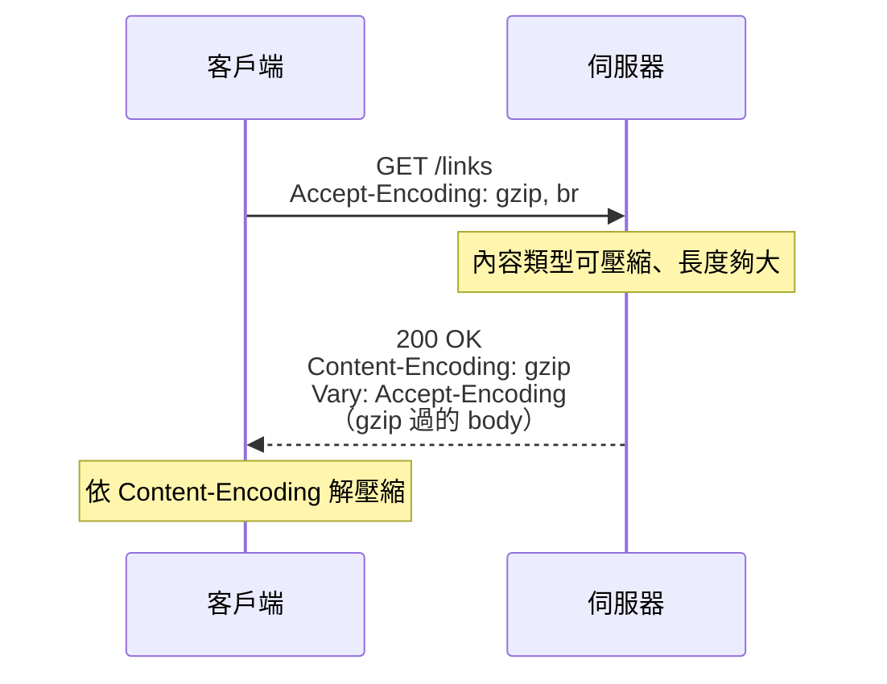

## 先想想

短網址服務 v1 的 `GET /links` 回傳 200 條連結，JSON 約 14 KB。同一個服務還有 `GET /avatar.png`（4 KB 的頭像）和 `GET /ping`（回傳 `pong` 四個字）。使用者多半在行動網路上，頻寬很貴也很慢。

同事想「一勞永逸」：寫一個 middleware，不管三種回應是什麼，全部先用 gzip 壓過再送。你覺得三個端點各會得到什麼結果？有哪一個反而會變差？另外，如果客戶端是一支不支援 gzip 的舊程式，這個 middleware 又會發生什麼事？

<details>
<summary>提示</summary>

想想壓縮靠的是什麼：資料裡有沒有重複的樣式。再想想誰有資格決定「這個回應可以壓縮」，是伺服器，還是客戶端？

</details>

## 是什麼

**HTTP 回應壓縮（HTTP compression）** 是伺服器在送出回應 body 之前先壓縮它，客戶端收到後再解壓縮，用 CPU 換頻寬。**gzip** 是其中最通用的編碼，格式定義在 RFC 1952，內部使用 DEFLATE 演算法（RFC 1951）。

壓縮不是伺服器單方面決定的，而是一次 **內容協商（content negotiation）**：客戶端用 `Accept-Encoding` 說「我看得懂這些編碼」，伺服器挑一種，並在 `Content-Encoding` 標明實際用了哪一種。它和[HTTP 語意](/backend/l1/1-2-http-api/http-semantics/)裡的 header 一樣，是請求與回應之間的約定，不是 body 的一部分。

## 為什麼存在

文字格式為了人讀，充滿重複：JSON 的欄位名稱每一筆都出現一次，HTML 的標籤、CSS 的選擇器也是。沒有壓縮時，這些重複全部照原樣走過網路。

以範例的 `GET /links` 為例，本機實測原始 body 是 14,396 bytes，用 gzip 壓縮後是 1,138 bytes，不到原來的 8%。重複度越高壓得越小，這個數字是範例資料的結果，真實資料通常沒有這麼整齊，但文字類內容壓縮到原來的 20% 到 30% 並不少見。

少傳 13 KB 看起來不多，但乘上每天幾百萬次請求，就是頻寬帳單與行動使用者載入時間的差別。壓縮在 HTTP 層做一次，所有端點都受惠，不需要每個 handler 各自想辦法縮小 JSON。

## 怎麼運作

### 協商：客戶端說能收什麼

一次壓縮的來回長這樣：



看這張圖的兩個 header：`Accept-Encoding` 是客戶端的「能力清單」，`Content-Encoding` 是伺服器的「實際選擇」。伺服器只能從客戶端列出的編碼裡挑，所以沒有 `Accept-Encoding` 的請求一律不壓縮。

`Accept-Encoding` 的值可以帶權重：`gzip;q=0` 表示 gzip 不可接受，`*` 表示其他所有編碼都可以。範例用這個函式判斷：

```go title="gzip.go"
func acceptsGzip(header string) bool {
	star := false
	for _, part := range strings.Split(header, ",") {
		name, params, _ := strings.Cut(strings.TrimSpace(part), ";")
		// ...
		switch name {
		case "gzip", "x-gzip":
			return q > 0
		case "*":
			star = q > 0
		}
	}
	return star
}
```

只用 `strings.Contains(header, "gzip")` 判斷是常見的簡化寫法，但 `gzip;q=0` 也包含 `gzip` 這四個字，會對明確拒絕的客戶端送出壓縮內容。

### 壓縮什麼：類型決定值不值得

gzip 靠找重複的樣式縮小資料，所以效果取決於內容：

| 內容 | 例子 | 壓縮效果 |
| --- | --- | --- |
| 文字類 | `text/html`、`text/css`、`application/json`、`application/javascript`、`image/svg+xml` | 很好 |
| 已壓縮的格式 | `image/png`、`image/jpeg`、`video/mp4`、`font/woff2`、`application/zip` | 幾乎沒有，甚至略變大 |

已壓縮的格式本身就用過類似的演算法，內容看起來接近隨機雜訊，gzip 找不到重複可用，只會多花 CPU，還多出十幾個 bytes 的 gzip 標頭。所以要用 **白名單（allowlist）** 列出要壓縮的類型，而不是對所有東西壓縮：

```go title="gzip.go"
var DefaultGzip = GzipConfig{
	Level:     gzip.DefaultCompression,
	MinLength: 1024,
	Types: []string{
		"text/*",
		"application/json",
		"application/javascript",
		"application/xml",
		"image/svg+xml",
	},
}
```

比對時先用 `mime.ParseMediaType` 去掉 `; charset=utf-8` 這類參數，再比對完整類型。`text/*` 這種寫法代表整個家族。`image/svg+xml` 雖然屬於 `image/`，但它是文字，所以要單獨列出。

### 三個設定：類型、長度門檻、等級

壓縮的設定可以歸納成三項，任何伺服器或框架（包含之後會看到的 Nginx）的設定都是這三件事換個名字：

- **類型**：上面的白名單。
- **最小長度**：太小的回應不值得壓。壓縮有固定開銷（gzip 標頭加結尾約 18 bytes，加上建立壓縮器的 CPU），小到只有幾十 bytes 的 `pong` 壓完可能比原來還大。範例用 1,024 bytes 當門檻，這是常見的起點，不是定律。
- **等級**：`compress/gzip` 的等級是 1（最快）到 9（最小），`gzip.DefaultCompression` 相當於 6。等級越高 CPU 時間越多，但縮小的幅度遞減，多數情況停在預設值就好。

### 實作：一個 middleware

middleware 的基本形狀已經在 [net/http](/backend/l1/1-2-http-api/net-http/) 看過：接收一個 handler，回傳包住它的 handler。壓縮的難處在於：要不要壓，要等到看見回應才知道（Content-Type 與長度都是 handler 寫出來的），而 header 一旦送出就不能再改。

做法是包一層 `ResponseWriter`，先把最前面的 `MinLength` bytes 暫存起來，到了門檻再決定：

```go title="gzip.go"
func (w *gzipWriter) Write(p []byte) (int, error) {
	if w.status == 0 {
		w.status = http.StatusOK
	}
	if !w.decided {
		w.buf = append(w.buf, p...)
		if len(w.buf) < w.cfg.MinLength {
			return len(p), nil
		}
		// ...
	}
	// ...
}
```

決定的條件集中在一個函式裡：

```go title="gzip.go"
func (w *gzipWriter) shouldCompress() bool {
	h := w.Header()
	switch {
	case w.status < 200 || w.status == http.StatusNoContent ||
		w.status == http.StatusNotModified || w.status == http.StatusPartialContent:
		return false
	case h.Get("Content-Encoding") != "":
		return false // already compressed by the handler
	case len(w.buf) < w.cfg.MinLength:
		return false
	}
	// ...
	return typeAllowed(ct, w.cfg.Types)
}
```

要壓縮時，`decide` 做兩件事：設 `Content-Encoding: gzip`，並 **刪掉 `Content-Length`**，因為那個數字是壓縮前的長度。最外層的 middleware 一開始就加 `Vary: Accept-Encoding`，下一節說明原因。

```go title="gzip.go"
w.Header().Add("Vary", "Accept-Encoding")
```

### Vary：讓快取分得清兩種版本

同一個 URL 現在可能有兩種回應：壓縮的與沒壓縮的。中間的快取（CDN、瀏覽器、反向代理）如果只用 URL 當 key，就可能把壓縮版本發給不支援 gzip 的客戶端。`Vary: Accept-Encoding` 告訴快取：「這個回應會隨請求的 `Accept-Encoding` 而不同，請把它也納入 key。」

注意：沒有被壓縮的回應也要帶 `Vary`。原因是快取不知道這次沒壓縮是因為客戶端不支援，還是因為內容太小，下一個支援 gzip 的客戶端來了，它需要知道自己應該重新向伺服器問。範例的測試 `TestVaryEvenWhenNotCompressed` 就在檢查這件事。

回到一開始的問題：`GET /links` 會從約 14 KB 縮到約 1 KB，是三個端點裡最大的受益者；`GET /avatar.png` 已經是壓縮過的格式，gzip 幾乎省不了，只是白花 CPU；`GET /ping` 只有四個 bytes，壓完會多出十幾個 bytes 的標頭，反而更大。至於不支援 gzip 的舊客戶端，如果 middleware 沒看 `Accept-Encoding` 就一律壓縮，收到的會是無法解讀的二進位資料，所以是否壓縮要由客戶端先同意，而不是伺服器自己決定。

## 取捨與替代方案

gzip 不是唯一的壓縮編碼，壓縮也不一定要在應用程式裡做：

| 方案 | 優點 | 代價 | 適用情境 |
| --- | --- | --- | --- |
| 不壓縮 | 沒有 CPU 成本，實作最簡單 | 文字類回應多花頻寬與時間 | 內網服務之間、回應本來就很小 |
| gzip | 所有瀏覽器與 HTTP 客戶端都支援，壓縮速度快 | 壓縮率不是最好 | 預設選擇，動態回應的首選 |
| brotli（`br`） | 通常比 gzip 再小一些，瀏覽器普遍支援 | 高等級壓縮很耗 CPU；瀏覽器只在 HTTPS 下使用；Go 標準庫沒有內建 | 靜態資源預先壓好，部署時一次完成 |
| zstd | 壓縮與解壓縮都很快 | 瀏覽器支援較新，不是每個客戶端都認得 | 內部服務之間，或確定客戶端支援時 |
| 交給反向代理或 CDN | 應用程式不用管壓縮，所有服務統一設定 | 要多維護一層設定，兩層都壓縮就會出錯 | 正式環境，通常的選擇 |

最後一列是實務上最常見的做法：應用程式回傳原始內容，由 Nginx 或 CDN 這類反向代理負責壓縮，因為它們本來就在每個請求的路上，而且能一次涵蓋所有後端服務。這一篇的 Go middleware 讓你搞懂壓縮的每一個環節，之後在 DevOps 看到反向代理的設定時，就知道每個選項對應的是哪個決定。

### 什麼時候不該用

- **內容已經壓縮過**：圖片、影片、字型、zip。多壓一次省不到東西，只是多花 CPU。
- **回應很小**：低於幾百 bytes 的回應，壓縮的固定開銷可能大於省下的量。
- **需要即時逐段送出的串流**：Server-Sent Events 這類回應必須一段一段到達客戶端，壓縮器若暫存資料等到湊滿再送，客戶端會久久收不到更新。範例的 middleware 特別排除了 `text/event-stream`。
- **CPU 已是瓶頸，且頻寬不是問題**：壓縮用 CPU 換頻寬，兩者只能省一個的時候，先看哪個是瓶頸。
- **前面的反向代理已經壓縮**：應用程式與反向代理只應該有一層負責壓縮。

## 常見坑與故障案例

### 漏掉 Vary

**症狀**：有些使用者看到的網頁是一堆亂碼，重新整理或換瀏覽器又好了。問題只出現在經過 CDN 或共用代理的流量。

**原因**：伺服器依 `Accept-Encoding` 回不同版本，卻沒有 `Vary: Accept-Encoding`。快取只用 URL 當 key，先被支援 gzip 的客戶端請求，就把壓縮版本存起來，之後發給所有人，包括不支援 gzip 的客戶端。（示意案例，非特定事故。）

**避免**：只要回應會因為 `Accept-Encoding` 而不同，就一律加 `Vary: Accept-Encoding`，包含沒壓縮的那一次。先加 header 再決定要不要壓縮，順序不能顛倒。

### 對已壓縮的內容再壓縮一次

**症狀**：CPU 使用率隨流量上升，圖片與下載檔案的傳輸大小幾乎沒變；有時瀏覽器顯示檔案損壞。

**原因**：middleware 沒有看 `Content-Type`，對所有回應都壓。handler 或上一層（例如反向代理）已經設了 `Content-Encoding`，又被包一層 gzip，客戶端只解開一層，剩下的還是壓縮資料。

**避免**：用類型白名單決定要不要壓，並且在 `Content-Encoding` 已經存在時一律跳過（範例的 `TestNoDoubleCompression`）。如果上層已經有反向代理負責壓縮，應用程式端就把壓縮關掉。

### Content-Length 與實際 body 不一致

**症狀**：客戶端卡住直到逾時，或出現 `unexpected EOF`、curl 的 `transfer closed with N bytes remaining to read`。

**原因**：handler 先設了 `Content-Length: 14396`（原始長度），middleware 卻把 body 換成 1,138 bytes 的壓縮資料，header 沒有更新。客戶端依 header 以為還有資料沒到，繼續等。

**避免**：壓縮時刪除 `Content-Length`，改由 `Transfer-Encoding: chunked`（HTTP/1.1）或 HTTP/2 的框架機制處理長度。範例的測試 `TestCompressesJSON` 檢查了壓縮回應沒有 `Content-Length`。

### 對小回應與無 body 的回應也壓縮

**症狀**：`204 No Content` 或 `304 Not Modified` 的回應日誌出現 `http: request method or response status code does not allow body`，或傳輸大小比原本還大。

**原因**：middleware 無條件在 `defer` 裡呼叫 `gz.Close()`。gzip 在關閉時會寫出標頭與結尾，即使從頭到尾沒有任何資料，也會輸出約 20 bytes。這些 bytes 對沒有 body 的狀態碼是不合法的。

**避免**：先判斷狀態碼（1xx、204、304 一律不壓縮），並設定最小長度門檻，讓太小的回應直接原樣輸出。

### 壓縮含有祕密的回應：BREACH

**症狀**：沒有任何錯誤訊息。攻擊者在 HTTPS 底下，仍然能一個字元一個字元地猜出頁面中的 CSRF token 之類的祕密。

**原因**：壓縮演算法會把重複的字串壓得更短。如果回應同時包含「攻擊者能控制的輸入」（例如被回顯的查詢參數）與「祕密」（CSRF token），攻擊者每猜對一個字元，壓縮後的長度就會略微變小。攻擊者只需要量測回應長度，不需要破解加密。這是 2013 年公開的 BREACH 攻擊（[BREACH 攻擊說明](https://www.breachattack.com/)）。

**避免**：同時符合三個條件的回應要避免壓縮：使用 HTTPS 壓縮、回顯攻擊者能控制的輸入、含有祕密。實務上的做法包含不壓縮含 token 的頁面、不在回應中回顯使用者輸入，以及對祕密做每次請求不同的遮罩（masking）。純 JSON API 若不把輸入原樣回顯，風險低很多，但不是零。

## 小練習

範例程式在 `playground/backend/l1/1-2-http-api/http-compression/`。先執行 `go test -race ./...` 確認全部通過，再用 `go run .` 啟動服務，比較壓縮前後的大小：

```bash
curl -s localhost:8080/links | wc -c
curl -s -H 'Accept-Encoding: gzip' localhost:8080/links | wc -c
curl -s -D- -o /dev/null -H 'Accept-Encoding: gzip' localhost:8080/avatar.png
```

```text
14396
1138
HTTP/1.1 200 OK
Content-Type: image/png
Vary: Accept-Encoding
...
```

**1. 觀察。** 第三個指令的回應為什麼沒有 `Content-Encoding`，但還是有 `Vary`？

<details>
<summary>參考解答</summary>

`image/png` 不在類型白名單，所以不壓縮，沒有 `Content-Encoding`。`Vary: Accept-Encoding` 由最外層一開始就加上：同一個 URL 在別的情況下（例如白名單改了）可能壓縮，快取需要知道回應會隨 `Accept-Encoding` 改變。

</details>

**2. 完成類型比對。** `exercise/types.go` 裡的 `TypeAllowed` 目前永遠回傳 `false`。照註解的規則補完：忽略參數、不分大小寫、`/*` 代表整個家族、空字串或格式錯誤一律不允許。執行下面的指令，全部測試通過就完成了：

```bash
go test -tags exercise ./exercise/
```

<details>
<summary>參考解答</summary>

重點有三個。第一，用 `mime.ParseMediaType` 解析，它會去掉參數、統一轉成小寫，格式錯誤時回傳錯誤，正好對應「malformed 不允許」。第二，家族比對要比 `fam + "/"`，只比 `fam` 的話 `textual/plain` 也會被 `text/*` 吃掉。第三，完整類型要整段相等，所以 `application/jsonp` 不會被 `application/json` 吃掉。

```go
mt, _, err := mime.ParseMediaType(contentType)
if err != nil {
	return false
}
for _, a := range allow {
	if fam, ok := strings.CutSuffix(a, "/*"); ok {
		if strings.HasPrefix(mt, fam+"/") {
			return true
		}
	} else if mt == a {
		return true
	}
}
return false
```

</details>

### 辨識

下面是 AI 產生的 gzip middleware，編譯得過，用瀏覽器開網頁也看得到內容。請做程式碼審查，找出違反這篇原則的地方（至少四處），說明後果與正確做法。

```go title="gzip_mw.go"
func gzipMiddleware(next http.Handler) http.Handler {
	return http.HandlerFunc(func(w http.ResponseWriter, r *http.Request) {
		w.Header().Set("Content-Encoding", "gzip")

		gz, err := gzip.NewWriterLevel(w, gzip.BestCompression)
		if err != nil {
			http.Error(w, err.Error(), http.StatusInternalServerError)
			return
		}
		defer gz.Close()

		next.ServeHTTP(gzipResponseWriter{Writer: gz, ResponseWriter: w}, r)
	})
}

func report(w http.ResponseWriter, r *http.Request) {
	// ...
	w.Header().Set("Content-Type", "application/json")
	w.Header().Set("Content-Length", strconv.Itoa(len(data)))
	w.Write(data)
}
```

完整檔案在 `playground/backend/l1/1-2-http-api/http-compression/recognize/gzip_mw.go`，可用 `go vet recognize/gzip_mw.go` 確認能編譯，它不屬於測試。

<details>
<summary>參考解答</summary>

1. **沒有檢查 `Accept-Encoding`。** 不支援 gzip 的客戶端（`curl` 不加 `--compressed`、簡單的爬蟲、舊程式）也會收到壓縮資料，拿到亂碼。修法：用 `acceptsGzip` 判斷，客戶端沒有同意就原樣輸出。
2. **沒有 `Vary: Accept-Encoding`。** 經過 CDN 或共用快取時，壓縮版本可能被發給不支援的客戶端，或反過來。修法：一開始就加 `Vary`，不管這次有沒有壓縮。
3. **不看類型也不看長度。** `/static/` 底下的 PNG、JPEG、zip 都被再壓一次，浪費 CPU 且幾乎沒有效果；很小的回應反而變大。修法：用類型白名單加最小長度門檻。
4. **`Content-Length` 沒有處理。** `report` 先設了原始長度，body 被換成壓縮資料，兩者不一致，客戶端會卡住或報 `unexpected EOF`。修法：壓縮時刪除 `Content-Length`。
5. **`Content-Encoding` 在還不知道要不要壓縮時就設了，而且不管狀態碼。** 對 204 或 304 這類沒有 body 的回應，`defer gz.Close()` 仍會寫出 gzip 標頭與結尾，造成 `http: request method or response status code does not allow body`，header 也宣告了不存在的編碼。修法：看見回應後才決定，沒有 body 的狀態碼一律跳過。
6. **`BestCompression`（等級 9）。** 每個請求都用最高等級，CPU 成本高，縮小的幅度比預設等級多不了多少。修法：用 `gzip.DefaultCompression`，除非實測證明值得。

</details>

## 快閃卡

<details>
<summary>伺服器怎麼知道可以用 gzip 壓縮回應？它又是怎麼告訴客戶端的？</summary>

客戶端在請求中用 `Accept-Encoding` 列出自己能解的編碼，伺服器只能從裡面挑。伺服器在回應中用 `Content-Encoding: gzip` 標明實際採用的編碼，客戶端依它解壓縮。

</details>

<details>
<summary>為什麼壓縮要用類型白名單，而不是對所有回應都壓縮？</summary>

gzip 靠重複的樣式縮小資料。PNG、JPEG、MP4、zip 這類格式已經壓縮過，內容接近隨機，再壓幾乎省不到，只是多花 CPU 並多出標頭。文字類（HTML、CSS、JS、JSON、SVG）重複度高，才值得壓。

</details>

<details>
<summary>請求帶 Accept-Encoding: gzip;q=0, identity，用 strings.Contains(header, "gzip") 判斷會出什麼錯？</summary>

字串裡有 `gzip` 這四個字，會誤判為客戶端接受 gzip，於是送出壓縮內容。但 `q=0` 的意思是「gzip 不可接受」，客戶端會收到無法處理的資料。要解析權重，而不是只看字串是否出現。

</details>

<details>
<summary>為什麼沒有被壓縮的回應也要帶 Vary: Accept-Encoding？</summary>

快取不知道這次沒壓縮是因為客戶端不支援，還是內容太小。如果不帶 `Vary`，快取可能把這份沒壓縮的版本發給下一個支援 gzip 的客戶端，或把壓縮版本發給不支援的客戶端。帶了 `Vary`，快取就會把 `Accept-Encoding` 一併當成 key。

</details>

<details>
<summary>一個 handler 回傳 Content-Length: 14396 的 JSON，被 gzip middleware 包住後，不處理 Content-Length 會怎樣？</summary>

實際送出的是 1,138 bytes 的壓縮資料，header 卻說有 14,396 bytes。客戶端以為還有資料沒到，會一直等到逾時，或報 `unexpected EOF`。壓縮時要刪掉 `Content-Length`，讓伺服器改用 chunked 傳輸或由 HTTP/2 處理長度。

</details>

<details>
<summary>gzip middleware 對 204 或 304 的回應也無條件執行 gz.Close()，會發生什麼事？</summary>

gzip 在關閉時會寫出標頭與結尾，即使沒有任何資料也有約 20 bytes。204 與 304 不允許帶 body，Go 的伺服器會記錄 `http: request method or response status code does not allow body`。1xx、204、304 都要先跳過壓縮。

</details>

<details>
<summary>比較 gzip 與 brotli：什麼情況下偏好 brotli？</summary>

brotli 通常壓得比 gzip 小，但高等級壓縮很耗 CPU，所以適合部署時預先壓好的靜態資源，而不是每個請求即時壓縮的動態回應。瀏覽器只在 HTTPS 下使用，Go 標準庫也沒有內建。動態回應以 gzip 為預設選擇。

</details>

<details>
<summary>BREACH 攻擊需要哪三個條件才成立？為什麼 HTTPS 擋不住？</summary>

需要：回應被壓縮、回應回顯攻擊者能控制的輸入、回應中含有祕密（例如 CSRF token）。壓縮會讓重複的字串變短，攻擊者猜對一個字元，壓縮後長度就略微變小，只需量測長度就能逐字猜出祕密。加密保護的是內容，不隱藏長度，所以 HTTPS 擋不住。

</details>

## 延伸閱讀

- [RFC 9110: HTTP Semantics，Content-Encoding 與 Accept-Encoding](https://www.rfc-editor.org/rfc/rfc9110#name-content-codings)：內容編碼與協商的正式定義，包含 `q` 權重與 `*` 的規則
- [RFC 1952: GZIP file format specification](https://www.rfc-editor.org/rfc/rfc1952)：gzip 檔案格式，標頭與結尾各是什麼
- [RFC 1951: DEFLATE Compressed Data Format Specification](https://www.rfc-editor.org/rfc/rfc1951)：gzip 內部使用的壓縮演算法
- [MDN: Compression in HTTP](https://developer.mozilla.org/en-US/docs/Web/HTTP/Guides/Compression)：端對端壓縮與逐跳壓縮的差別，以及各編碼的支援情況
- [Go 套件文件：compress/gzip](https://pkg.go.dev/compress/gzip)：壓縮等級常數與 `Writer` 的使用方式
- [BREACH 攻擊說明](https://www.breachattack.com/)：攻擊的原始說明與緩解建議
