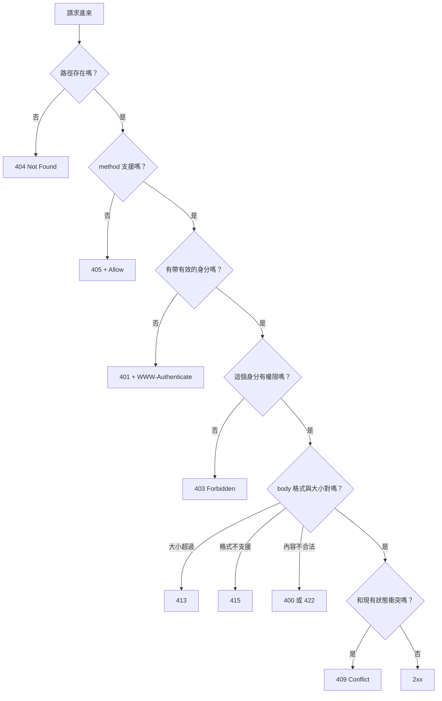

## 先想想

短網址服務 v1 多了一個管理頁，同事為了省事，在每一列連結旁邊放了一個超連結 `<a href="/links/abc/delete">刪除</a>`，後端對應 `GET /links/{code}/delete`。手動點一下，連結真的被刪了，看起來一切正常。

上線一週後，客服收到抱怨：使用者沒點任何東西，管理頁上的連結卻一條一條消失。翻存取紀錄，刪除請求來自聊天軟體的連結預覽機器人和瀏覽器的預先載入。

這是誰的錯？機器人只是照規矩「看一下」網址，為什麼會刪掉資料？還有一個問題：如果改成正確的刪除方式，同一條連結被刪第二次時，伺服器該回什麼狀態碼？

<details>
<summary>提示</summary>

想想機器人怎麼判斷「哪些網址可以隨便打」。它看不懂你的程式，只看得到請求的 method。

</details>

## 是什麼

**HTTP 語意（HTTP semantics）** 是 HTTP 對每個 method、狀態碼與 header 意義的約定，定義在 RFC 9110。它告訴每一個經手請求的程式：這個請求會不會改變伺服器的資料、能不能重送、回應能不能存起來給下一個人用。

[請求生命週期](/backend/l1/1-2-http-api/request-lifecycle/)講的是一個請求「怎麼送到」，這篇講的是它「代表什麼」。兩者是分開的：同一套語意可以跑在 HTTP/1.1、HTTP/2 或 HTTP/3 上，訊息的編碼不同，意義不變。

## 為什麼存在

一個請求從客戶端到你的 handler，中間可能經過瀏覽器快取、公司 proxy、CDN、負載平衡器、重試函式庫。這些程式都看不懂你的業務邏輯，唯一的線索是 method、狀態碼與 header。如果沒有共同語意，它們只有兩種選擇：什麼都不敢做（不快取、不重試），或是猜錯。

語意寫錯的後果是具體的：

- **用 GET 改資料**：預先載入、爬蟲、連結預覽會替使用者「點」下去，像「先想想」裡的刪除事件。
- **錯誤也回 200**：監控顯示成功率 100%，重試函式庫不會重試，快取可能把錯誤頁存起來給所有人看。
- **把不能重送的請求當成能重送**：網路逾時後自動重試一次 `POST /payments`，使用者被扣兩次款。

有了語意，你只要把端點標對，所有中間層就能正確地幫你快取、重試與擋錯。

## 怎麼運作

### Method：這個請求想做什麼

每個 method 帶兩個性質：

- **安全（safe）**：客戶端預期它不會改變伺服器狀態。記錄存取紀錄、計數這類副作用可以有，但客戶端不必為它負責。
- **冪等（idempotency）**：同一個請求送一次和送 N 次，伺服器最後的狀態相同。安全的 method 一定冪等。

| method | 用途 | 安全 | 冪等 | 短網址服務的例子 |
| --- | --- | --- | --- | --- |
| GET | 讀取資源 | 是 | 是 | `GET /{code}` 重新導向、`GET /links/{code}` 查目標 |
| HEAD | 同 GET，但只回 header | 是 | 是 | 檢查短網址存不存在 |
| OPTIONS | 詢問支援哪些 method | 是 | 是 | CORS 預檢 |
| PUT | 用請求內容整個取代資源，不存在就建立 | 否 | 是 | `PUT /links/{code}` 建立或改目標 |
| DELETE | 刪除資源 | 否 | 是 | `DELETE /links/{code}` |
| POST | 交給伺服器處理，常用來建立「由伺服器命名」的資源 | 否 | 否 | `POST /links` 由伺服器產生短碼 |
| PATCH | 部分修改 | 否 | 不保證 | 只改連結的到期時間 |

看表時留意最後兩欄的差別：PUT 與 DELETE 不安全，但冪等，所以網路斷線後可以放心重送。

PUT 冪等是因為「把 abc 設成 X」做幾次結果都一樣。POST 不冪等是因為「幫我建一個新連結」做兩次就有兩個連結。範例的測試把這件事固定下來：

```go title="server_test.go"
first := do(h, "POST", "/links", "https://example.com/a")
second := do(h, "POST", "/links", "https://example.com/a")
if first.Code != http.StatusCreated || second.Code != http.StatusCreated {
	t.Fatalf("POST codes = %d, %d, want 201, 201", first.Code, second.Code)
}
a, b := first.Header().Get("Location"), second.Header().Get("Location")
if a == "" || a == b {
	t.Fatalf("Locations = %q, %q, want two different links", a, b)
}
```

在 Go 裡，method 寫在 `ServeMux` 的 pattern 上。路徑存在但 method 不符時，mux 自動回 `405 Method Not Allowed` 並帶 `Allow` header，`GET` 也會順便處理 `HEAD`：

```go title="server.go"
mux := http.NewServeMux()
mux.HandleFunc("GET /{code}", s.Redirect)
mux.HandleFunc("POST /links", s.PostLink)
mux.HandleFunc("GET /links/{code}", s.Show)
mux.HandleFunc("PUT /links/{code}", s.PutLink)
mux.HandleFunc("DELETE /links/{code}", s.DeleteLink)
```

### 狀態碼：結果是什麼

狀態碼的第一位數字是類別，中間層常常只看這一位就做決定：

| 類別 | 意義 | 常用 |
| --- | --- | --- |
| 2xx | 成功 | 200 OK、201 Created、204 No Content |
| 3xx | 去別的地方拿 | 301、302、303、307、308、304 Not Modified |
| 4xx | 客戶端的錯，原樣重送也沒用 | 400、401、403、404、405、409、413、415、422、429 |
| 5xx | 伺服器的錯，稍後重試可能會好 | 500、502、503、504 |

4xx 與 5xx 的界線決定了誰該修：4xx 要客戶端改請求，5xx 要你修伺服器。重試函式庫通常只重試 5xx（以及 429），所以把「網址格式錯誤」回成 500，客戶端會一直重送一個永遠不會成功的請求。

範例的 `PutLink` 依情況回三種結果：

```go title="handlers.go"
func (s *Store) PutLink(w http.ResponseWriter, r *http.Request) {
	target, ok := readTarget(w, r)
	if !ok {
		return
	}
	code := r.PathValue("code")
	if s.Put(code, target) {
		w.Header().Set("Location", "/links/"+code)
		w.WriteHeader(http.StatusCreated)
		return
	}
	w.WriteHeader(http.StatusNoContent)
}
```

新建立時回 201 並用 `Location` 指向新資源；取代既有資源時沒有東西要回，用 204。`readTarget` 在驗證失敗時自己寫好錯誤：`Content-Type` 不是 `text/plain` 回 415，body 超過上限回 413，不是 http 或 https 網址回 400。

下面這張圖是選 4xx 時的判斷順序：



看圖時留意 401 與 403 的位置：401 是「我不知道你是誰」，403 是「我知道你是誰，但你不能做」。這正是[認證與授權的差異](/backend/l1/1-4-auth-basics/authn-vs-authz/)那一篇的兩層。

### 重新導向：選 301、302 還是 307

短網址服務的核心是 `GET /{code}` 回 3xx。幾個 3xx 的差別在兩件事：是不是永久的、會不會保留原本的 method。

| 狀態碼 | 永久 | 重送時的 method | 用途 |
| --- | --- | --- | --- |
| 301 Moved Permanently | 是 | 歷史上 POST 會被改成 GET | 整個網站搬家 |
| 302 Found | 否 | 歷史上 POST 會被改成 GET | 一般的暫時導向 |
| 303 See Other | 否 | 一律改成 GET | 表單送出後導向結果頁 |
| 307 Temporary Redirect | 否 | 保留原 method 與 body | 暫時導向 API 請求 |
| 308 Permanent Redirect | 是 | 保留原 method 與 body | 永久搬移 API 端點 |

RFC 9110 規定 301 預設可以被快取，多數瀏覽器在沒有 `Cache-Control` 時會記很久。短網址用 301，使用者第二次點同一個短網址時，瀏覽器直接跳去目標，請求根本不會到你的伺服器：改目標無效，點擊也算不到。所以範例用 302：

```go title="handlers.go"
// 302, not 301: browsers cache a 301 with no expiry, so a changed
// target or a click counter would never see that visitor again.
http.Redirect(w, r, target, http.StatusFound)
```

### Header：關於這則訊息的資訊

header 是附在請求或回應上的中繼資料。L1 先認得下面這幾個：

| header | 方向 | 意義 |
| --- | --- | --- |
| `Content-Type` | 雙向 | body 是什麼格式，例如 `text/plain; charset=utf-8` |
| `Accept` | 請求 | 客戶端希望收到什麼格式 |
| `Location` | 回應 | 201 時指向新資源，3xx 時指向要去的地方 |
| `Allow` | 回應 | 405 時列出這個路徑支援的 method |
| `WWW-Authenticate` | 回應 | 401 時說明該用哪種方式認證，例如 `Bearer` |
| `Retry-After` | 回應 | 429 或 503 時告訴客戶端幾秒後再試 |
| `Cache-Control` | 雙向 | 能不能快取、能存多久 |

handler 沒有設定 `Content-Type` 時，Go 會讀 body 的前 512 個 byte 猜一個。猜測不可靠，回應有 body 時請自己設定。

### 冪等與重試

冪等談的是**伺服器的狀態**，不是回應。範例的第一次 `DELETE /links/abc` 回 204，第二次回 404，回應不同，但兩次之後「abc 不存在」這個狀態一樣，所以 DELETE 仍然冪等：

```go title="handlers.go"
func (s *Store) DeleteLink(w http.ResponseWriter, r *http.Request) {
	if !s.Delete(r.PathValue("code")) {
		http.NotFound(w, r)
		return
	}
	w.WriteHeader(http.StatusNoContent)
}
```

這帶來一個實用的規則：客戶端逾時、不知道請求有沒有成功時，冪等的請求可以直接重送；不冪等的請求（POST）重送前要想清楚。常見做法是讓客戶端在 header 帶一個唯一的 `Idempotency-Key`，伺服器記住處理過的 key，重複時回上次的結果。這個 header 目前還是 IETF 草案，Stripe 等金流 API 已經這樣用，實作會在後面的冪等設計章節展開。

### 回到一開始的問題

錯在用 GET 刪資料。GET 被定義成安全的 method，所以連結預覽、預先載入、爬蟲都假設它可以隨便打，它們沒有做錯任何事。正確做法是刪除改用 `DELETE /links/{code}`，管理頁用表單或 `fetch` 送出，機器人就不會碰它。至於第二次刪除，回 404 是合理的：回應雖然和第一次的 204 不同，伺服器的狀態相同，DELETE 依然冪等。

## 取捨與替代方案

不是每個團隊都完整遵守 HTTP 語意。常見的三種風格：

| 方案 | 優點 | 代價 | 適用情境 |
| --- | --- | --- | --- |
| 照 HTTP 語意設計（method + 狀態碼表達結果） | 瀏覽器、CDN、重試函式庫、監控都能直接理解；`curl -i` 就看得懂 | 要為每個端點想清楚 method 與狀態碼；複雜操作不一定對得上某個 method | 對外公開的 API、需要被快取的讀取端點 |
| RPC 風格（全部 POST，結果放在 body，例如 gRPC、JSON-RPC） | 操作命名自由，像呼叫函式 | 中間層無法快取或判斷能否重試，要靠自己的協定與客戶端 | 內部服務之間、有強型別客戶端的系統 |
| GraphQL（多數查詢走 `POST /graphql`，錯誤常在 200 的 body 裡） | 客戶端一次拿到需要的欄位 | HTTP 層的狀態碼與快取幾乎用不上，要另外做監控與快取 | 前端需要彈性組合資料的產品 |

即使選照語意設計，還有一個常見的小取捨：修改用 PUT 還是 PATCH。PUT 要送整份資源，冪等，重試安全；PATCH 只送差異，省頻寬，但「把點擊數加一」這種 PATCH 重送兩次就加兩次。

### 什麼時候不該用

- **不要為了「純粹」把每個操作硬塞進五個 method。** 像「重新產生短碼」「批次匯入」這種動作，用 `POST /links/{code}/regenerate` 比扭曲成某種 PUT 更清楚，只要記得它不冪等。
- **不要在已經選了 RPC 或 GraphQL 的系統裡混用一半的 REST 狀態碼。** 客戶端會同時要處理兩套錯誤規則，比只用一套更容易出錯。
- **不要把狀態碼當成唯一的錯誤資訊。** 400 只說「你的請求有問題」，客戶端還需要 body 說明哪個欄位錯了，格式在本節的「統一的錯誤回應格式」討論。

## 常見坑與故障案例

### 錯誤也回 200

**症狀**：監控顯示成功率 100%，使用者卻說功能壞了；客戶端的重試沒有生效；CDN 把一份「找不到」的頁面快取給所有人。

**原因**：handler 把錯誤寫在 body 裡（例如 `{"ok": false}`），狀態碼仍是預設的 200。所有只看狀態碼的中間層都認為請求成功。

**避免**：錯誤一律用對應的 4xx 或 5xx，body 只用來補充細節。測試裡斷言狀態碼，不要只斷言 body。

### 401 與 403 混用

**症狀**：token 過期的使用者一直看到「沒有權限」，從來沒被導去重新登入；或是權限不足的使用者被一再要求登入。

**原因**：客戶端通常靠 401 觸發「刷新 token 或重新登入」，靠 403 顯示「你沒有權限」。伺服器把兩者對調，客戶端就走錯流程。

**避免**：沒帶身分或身分無效回 401，並附上 `WWW-Authenticate`；身分有效但權限不足回 403。

### 用 GET 改狀態

**症狀**：資料在沒人操作的情況下被改動或刪除，請求來自爬蟲、預先載入或連結預覽。

**原因**：GET 被定義為安全的 method，自動化工具會主動抓取頁面上的 GET 連結。2005 年 Google Web Accelerator 會預先抓取頁面上的連結，結果 37signals 的 Basecamp 等服務出現帳號與資料被刪的回報，因為那些刪除動作是 GET 連結，只靠 JavaScript 的確認視窗擋著（[eWeek 報導](https://www.eweek.com/enterprise-apps/googles-accelerator-breaks-web-apps-security/)）。

**避免**：任何會改資料的操作都用 POST、PUT、PATCH 或 DELETE。審查時看到 `/delete`、`/remove`、`/update` 出現在 GET 路由上，直接當成 bug。

### 302 讓 POST 變成 GET

**症狀**：API 搬到新路徑後，舊路徑回 302 導向新路徑，客戶端的建立請求變成「查詢」，資料沒有被寫入，也沒有任何錯誤。

**原因**：多數 HTTP 客戶端收到 301 或 302 時，會把 POST 改成 GET 並丟掉 body 再重送，這是早期瀏覽器留下的行為，RFC 9110 也承認這種做法。

**避免**：要保留 method 與 body 時，暫時的用 307，永久的用 308。

### 建立資源卻沒有回 201 與 Location

**症狀**：客戶端用 `POST /links` 建立成功，卻不知道新連結的短碼是什麼，只好再查一次列表，或是解析各端點格式都不同的 body。

**原因**：handler 成功時只回預設的 200，沒有告訴客戶端新資源在哪裡。

**避免**：建立成功回 201，並用 `Location` 指向新資源，像範例的 `PostLink` 與 `PutLink`。

## 小練習

範例程式在 `playground/backend/l1/1-2-http-api/http-semantics/`。先執行 `go test -race ./...` 確認全部通過。

**1. 觀察 mux 幫你做的事。** 把服務跑起來，用 `curl` 送下面幾個請求，記下每個的狀態碼與 header：

```bash
go run .
curl -i -X PUT -H "Content-Type: text/plain" -d https://example.com localhost:8080/links/abc
curl -I localhost:8080/abc
curl -i -X PATCH localhost:8080/links/abc
curl -i -X PUT -H "Content-Type: application/json" -d '{}' localhost:8080/links/abc
```

<details>
<summary>參考解答</summary>

依序是：201 帶 `Location: /links/abc`；HEAD 得到 302 與 `Location: https://example.com`，沒有 body；PATCH 得到 405 與 `Allow: DELETE, GET, HEAD, PUT`，這是 mux 自動產生的；JSON 的 PUT 得到 415，連結沒有被改動。

</details>

**2. 完成 `PutLink` 與 `DeleteLink`。** `exercise/links.go` 裡的兩個 handler 目前回 501。照註解裡的 TODO 補完：空 body 回 400 且不能存任何東西、新短碼回 201 加 `Location`、既有短碼取代後回 204、刪除存在的短碼回 204、不存在的回 404。執行下面的指令，四個測試全部通過就完成了：

```bash
go test -tags exercise ./exercise/
```

<details>
<summary>參考解答</summary>

重點有兩個：驗證要在寫入之前，否則被拒絕的請求也改了資料；在同一段鎖裡判斷「原本存不存在」並寫入，否則兩個並行的 PUT 可能都以為自己是建立者。

```go
target := strings.TrimSpace(string(body))
if target == "" {
	http.Error(w, "empty target", http.StatusBadRequest)
	return
}
code := r.PathValue("code")
s.mu.Lock()
_, existed := s.links[code]
s.links[code] = target
s.mu.Unlock()
if existed {
	w.WriteHeader(http.StatusNoContent)
	return
}
w.Header().Set("Location", "/links/"+code)
w.WriteHeader(http.StatusCreated)
```

`DeleteLink` 同樣在鎖裡判斷並刪除，不存在時 `http.NotFound`，存在時 `WriteHeader(http.StatusNoContent)`。完整寫法可以對照主程式的 `handlers.go`。

</details>

### 辨識

下面這段是 AI 產生的短網址 API，能編譯，用瀏覽器和 `curl` 手動試也都「能用」。請做程式碼審查，找出違反 HTTP 語意的地方（至少四處），說明後果與正確做法。

```go title="api.go"
func main() {
	mux := http.NewServeMux()
	mux.HandleFunc("GET /{code}", redirect)
	mux.HandleFunc("POST /links/{code}", create)
	mux.HandleFunc("GET /links/{code}/delete", remove)
	srv := &http.Server{Addr: ":8080", Handler: mux, ReadHeaderTimeout: 5 * time.Second}
	log.Fatal(srv.ListenAndServe())
}

func redirect(w http.ResponseWriter, r *http.Request) {
	mu.Lock()
	target, ok := links[r.PathValue("code")]
	mu.Unlock()
	if !ok {
		reply(w, map[string]any{"ok": false, "error": "not found"})
		return
	}
	http.Redirect(w, r, target, http.StatusMovedPermanently)
}

func create(w http.ResponseWriter, r *http.Request) {
	if r.Header.Get("Authorization") != "Bearer "+os.Getenv("API_TOKEN") {
		http.Error(w, "forbidden", http.StatusForbidden)
		return
	}
	body, err := io.ReadAll(http.MaxBytesReader(w, r.Body, 2048))
	if err != nil {
		reply(w, map[string]any{"ok": false, "error": "bad body"})
		return
	}
	mu.Lock()
	links[r.PathValue("code")] = strings.TrimSpace(string(body))
	mu.Unlock()
	reply(w, map[string]any{"ok": true})
}
```

完整檔案（含 `reply` 與 `remove`）在 `playground/backend/l1/1-2-http-api/http-semantics/recognize/api.go`，可用 `go vet recognize/api.go` 檢查能編譯，它不屬於測試。

<details>
<summary>參考解答</summary>

1. **錯誤用 200 回應。** `reply` 從不設定狀態碼，所以「找不到」與「body 讀取失敗」都是 200 加 `{"ok": false}`。監控看不到錯誤，CDN 可能快取這個 200。修法：找不到用 `http.NotFound`，body 太大回 413。
2. **`GET /links/{code}/delete` 用 GET 刪資料。** 連結預覽、預先載入、爬蟲都會打 GET，連結會被自動刪掉。修法：改成 `DELETE /links/{code}`，成功回 204。
3. **重新導向用 301。** 瀏覽器會長期快取 301，之後改目標無效，點擊也不再經過伺服器。修法：用 302。
4. **沒帶或帶錯 token 回 403。** 這是「我不知道你是誰」，應該回 401 並附 `WWW-Authenticate: Bearer`，客戶端才會走重新登入的流程。403 留給身分有效但沒有權限的情況。
5. **用 POST 處理「客戶端指定短碼」的建立，成功時回 200 沒有 `Location`。** 短碼已經在路徑上，重送會覆寫同一筆，這本來就是冪等的 PUT 語意；用 POST 會讓重試函式庫以為不能重送。修法：改成 `PUT /links/{code}`，新建回 201 加 `Location`，取代回 204。

附帶一提，`API_TOKEN` 沒設定時，`"Bearer "+""` 會讓帶 `Bearer ` 的請求通過，這是 [net/http](/backend/l1/1-2-http-api/net-http/) 那一篇提過的坑。

</details>

## 快閃卡

<details>
<summary>安全（safe）與冪等（idempotent）的 method 各是什麼意思？兩者的關係是什麼？</summary>

安全是客戶端預期它不改變伺服器狀態；冪等是送一次與送 N 次後伺服器狀態相同。安全的 method 一定冪等，但冪等的不一定安全，例如 PUT 與 DELETE。

</details>

<details>
<summary>為什麼 PUT /links/abc 是冪等的，POST /links 不是？</summary>

PUT 的意思是「把 abc 設成這個內容」，做幾次結果都一樣。POST /links 是「幫我建一個新連結」，伺服器每次都產生新短碼，送兩次就有兩筆。

</details>

<details>
<summary>第一次 DELETE /links/abc 回 204，第二次回 404。DELETE 還算冪等嗎？</summary>

算。冪等談的是伺服器的狀態，不是回應內容。兩次之後「abc 不存在」的狀態相同，只是第二次的回應不同。

</details>

<details>
<summary>請求帶了 Authorization: Bearer expired-token，token 已過期。該回 401 還是 403？</summary>

回 401，並附 `WWW-Authenticate`。過期等於伺服器無法確認你是誰，客戶端看到 401 會去刷新 token 或重新登入。403 用在身分有效但權限不足時。

</details>

<details>
<summary>客戶端送來的 URL 格式錯誤，伺服器回了 500。會發生什麼問題？</summary>

5xx 代表伺服器的錯、稍後重試可能會好，所以重試函式庫會一再重送這個永遠不會成功的請求，監控也會把客戶端的錯算成伺服器故障。應回 400。

</details>

<details>
<summary>短網址服務用 301 做重新導向，會有什麼後果？</summary>

301 預設可被快取，多數瀏覽器會記很久。使用者再點同一個短網址時，瀏覽器直接跳去舊目標，不經過伺服器，所以改目標無效、點擊也算不到。短網址應該用 302。

</details>

<details>
<summary>舊 API 路徑用 302 導向新路徑後，客戶端的 POST 建立請求沒有寫入任何資料。可能的原因是什麼？</summary>

多數客戶端收到 301 或 302 時會把 POST 改成 GET 並丟掉 body 再重送，所以新路徑收到的是一個查詢。要保留 method 與 body 應該用 307（暫時）或 308（永久）。

</details>

<details>
<summary>為什麼用 GET 做刪除，就算有 JavaScript 確認視窗也不安全？</summary>

GET 被定義為安全的 method，爬蟲、預先載入、連結預覽會直接抓取 GET 連結，而且不執行你的確認視窗。2005 年 Google Web Accelerator 預先抓取連結就因此刪掉了使用者資料。

</details>

<details>
<summary>建立資源成功時，回應應該帶哪個狀態碼與 header？為什麼？</summary>

回 201 Created，並用 `Location` 指向新資源。客戶端不必解析 body 就知道新資源在哪裡，伺服器產生短碼時尤其需要。

</details>

## 延伸閱讀

- [RFC 9110: HTTP Semantics](https://www.rfc-editor.org/rfc/rfc9110)：method、狀態碼與 header 意義的正式定義，第 9 節（method）與第 15 節（狀態碼）最常用
- [HTTP response status codes（MDN）](https://developer.mozilla.org/en-US/docs/Web/HTTP/Status)：每個狀態碼的說明與瀏覽器行為，查詢時最方便
- [HTTP request methods（MDN）](https://developer.mozilla.org/en-US/docs/Web/HTTP/Methods)：各 method 是否安全、冪等、可快取的對照
- [net/http 常數](https://pkg.go.dev/net/http#pkg-constants)：Go 裡 `http.StatusCreated` 等狀態碼與 method 常數的完整列表
- [Google's Accelerator Breaks Web Apps, Security（eWeek）](https://www.eweek.com/enterprise-apps/googles-accelerator-breaks-web-apps-security/)：2005 年預先抓取 GET 連結刪掉使用者資料的事件報導
