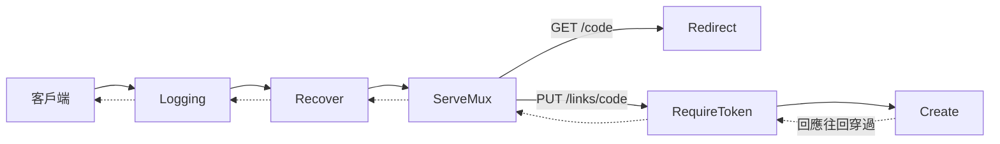

## 先想想

短網址服務 v1 有兩個路由：`GET /{code}` 導向長網址，`PUT /links/{code}` 建立新連結。現在要加三件事：每個請求都記一行存取紀錄（method、路徑、狀態碼、耗時）、建立連結需要 token、任何 handler 出現 panic 都不能讓連線直接斷掉。

最直覺的做法是把這三段程式複製到每個 handler 開頭。路由有 2 個時還撐得住；有 30 個時，漏改一個就是漏洞。

有沒有辦法讓每個 handler 只寫自己的業務邏輯，而記錄、認證、panic 保護寫一次就套用到所有（或部分）路由？而且要怎麼保證「記錄看得到 panic 造成的 500」？

<details>
<summary>提示</summary>

先想想「handler」在 Go 裡到底是什麼型別。如果任何東西只要長得像 handler 就能當 handler，那「包住一個 handler 的東西」本身也能是 handler。

</details>

## 是什麼

**`net/http`** 是 Go 標準庫裡的 HTTP 用戶端與伺服器實作。伺服器端的核心只有一個介面：

```go
type Handler interface {
	ServeHTTP(ResponseWriter, *Request)
}
```

**Handler** 就是「收到請求、寫出回應」的東西。**ServeMux** 是一個特殊的 handler：它不處理請求，只依 method 與路徑把請求轉給別人。**middleware** 則是一個慣例而非型別，指「接收一個 handler、回傳另一個 handler」的函式，用來把共通邏輯包在外面。

這三者可以用你已經學過的概念理解：Handler 是只有一個方法的 interface（Go 核心章節的「method 與 interface」）；`http.HandlerFunc` 讓一般函式也能滿足這個 interface；middleware 就是把 interface 疊起來的裝飾器。

## 為什麼存在

沒有統一的 handler 約定，每個框架都會發明自己的簽名：這個吃 `(w, r)`，那個吃 `(ctx)`，另一個吃 `(req) resp`。共通邏輯只能寫成特定框架的外掛，換框架就要重寫。

只有一個方法的小介面解決了這件事：所有東西都是 `ServeHTTP(w, r)`，所以路由器、檔案伺服器、反向代理、你寫的 handler 與包在外面的 middleware，彼此都可以任意組合。標準庫的 `http.FileServer`、`http.StripPrefix`、`http.TimeoutHandler` 都是用這個方式組出來的。

代價是標準庫只給你積木，不給你整套規矩。記錄、認證、panic 保護沒有現成的內建版本（`http.TimeoutHandler` 是少數例外），要自己寫，或用第三方套件。

## 怎麼運作

### Handler 與 HandlerFunc

最直接的寫法是自訂型別並實作 `ServeHTTP`。但多數 handler 不需要狀態，所以標準庫提供轉接器：

```go
type HandlerFunc func(ResponseWriter, *Request)

func (f HandlerFunc) ServeHTTP(w ResponseWriter, r *Request) { f(w, r) }
```

`HandlerFunc` 是一個函式型別，而且它自己有 `ServeHTTP` 方法，所以任何簽名吻合的函式轉型成 `HandlerFunc` 後，就是一個 `Handler`。範例裡的連結儲存庫把狀態放在 struct 裡，handler 是它的方法：

```go title="links.go"
// Redirect handles GET /{code}.
func (s *Store) Redirect(w http.ResponseWriter, r *http.Request) {
	target, ok := s.Get(r.PathValue("code"))
	if !ok {
		http.NotFound(w, r)
		return
	}
	http.Redirect(w, r, target, http.StatusFound)
}
```

`s.Redirect` 這種「綁定了接收者的方法值」簽名正好符合 `HandlerFunc`，可以直接交給路由器。注意 `http.NotFound` 之後的 `return`：寫出錯誤回應不會自動結束函式。

### ServeMux：路由

`http.NewServeMux()` 建立一個路由器。Go 1.22 起，pattern 可以包含 method 與路徑參數：

```go title="server.go"
mux := http.NewServeMux()
mux.HandleFunc("GET /{code}", store.Redirect)
mux.Handle("PUT /links/{code}", Chain(
	http.HandlerFunc(store.Create),
	RequireToken(token),
))
```

pattern 的規則整理如下：

| pattern | 匹配 | 說明 |
| --- | --- | --- |
| `GET /{code}` | `GET /abc`，但不匹配 `/` 與 `/a/b` | `{name}` 匹配恰好一個非空的路徑段，用 `r.PathValue("name")` 取值 |
| `/static/` | `/static/` 底下所有路徑 | 以 `/` 結尾代表子樹 |
| `/files/{path...}` | `/files/` 底下所有路徑 | 結尾的 `...` 匹配剩下的所有段 |
| `GET /{$}` | 只有 `GET /` | `{$}` 表示精確匹配到這裡為止 |

寫了 method 的 pattern 有幾個行為，不必自己處理：`GET` 同時匹配 `HEAD`；路徑存在但 method 不符時，自動回 `405 Method Not Allowed` 並帶上 `Allow` header；找不到任何 pattern 時回 `404`。

兩個 pattern 都能匹配同一個請求時，**比較具體的那個贏** （例如 `/links/{code}` 比 `/{a}/{b}` 具體）。如果沒有哪一個更具體（兩者互相衝突），`Handle` 會在註冊時直接 panic，而不是等到執行時才出問題。這讓路由衝突在伺服器啟動那一刻就被發現。

### Middleware：包住 handler

middleware 的型別就是「handler 進、handler 出」：

```go title="middleware.go"
type Middleware func(http.Handler) http.Handler

func Logging(logger *log.Logger) Middleware {
	return func(next http.Handler) http.Handler {
		return http.HandlerFunc(func(w http.ResponseWriter, r *http.Request) {
			start := time.Now()
			rec := &statusRecorder{ResponseWriter: w, status: http.StatusOK}
			next.ServeHTTP(rec, r)
			logger.Printf("%s %s -> %d (%s)", r.Method, r.URL.Path, rec.status, time.Since(start))
		})
	}
}
```

三個重點：

- **呼叫 `next.ServeHTTP` 之前是「進來」，之後是「出去」。** 計時、記錄在前後各做一半；認證只做進來那一半。
- **不呼叫 `next` 就等於攔截。** `RequireToken` 驗證失敗時寫出 401 並 `return`，裡面的 handler 完全不會被執行。
- **`ResponseWriter` 沒有「查詢狀態碼」的方法。** 要記錄狀態碼，只能用 `statusRecorder` 包住它，攔截 `WriteHeader` 時順手記下來。

### 組合與順序

`Chain` 把多個 middleware 疊在 handler 外：

```go title="middleware.go"
// Chain applies middlewares so that the first one is the outermost.
func Chain(h http.Handler, mws ...Middleware) http.Handler {
	for i := len(mws) - 1; i >= 0; i-- {
		h = mws[i](h)
	}
	return h
}
```

整個服務的組裝如下，`Logging` 在最外層、`Recover` 在它裡面：

```go title="server.go"
// Logging is outermost: it must see the 500 that Recover writes,
// otherwise a panicking request would leave no access-log line.
return Chain(mux, Logging(logger), Recover(logger))
```



看圖時留意：請求往右穿過每一層，回應沿原路往回穿過；`RequireToken` 只包住 `PUT` 這一條路由，`GET` 不經過它。

最外層先執行、最後結束，這是順序重要的原因。如果把 `Recover` 放在 `Logging` 外面，panic 會先穿過 `Logging`（它的 `next.ServeHTTP` 之後的程式碼被跳過，沒有記錄），再被 `Recover` 接住。結果是 500 回給了客戶端，存取紀錄裡卻找不到這個請求。

### 啟動伺服器

最後把 handler 交給 `http.Server`，並照[請求生命週期](/backend/l1/1-2-http-api/request-lifecycle/)那一篇的結論設好逾時：

```go title="server.go"
func NewServer(addr string, h http.Handler) *http.Server {
	return &http.Server{
		Addr:              addr,
		Handler:           h,
		ReadHeaderTimeout: 5 * time.Second,
		ReadTimeout:       10 * time.Second,
		WriteTimeout:      10 * time.Second,
		IdleTimeout:       60 * time.Second,
	}
}
```

### 回到一開始的問題

共通邏輯寫成 middleware，每個 handler 只管業務。因為每一層都是 `http.Handler`，用 `Chain` 疊起來後仍然是一個 `http.Handler`，可以整個交給 `Server`，也可以只包住某一條路由。記錄之所以看得到 panic 造成的 500，是因為 `Logging` 在 `Recover` 的外面：`Recover` 先把 panic 變成一個正常寫出的 500 回應，`Logging` 才在回應往回走時記下它。

## 取捨與替代方案

| 方案 | 優點 | 代價 | 適用情境 |
| --- | --- | --- | --- |
| 標準庫 `ServeMux` + 手寫 middleware | 無依賴，與生態系的所有 `http.Handler` 相容，Go 1.22 後已有 method 與路徑參數 | 沒有路由分組、沒有現成的 middleware，要自己寫 | 小型到中型 API，想少依賴 |
| chi | 相容 `http.Handler`，有路由分組與常用 middleware | 多一個依賴 | 路由多、需要分組掛 middleware |
| gin、echo | 功能齊全，綁定、驗證、回應輔助都有 | 用自己的 context 型別，handler 簽名不是 `http.Handler`，換框架成本高 | 想要全包式框架的團隊 |
| 全部自己寫路由判斷（`switch r.URL.Path`） | 完全可控 | 要自己處理 405、路徑參數、衝突，容易出錯 | 只有一兩個路由的小工具 |

框架選型會在本節稍後專文討論。這裡先記住一個判斷方式：能不能把整個東西當 `http.Handler` 交出去，決定你之後換工具有多容易。

### 什麼時候不該用

- **不要把 middleware 當成萬用的程式碼共用方式。** 只有一個 handler 用到的邏輯，直接寫在 handler 裡更清楚。middleware 適合「與業務無關、每個請求都要做」的事。
- **不要把業務資料藏在 middleware 與 handler 之間的隱含約定裡。** 例如 middleware 悄悄塞進 context 的值，handler 假設一定存在。缺了某個 middleware 就會 panic 或回傳錯誤資料，這種相依很難從 handler 本身看出來。

## 常見坑與故障案例

### 寫完錯誤回應忘了 return

**症狀**：沒帶 token 的請求收到 401，但資料還是被改動了。

**原因**：`http.Error` 只負責寫出回應，不會結束函式。middleware 裡驗證失敗後若沒有 `return`，仍會繼續呼叫 `next.ServeHTTP`，裡面的 handler 照常執行，而且還會再寫一次回應。

**避免**：寫錯誤回應的下一行永遠是 `return`。審查時把每個 `http.Error`、`http.NotFound`、`http.Redirect` 後面有沒有 `return` 當成固定檢查項。

### 先寫了狀態碼才發現出錯

**症狀**：寫入失敗了，客戶端卻收到 201。伺服器日誌出現 `http: superfluous response.WriteHeader call`。

**原因**：第一次 `WriteHeader`（或第一次寫 body，它會隱含 `WriteHeader(200)`）就把狀態碼與 header 送出去了。之後再呼叫 `http.Error` 改不了已送出的內容。

**避免**：先完成所有可能失敗的工作，最後才寫狀態碼。需要「先處理再決定回應」時，把結果存在變數裡，最後一次寫出。

### middleware 順序放反

**症狀**：服務偶爾回 500，但存取紀錄裡找不到對應的請求；或是未認證的請求也被計入「成功率」。

**原因**：外層看不到內層「吞掉」的事。`Recover` 在 `Logging` 外面時，panic 繞過了記錄；把 `Logging` 放在 `RequireToken` 外面或裡面，會決定被拒絕的請求有沒有被記錄。

**避免**：寫 middleware 時先決定「這件事需不需要看到所有請求（包含被拒絕、panic 的）」。需要的就放外層。範例的測試 `TestRecoverTurnsPanicInto500` 把這件事固定下來。

### 用全域的 DefaultServeMux 與 `http.ListenAndServe`

**症狀**：服務多了一個你沒寫過的路由，例如 `/debug/pprof/`；或是慢速連線把服務占滿。

**原因**：`http.Handle`、`http.HandleFunc` 註冊到全域的 `http.DefaultServeMux`，任何被引入的套件都能往裡面加路由（`net/http/pprof` 就是這樣做的）。而 `http.ListenAndServe(addr, nil)` 使用沒有任何逾時的預設 `Server`。

**避免**：自己 `NewServeMux()`，自己建 `http.Server` 並設逾時，不使用全域的那一組。

### handler 之間共用的 map 沒有加鎖（示意案例）

**症狀**：服務偶爾直接崩潰，訊息是 `fatal error: concurrent map writes`。

**原因**：每個請求在自己的 goroutine 執行，同一個 handler 物件被它們共用。多個請求同時寫同一個 map，Go 的 runtime 會偵測到並直接終止程式。在單人測試時永遠碰不到。

**避免**：共用的狀態用 `sync.Mutex` 或 `sync.RWMutex` 保護（如範例的 `Store`），並用 `go test -race` 跑測試。

## 小練習

範例程式在 `playground/backend/l1/1-2-http-api/net-http/`。先執行 `go test -race ./...` 確認全部通過，也可以用下面的指令實際跑起來：

```bash
API_TOKEN=secret go run .
curl -i -X PUT -H "Authorization: Bearer secret" -d https://example.com localhost:8080/links/abc
curl -i localhost:8080/abc
```

**1. 加一個 `Timeout` middleware。** 寫 `func Timeout(d time.Duration) Middleware`，讓 handler 超過 `d` 就回 `503`。不要自己實作，用標準庫的 `http.TimeoutHandler`。在 `server_test.go` 加一個測試：包一個 `time.Sleep` 100ms 的 handler、`d` 設 10ms，預期收到 503。

<details>
<summary>參考解答</summary>

`http.TimeoutHandler` 本身簽名就是 `(Handler, time.Duration, string) Handler`，只要再包一層：

```go
func Timeout(d time.Duration) Middleware {
	return func(next http.Handler) http.Handler {
		return http.TimeoutHandler(next, d, "timeout")
	}
}
```

這是「標準庫的 handler 本身就能當 middleware」的例子。測試用 `httptest.NewRecorder` 即可，不需要真的開伺服器。

</details>

**2. 讓 `Logging` 記錄請求 ID。** 在 `Logging` 之前新增一個 middleware，若請求沒有 `X-Request-ID` header 就產生一個，並寫進回應 header；`Logging` 的輸出要包含它。想想：這個新 middleware 應該放在 chain 的哪裡？

<details>
<summary>參考解答</summary>

要放在 `Logging` 外面（或至少在它之前），因為 `Logging` 在 `next` 回來之後印出時要讀得到這個 ID，而且被 `Recover` 攔下的 500 也應該帶有 ID。產生 ID 可以用 `crypto/rand` 讀 8 個 byte 再轉成十六進位。跨 middleware 傳遞值通常用 `context.WithValue`，這部分之後會在 context 的章節詳細說明；這個練習先用「寫進 request header」的簡化做法即可。

</details>

### 辨識

下面這段是 AI 產生的短網址 API，有路由、token 保護與建立連結。它能編譯、手動測一下也能用。請做程式碼審查，找出它在正式環境會出問題的地方（至少三處），說明後果與正確做法。

```go title="api.go"
func main() {
	http.Handle("PUT /links/{code}", requireToken(http.HandlerFunc(create)))
	http.HandleFunc("GET /{code}", redirect)
	log.Println("listening on :8080")
	log.Fatal(http.ListenAndServe(":8080", nil))
}

func requireToken(next http.Handler) http.Handler {
	return http.HandlerFunc(func(w http.ResponseWriter, r *http.Request) {
		if r.Header.Get("Authorization") != "Bearer "+os.Getenv("API_TOKEN") {
			http.Error(w, "unauthorized", http.StatusUnauthorized)
		}
		next.ServeHTTP(w, r)
	})
}

func create(w http.ResponseWriter, r *http.Request) {
	w.WriteHeader(http.StatusCreated)
	body, err := io.ReadAll(r.Body)
	if err != nil {
		http.Error(w, "cannot read body", http.StatusBadRequest)
		return
	}
	mu.Lock()
	links[r.PathValue("code")] = string(body)
	mu.Unlock()
}
```

完整檔案在 `playground/backend/l1/1-2-http-api/net-http/recognize/api.go`（可用 `go vet recognize/api.go` 檢查能編譯，它不屬於測試）。

<details>
<summary>參考解答</summary>

1. **`requireToken` 在 `http.Error` 後沒有 `return`。** 沒帶 token 的請求會收到 401 的文字，但接著 `next.ServeHTTP` 仍執行，`create` 照樣把資料寫進 map。認證形同虛設，而且回應被寫了兩次。修法：`http.Error` 後加 `return`。
2. **`create` 一開始就 `w.WriteHeader(201)`。** 之後即使 `io.ReadAll` 失敗，狀態碼已經送出，`http.Error` 改不了，客戶端以為建立成功。修法：全部成功之後才寫 201。
3. **`io.ReadAll(r.Body)` 沒有大小上限。** 任何人可以送一個數 GB 的 body 把記憶體吃光。修法：先用 `http.MaxBytesReader` 包住 `r.Body`，超過時回 413。
4. **使用 `http.DefaultServeMux` 與 `http.ListenAndServe(":8080", nil)`。** 沒有任何逾時，慢速連線可以占滿連線；全域 mux 也讓其他套件能偷偷加路由。修法：`NewServeMux` 與自己建的 `http.Server` 並設定 `ReadHeaderTimeout` 等逾時。
5. **token 用 `!=` 比較，而且 `API_TOKEN` 沒設時會變成接受 `Bearer `（空 token）。** 前者有計時側通道的疑慮，後者在忘了設環境變數時等於沒有認證。修法：用 `subtle.ConstantTimeCompare`，並在啟動時檢查 token 不為空。
6. **沒有 `Recover` 與記錄 middleware。** handler panic 時 `net/http` 只會中斷該連線並印出堆疊，客戶端看到的是連線被重設，不是 500。

</details>

## 快閃卡

<details>
<summary>http.Handler 這個介面長什麼樣子？為什麼只定義一個方法就夠了？</summary>

只有一個方法：`ServeHTTP(ResponseWriter, *Request)`。介面越小，越多東西能滿足它：路由器、檔案伺服器、你寫的 handler、包在外面的 middleware 都是 `Handler`，因此能任意組合。

</details>

<details>
<summary>http.HandlerFunc 解決什麼問題？</summary>

它是一個函式型別，並替自己實作了 `ServeHTTP`。任何簽名為 `func(ResponseWriter, *Request)` 的函式轉型成它之後就是 `Handler`，不必為了每個簡單的 handler 都宣告一個 struct。

</details>

<details>
<summary>註冊了 mux.HandleFunc("GET /{code}", h)。請求 POST /abc 與 GET /a/b 各會得到什麼？</summary>

`POST /abc` 得到 405，並帶 `Allow: GET, HEAD`，因為路徑匹配但 method 不符。`GET /a/b` 得到 404，因為 `{code}` 只匹配一個路徑段，沒有任何 pattern 匹配。

</details>

<details>
<summary>同時註冊 "GET /links/{code}" 與 "GET /{a}/{b}"，請求 GET /links/x 由誰處理？如果兩個 pattern 互相衝突呢？</summary>

由 `/links/{code}` 處理，因為它比較具體（具體的 pattern 優先）。若兩者都匹配同一批請求而且沒有誰更具體，`Handle` 會在註冊時 panic，在伺服器啟動時就發現衝突。

</details>

<details>
<summary>一個 middleware 的函式簽名是什麼？「呼叫 next 之前」與「之後」分別適合做什麼？</summary>

簽名是 `func(http.Handler) http.Handler`。呼叫 `next.ServeHTTP` 之前適合做認證、計時開始、補 header；之後適合做記錄狀態碼與耗時，因為這時回應已經產生。不呼叫 `next` 就是攔截請求。

</details>

<details>
<summary>為什麼 Logging 要放在 Recover 外面？放反了會看到什麼？</summary>

`Recover` 把 panic 變成一個正常寫出的 500，`Logging` 在外層才能在回應往回走時看到它。放反時 panic 會先穿過 `Logging`，`next.ServeHTTP` 之後的記錄程式被跳過，客戶端收到 500，存取紀錄卻沒有這筆請求。

</details>

<details>
<summary>一個 handler 寫了 w.WriteHeader(201) 之後 io.ReadAll 失敗，接著呼叫 http.Error(w, "...", 400)。客戶端收到什麼？為什麼？</summary>

客戶端收到 201，伺服器日誌出現 `superfluous response.WriteHeader call`。狀態碼與 header 在第一次 `WriteHeader`（或第一次寫 body）就送出去了，之後的 `http.Error` 改不了它。

</details>

<details>
<summary>為什麼正式服務不該用 http.HandleFunc 搭配 http.ListenAndServe(addr, nil)？</summary>

`http.HandleFunc` 註冊到全域的 `DefaultServeMux`，任何被引入的套件都能往裡面加路由（例如 `net/http/pprof`）。`ListenAndServe(addr, nil)` 還使用沒有任何逾時的預設 `Server`，容易被慢速連線占滿。應自建 `ServeMux` 與 `http.Server` 並設逾時。

</details>

<details>
<summary>為什麼在 middleware 裡記錄狀態碼，要用 statusRecorder 包住 ResponseWriter？</summary>

`ResponseWriter` 只有寫入的方法，沒有讀回狀態碼的方法。包一層並覆寫 `WriteHeader`，在轉交給原本的 writer 之前先記下 `code`，`Logging` 在 `next` 回來之後才有東西可印。

</details>

## 延伸閱讀

- [net/http 套件文件](https://pkg.go.dev/net/http)：`Handler`、`ServeMux` 的 pattern 語法與 `Server` 各欄位的官方說明
- [Routing Enhancements for Go 1.22](https://go.dev/blog/routing-enhancements)：Go 團隊說明 method、萬用字元與優先順序規則的設計理由
- [Writing Web Applications](https://go.dev/doc/articles/wiki/)：官方教學，用 `net/http` 從頭做一個小型網頁應用
- [The complete guide to Go net/http timeouts](https://blog.cloudflare.com/the-complete-guide-to-golang-net-http-timeouts/)：`http.Server` 各個逾時設定在生命週期的哪一段生效
