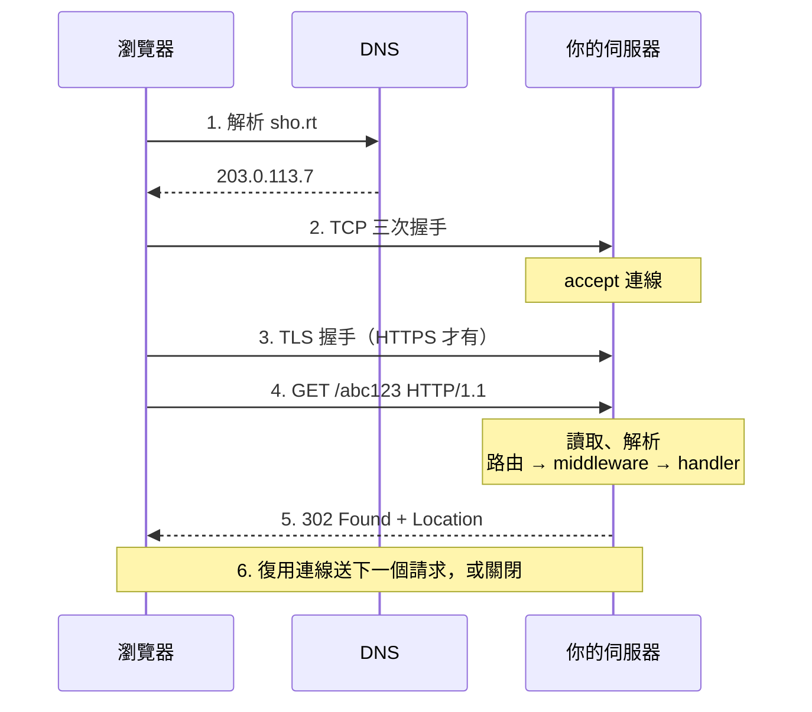

## 先想想

短網址服務 v1 上線了。使用者在瀏覽器輸入 `https://sho.rt/abc123` 按下 Enter，幾十毫秒後被導到原本的長網址。你的 Go 程式裡只有一個十幾行的 handler，查表、回 302。

但監控上有三種不同的症狀：有人說「網頁一直轉圈圈，最後逾時」，有人看到 `502 Bad Gateway`，還有一台機器的連線數慢慢爬到上限，handler 的 CPU 卻幾乎是閒的。

從按下 Enter 到 handler 開始執行，中間經過哪些階段？這三種症狀各自最可能卡在哪一段？

<details>
<summary>提示</summary>

handler 只是最後一步。在它之前，請求至少要先「到達這台機器」、「被讀成一個結構」、「被送到對的 handler」。

</details>

## 是什麼

**請求生命週期（request lifecycle）** 是一個 HTTP 請求從客戶端建立連線開始，到伺服器讀取、路由、處理、寫回應，最後關閉或復用連線的完整路徑。

你可以把它想成一條流水線。handler 是其中一站，而且是唯一一站由你的業務邏輯決定做什麼；其他站由網路、作業系統和 HTTP 伺服器程式庫負責，但每一站都有可能卡住、出錯或被濫用，也都有你能設定的參數。

## 為什麼存在

沒有這個階段模型，除錯只能靠猜。「請求很慢」這句話至少對應五種不同的問題：DNS 解析慢、TCP 連線建不起來、TLS 握手慢、伺服器排隊讀不到請求、handler 本身慢。每一種的修法完全不同，改錯地方不會有任何效果。

設定也一樣。伺服器預設通常不替你限制「一個客戶端最多可以花多久送完請求」。假設一台機器最多撐 10,000 條連線，攻擊者只要開 10,000 條連線、每條每 10 秒送一個 byte，就能把服務擠到沒有空位，而整個過程不需要大量流量，handler 也一次都沒被呼叫。

有了階段模型，每一段都能對應到一個觀測點（哪一段花了多少時間）和一個保護設定（逾時、大小上限）。這就是後面「怎麼運作」要做的事。

## 怎麼運作

:::note
本篇先把整條路徑走一遍，`net/http` 的 API 在下一篇「`net/http`」才會詳細介紹。為了看得見每個階段，範例用 `net.Listen` 直接在 TCP 連線上手寫一個最小的 HTTP/1.1 伺服器，它只能用來學習，不是正式服務的寫法。
:::

### 全貌



這張圖的重點：階段 1 到 3 發生在「請求」存在之前，你的 handler 完全看不到；階段 4 到 5 才是 HTTP 本身；階段 6 決定下一個請求要不要再付一次建立連線的成本。

### 階段 1 到 3：連線建立

瀏覽器先把 `sho.rt` 解析成 IP 位址，再對該 IP 的 443 port 做 TCP 三次握手，HTTPS 還要再做一次 TLS 握手交換金鑰。這三步各需要至少一個來回（round trip）。如果客戶端離伺服器 50 毫秒，光是 TCP 加 TLS 就可能先花掉 100 到 150 毫秒（估計值，依 TLS 版本與是否復用工作階段而不同），還沒送出任何 HTTP 內容。

這也是連線復用有價值的原因：只要連線還開著，後面的請求可以跳過階段 1 到 3。

### 階段 4：accept 與讀取請求

伺服器端，作業系統在 `listen` 的 port 上替你完成握手，把建好的連線放進佇列，程式呼叫 `Accept` 就拿到一條連線。範例用最直接的模型：每個連線一個 goroutine。

```go title="server.go"
func (s *Server) Serve(ln net.Listener) error {
	for {
		conn, err := ln.Accept()
		if err != nil {
			return err
		}
		go s.handleConn(conn)
	}
}
```

goroutine 很輕量，所以「一個連線一個 goroutine」在 Go 裡是常態做法，標準庫的 `net/http` 也是這樣做。你不必擔心它像舊式的「一個連線一個作業系統執行緒」那麼昂貴，但連線數仍然受檔案描述符（file descriptor）上限和記憶體限制。

拿到連線之後，伺服器必須把一串 byte 讀成一個請求。HTTP/1.1 的格式是純文字：

```http
GET /abc123 HTTP/1.1
Host: sho.rt
Accept: */*

```

第一行是 **請求行（request line）** ：method、目標、協定版本。接著是一行一個的 header，以一個空行結束。如果有 `Content-Length`，後面還跟著那麼多 byte 的 body。範例的解析函式照這個順序讀：

```go title="server.go"
func ReadRequest(br *bufio.Reader) (*Request, error) {
	budget := maxHeaderBytes
	line, err := readLine(br, &budget)
	// ...
	for {
		line, err := readLine(br, &budget)
		if err != nil {
			return nil, err
		}
		if line == "" { // the blank line ends the headers
			break
		}
		// ...
	}
	// ...
}
```

這裡有兩件事對生命週期很重要。第一，TCP 是 byte 串流，沒有「一個請求」的邊界；請求行、header 的結尾和 body 的長度，全靠 HTTP 自己的格式（空行、`Content-Length`）來判斷。第二，所有讀取都是在等客戶端送資料，客戶端送得慢，這條 goroutine 就一直等。所以讀取要有期限和大小上限，下一節會看到。

### 階段 4 到 5：路由、middleware 與 handler

請求被解析成結構後，才進入你熟悉的部分：依 method 與路徑決定交給哪個 handler，中間可能經過一串 middleware（記錄、認證、限流等包在 handler 外面的函式）。範例沒有路由器，直接把 `*Request` 交給一個 handler 函式：

```go title="server.go"
func ShortURLHandler(links map[string]string) Handler {
	return func(req *Request) Response {
		if req.Method != "GET" {
			return Response{Status: 405, Header: map[string]string{"Allow": "GET"}}
		}
		target, ok := links[strings.TrimPrefix(req.Target, "/")]
		if !ok {
			return Response{Status: 404, Body: "not found\n"}
		}
		return Response{Status: 302, Header: map[string]string{"Location": target}}
	}
}
```

注意 handler 只回傳「狀態、header、body」，不碰連線。真正把這些變成 byte 寫回去的是伺服器：

```go title="server.go"
// The client needs Content-Length to know where this response ends,
// otherwise it cannot reuse the connection for the next one.
fmt.Fprintf(&b, "Content-Length: %d\r\nConnection: %s\r\n", len(resp.Body), conn)
```

回應也是純文字：狀態行、header、空行、body。`Content-Length` 讓客戶端知道這個回應在哪裡結束，這是連線能復用的前提。標準庫的 `http.ResponseWriter` 還多一個規則：第一次寫 body 之前會先把 header 與狀態碼送出去，之後就改不了，這在「常見坑」會再回頭看。

### 階段 6：keep-alive 與連線復用

HTTP/1.1 預設連線會保持開啟，除非任一方送出 `Connection: close`。範例的連線迴圈把「等下一個請求」和「讀完一個請求」分成兩個階段，各用不同的期限：

```go title="server.go"
for {
	// Waiting for the next request is idle time, not slow-client time,
	// so the two phases get different deadlines.
	if err := conn.SetReadDeadline(time.Now().Add(s.IdleTimeout)); err != nil {
		return
	}
	if _, err := br.Peek(1); err != nil {
		return
	}
	if err := conn.SetReadDeadline(time.Now().Add(s.ReadTimeout)); err != nil {
		return
	}
	req, err := ReadRequest(br)
	// ...
}
```

`Peek(1)` 只等第一個 byte 出現。在那之前，連線是閒置的，最多等 `IdleTimeout`（範例預設 60 秒）；第一個 byte 到了，客戶端就必須在 `ReadTimeout`（範例預設 5 秒）內送完整個請求。兩種等待的合理長度差很多，混成一個數字，不是太短會誤殺復用中的連線，就是太長讓慢速攻擊者有空間。

### 回到一開始的問題

按下 Enter 之後，請求依序經過 DNS、TCP、TLS、讀取與解析、路由與 middleware、handler、寫回應、連線復用或關閉；handler 只是其中一站，而且是最後才輪到的一站。

三種症狀可以這樣對應：

- **轉圈圈最後逾時**：最常見的位置是 handler 之前，例如連線建不起來，或請求一直讀不完；也可能 handler 本身很慢。看伺服器有沒有收到請求（access log 有沒有那一行）就能先切成兩半。
- **502**：通常是反向代理（reverse proxy）與你的伺服器之間出了問題，例如代理拿一條你已經關掉的復用連線去送請求。
- **連線數爬升、CPU 閒置**：連線被占著卻沒在做事，常見原因是沒有讀取逾時，或客戶端送一半就不動了。

## 取捨與替代方案

「一個連線怎麼被服務」本身有幾種設計：

| 方案 | 優點 | 代價 | 適用情境 |
| --- | --- | --- | --- |
| 一個連線一個作業系統執行緒 | 程式好寫，阻塞呼叫直觀 | 每個執行緒要幾百 KB 到數 MB 的 stack，連線數一萬就吃力 | 連線數很少的傳統伺服器 |
| 事件迴圈（單執行緒搭配 epoll 等） | 連線數可以非常多，記憶體省 | 程式要寫成回呼或狀態機，一個慢操作會卡住整個迴圈 | Nginx、Node.js 這類以 I/O 為主的服務 |
| 一個連線一個 goroutine（Go） | 程式像阻塞式般好寫，runtime 負責排程，連線數可到數萬 | goroutine 與連線仍占記憶體，必須自己設逾時 | 大多數 Go 服務，也是 `net/http` 的做法 |

另一個取捨是「誰來管連線」。你可以讓 Go 程式直接面對網際網路，也可以前面放反向代理（Nginx、雲端負載平衡器）。代理能吸收慢速客戶端、做 TLS、重送、限流，Go 程式只需處理它能信任的連線；代價是多一跳，也多了「代理與後端的 keep-alive 設定要配合」這個新的出錯點。

### 什麼時候不該自己管這些

- **不要在正式服務裡手寫 HTTP 解析。** 範例省略了分塊傳輸（chunked transfer encoding）、`Expect: 100-continue`、HTTP/2、請求走私（request smuggling）等一大堆邊界情況。這些在 RFC 裡有完整規則，標準庫已經替你處理。本篇手寫只為了看見階段。
- **不要把逾時當成「之後再調」。** 每個面向網路的伺服器，上線前就要有讀取、寫入與閒置的逾時。預設值通常是「不限制」，不是「合理值」。

## 常見坑與故障案例

### 沒有讀取逾時，被慢速連線占滿

**症狀**：連線數持續上升，新使用者連不進來；CPU、流量都很低，handler 的 log 幾乎沒有新請求。

**成因**：這是 Slowloris 類型的攻擊：客戶端建立連線後，每隔幾秒才送一個 byte 的 header，永遠不送完。伺服器的 goroutine 一直在等它，連線與記憶體被占住。Cloudflare 的學習中心有這種攻擊的說明，見延伸閱讀。標準庫的 `http.Server` 預設不限制讀取時間，只要沒設 `ReadHeaderTimeout`，就會有這個問題。

**修法**：每個伺服器都設 `ReadHeaderTimeout`、`IdleTimeout`，並限制 header 大小。範例裡的測試 `TestSlowClientGets408` 送出半個請求後不動，驗證伺服器在 `ReadTimeout` 後回 408 並關閉連線。

### 請求 body 沒有大小上限

**症狀**：某個端點被送了一個很大的 `Content-Length`，記憶體暴增，程式被作業系統砍掉（OOM）。

**成因**：範例的 `ReadRequest` 照 `Content-Length` 直接配置那麼大的 slice，客戶端說多大就配多大。這是刻意留下的缺口，在「小練習」要你補上。標準庫對應的做法是用 `http.MaxBytesReader` 包住 body。

**修法**：讀取前就依端點需求設上限，超過回 413。上限要依端點個別決定：建立短網址的 JSON 只要幾 KB，上傳檔案則另有一套（見 [檔案驗證](/backend/l4/4-1-file-upload/file-validation/)）。

### 沒讀完、沒關閉 body，連線無法復用

**症狀**：伺服器呼叫別的服務（例如前面「先想想」的內部連結服務）時，連線數與 goroutine 數緩慢增加，或每個請求都要重新建立 TCP 與 TLS 連線，延遲突然變高。

**成因**：用 `http.Get` 這類 client 呼叫別人時，回應的 `Body` 是一條還連著網路的串流。沒呼叫 `Body.Close()`，連線不會歸還給連線池，也永遠不會被復用；沒把 body 讀完就關閉，連線通常也只能丟棄而不能復用，因為後面還有沒讀完的 byte 卡在連線上。

**修法**：拿到回應就 `defer resp.Body.Close()`；不需要內容時也先用 `io.Copy(io.Discard, resp.Body)` 讀完。另外幫 client 設 `Timeout`，不要使用沒有逾時的預設 client。

### 寫出 header 之後才發現出錯

**症狀**：handler 寫了一半 JSON 才遇到錯誤，想改回 500，但客戶端收到的已經是 200，body 是被截斷的 JSON。

**成因**：第一次呼叫 `Write`（或 `WriteHeader`）的那一刻，狀態行與 header 就送出了。HTTP 回應是先狀態、後內容，已經送出的部分收不回來。標準庫甚至會在 log 印出 `superfluous response.WriteHeader call`。

**修法**：先把可能失敗的工作做完，結果完整後再一次寫出（例如先 `json.Marshal` 成 byte，成功了才寫）。統一的錯誤回應格式留到本章後面的「統一的錯誤回應格式」再談。

### 反向代理與後端的 keep-alive 時間不一致（示意案例）

**症狀**：流量不高時，偶爾出現零星的 502，重試就成功；日誌裡代理報 `connection reset` 或 `upstream prematurely closed connection`。

**成因**：代理為了省連線，保留與後端之間的連線準備復用。如果後端的 `IdleTimeout` 比代理保留連線的時間短（例如後端 30 秒就關，代理覺得還能用 60 秒），就會出現一個空檔：後端剛關了連線，代理還不知道，下一個請求恰好送進這條已死的連線，得到 reset。

**修法**：讓「靠近客戶端那一側」的閒置時間比「後端那一側」短，也就是後端的 `IdleTimeout` 要比代理的長。這是 Nginx、雲端負載平衡器與後端組合時很常見的設定，各家的參數名稱不同，要查自己用的那一個。

## 小練習

範例程式在 `playground/backend/l1/1-2-http-api/http-request-lifecycle/`。先執行 `go test ./...` 確認全部通過，也可以 `go run .` 之後用 `curl -i http://127.0.0.1:8080/abc123` 看到 302 與 `Location`。

**1. 補上 body 大小上限。** `Server` 裡有一個還沒被使用的欄位 `MaxBodyBytes`（0 表示不限制）。讓 `Content-Length` 超過它的請求回 413 並關閉連線，並在 `server_test.go` 加一個測試：`MaxBodyBytes` 設為 10、送 `Content-Length: 100` 的請求，預期收到 413。

<details>
<summary>參考解答</summary>

最簡單的做法是讓 `ReadRequest` 多收一個上限參數。定義 `var ErrBodyTooLarge = errors.New("body too large")`，在解析出 `n` 之後、配置 slice 之前檢查：

```go
if max > 0 && int64(n) > max {
	return nil, ErrBodyTooLarge
}
```

`handleConn` 呼叫時傳入 `s.MaxBodyBytes`，`statusFor` 對 `ErrBodyTooLarge` 回 413（記得在 `statusText` 補上 `413: "Content Too Large"`）。測試只要送出 header、不必真的送 100 個 byte：伺服器在配置記憶體前就拒絕了，這正是重點。

</details>

**2. 看到復用的好處。** 在 `server_test.go` 寫一個測試，讓同一條連線送 100 個請求，另一個測試每個請求都重新 `net.Dial`，用 `time.Since` 比較兩者的總時間。預測哪個比較快，再執行。

<details>
<summary>參考解答</summary>

多數情況下復用連線較快，因為少了 100 次 TCP 握手與 goroutine 建立。但在本機回送（loopback）上握手只需幾十微秒，差距可能不明顯，不要寫成對時間做斷言的測試，只印出結果觀察。這個差距在真實網路加上 TLS 時會放大許多，這就是 keep-alive 存在的原因。

</details>

### 辨識

下面這段是 AI 產生的短網址轉址服務，會呼叫內部的連結服務查出目標。請做程式碼審查：它看起來能跑，也能通過一般的功能測試，找出它在正式環境會出問題的地方，說明後果。

```go title="redirect.go"
func main() {
	http.HandleFunc("/", redirect)
	log.Println("listening on :8080")
	log.Fatal(http.ListenAndServe(":8080", nil))
}

func redirect(w http.ResponseWriter, r *http.Request) {
	code := strings.TrimPrefix(r.URL.Path, "/")
	resp, err := http.Get("http://links.internal/resolve?code=" + url.QueryEscape(code))
	if err != nil {
		http.Error(w, "upstream unavailable", http.StatusBadGateway)
		return
	}
	if resp.StatusCode == http.StatusNotFound {
		http.NotFound(w, r)
		return
	}
	target, err := io.ReadAll(resp.Body)
	if err != nil {
		http.Error(w, "upstream error", http.StatusBadGateway)
		return
	}
	http.Redirect(w, r, string(target), http.StatusFound)
}
```

完整檔案在 `recognize/redirect.go`，只能用 `go vet recognize/redirect.go` 檢查能編譯，不會被 `go test ./...` 執行。

<details>
<summary>參考解答</summary>

1. **`http.ListenAndServe` 沒有任何逾時** （`main` 的最後一行）。預設的 `http.Server` 不限制讀取時間，慢速客戶端可以長時間占住連線，連線與 goroutine 一直累積。改為自己建立 `http.Server`，設定 `ReadHeaderTimeout`、`IdleTimeout`，視端點設 `ReadTimeout`、`WriteTimeout`。
2. **`resp.Body` 從來沒有關閉。** 每次呼叫內部服務都會留下一條不歸還連線池的連線，直到連線用完或檔案描述符耗盡，接著所有轉址都開始失敗。拿到 `resp` 且 `err == nil` 後立刻 `defer resp.Body.Close()`，連 404 的分支也要關。
3. **`http.Get` 使用沒有逾時的預設 client。** 內部服務一旦卡住，每個進來的請求都會永遠等下去，goroutine 越積越多，最後拖垮整個服務。建立自己的 `http.Client{Timeout: ...}`，或用 `http.NewRequestWithContext` 把請求的 context 傳下去。

這三個問題的共通點是：功能測試只走「一切順利」的路徑，看不到任何一個。它們只在對方變慢、變多或變壞的時候才出現。

</details>

## 快閃卡

<details>
<summary>一個 HTTP 請求在 handler 被呼叫之前，至少經過哪些階段？</summary>

DNS 解析、TCP 三次握手、TLS 握手（HTTPS）、伺服器 accept 連線、讀取並解析請求行與 header（有 body 時再讀 body），接著才是路由、middleware 與 handler。

</details>

<details>
<summary>為什麼「一個連線一個 goroutine」在 Go 裡可行，但「一個連線一個作業系統執行緒」在連線很多時會吃力？</summary>

goroutine 的初始 stack 很小，由 Go runtime 排程；作業系統執行緒的 stack 與切換成本高得多。不過 goroutine 仍然占記憶體，連線數還是受檔案描述符與記憶體限制，所以仍然要設逾時。

</details>

<details>
<summary>伺服器怎麼知道一個 HTTP/1.1 請求的 body 在哪裡結束？</summary>

TCP 是沒有邊界的 byte 串流。header 以空行結束，body 的長度由 `Content-Length` 決定（範例只實作這一種）。如果缺少或錯誤，伺服器就無法正確切開相鄰的請求。

</details>

<details>
<summary>客戶端用 HTTP/1.1 送出 <code>GET /abc123</code>，沒有帶 <code>Connection</code> header。回應之後這條連線會被關掉嗎？</summary>

不會。HTTP/1.1 預設保持連線（keep-alive），除非任一方送出 `Connection: close`。這樣下一個請求可以省掉 TCP 與 TLS 握手，直到閒置逾時才關閉。

</details>

<details>
<summary>為什麼範例把「等下一個請求」和「讀完一個請求」用兩個不同的逾時？</summary>

兩者合理的長度差很多：閒置連線等下一個請求可以等幾十秒（復用），但一旦第一個 byte 到了，正常客戶端幾秒內就該送完。合成一個值，不是誤殺復用中的連線，就是讓慢速攻擊者有太多空間。

</details>

<details>
<summary>一台伺服器的連線數一直升到上限，但 CPU 與流量都很低，handler 的 log 也沒有新請求。最可能的原因是什麼？</summary>

大量連線被建立後卡在讀取階段，例如沒有設 `ReadHeaderTimeout`，被 Slowloris 類型的慢速連線占住；也可能是 client 沒關閉 `resp.Body` 造成連線洩漏。兩者的共同點是連線被占用但沒有完成請求。

</details>

<details>
<summary>handler 先 <code>w.Write</code> 了一段 JSON，之後才發現資料有誤，想改回 500。可行嗎？為什麼？</summary>

不可行。第一次寫入時狀態行與 header 就已送出，客戶端已經看到 200，之後無法更改。應該先在記憶體中把完整結果準備好，確定成功再一次寫出。

</details>

<details>
<summary>後端的 <code>IdleTimeout</code> 設 30 秒，前面的代理保留連線 60 秒。為什麼可能出現零星的 502？該怎麼調？</summary>

後端先關了連線，代理還以為連線可用，把下一個請求送進這條已死的連線，得到 reset。要讓後端的閒置時間比代理的長，使連線永遠由代理這一側先關閉。

</details>

## 延伸閱讀

- [RFC 9112：HTTP/1.1](https://www.rfc-editor.org/rfc/rfc9112)：請求行、header、`Content-Length` 與連線管理的正式規則，本篇範例省略的邊界情況都在這裡
- [The complete guide to Go net/http timeouts](https://blog.cloudflare.com/the-complete-guide-to-golang-net-http-timeouts/)：Cloudflare 工程師說明 `http.Server` 各個逾時設定在生命週期的哪一段生效
- [net/http 套件文件：Server](https://pkg.go.dev/net/http#Server)：`ReadHeaderTimeout`、`IdleTimeout`、`MaxHeaderBytes` 等欄位的官方說明
- [What is a Slowloris DDoS attack?](https://www.cloudflare.com/learning/ddos/ddos-attack-tools/slowloris/)：慢速連線攻擊的原理與防護方向
