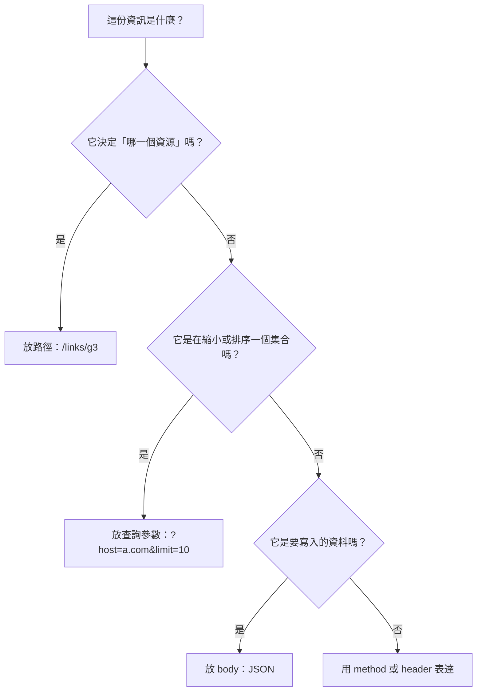

## 先想想

短網址服務 v1 的第一版 API 由一位新同事趕出來，路由長這樣：`POST /createLink`、`GET /getLink?id=3`、`POST /deleteLink`，連結的編號從 1 開始，每建一個加一。手動測試全部正常。

現在前端要兩個新功能：「列出使用者 u1 在 example.com 的所有連結」和「停用某條連結，但不刪掉」。同事打算再加 `GET /getLinksByUserAndHost` 和 `POST /disableLink`。

這樣加下去，一年後 API 會變成什麼樣子？如果是你，這兩個功能會設計成什麼 URL？另外，`id=3` 這種編號還有什麼隱憂？

<details>
<summary>提示</summary>

想想一個沒看過文件的人，能不能猜出刪除連結的網址。再想想：URL 裡哪些字是「名字」，哪些字其實是「動作」，而動作已經有 method 可以表達。

</details>

## 是什麼

**REST（Representational State Transfer）** 是 Roy Fielding 在博士論文中提出的一組網路架構限制。日常說的「REST API」多半指一種慣例：把系統裡的東西當成 **資源（resource）**，每個資源有自己的 URL，用 HTTP method 表達要對它做什麼。

資源是名詞，例如一條連結、一位使用者。同類資源的集合叫 **集合（collection）**，例如 `/links`；集合裡的一個成員叫 **項目（item）**，例如 `/links/g3`。這篇講的是這套日常慣例，不討論 Fielding 論文中的全部限制。

這是[HTTP 語意](/backend/l1/1-2-http-api/http-semantics/)的下一步：上一篇決定每個 method 與狀態碼的意義，這篇決定 URL 該長什麼樣子，兩者合起來才是一個讀得懂的 API。

## 為什麼存在

沒有慣例時，每個端點都是一次獨立的命名決定：有人寫 `createLink`，有人寫 `add_user`，有人寫 `/api/Orders/Create`。後果是具體的：

- **猜不到**：要刪除連結的人必須查文件，因為 `deleteLink`、`removeLink`、`link/delete` 都有人用過。
- **端點只增不減**：每個新需求加一個動詞端點，一年後有幾十個名字相近的路由，沒人敢刪。
- **中間層幫不上忙**：CDN、重試函式庫、監控只看 method 和狀態碼。動作藏在路徑裡，`POST /getLink` 這種請求沒人知道可不可以快取。
- **網址綁住實作**：把資料表或內部流程名稱放進 URL，改資料表就等於改 API。

資源導向的做法把問題縮小：只要決定「有哪些資源」，動作就由固定的 method 提供。知道 `/links` 存在，不看文件也能猜到 `GET /links/{code}` 是讀取、`DELETE /links/{code}` 是刪除。

## 怎麼運作

### 資源是名詞，集合用複數

先看範例的路由表。它是這篇所有規則的縮影：

```go title="server.go"
mux.HandleFunc("GET /{code}", s.Redirect)
mux.HandleFunc("GET /links", s.ListLinks)
mux.HandleFunc("POST /links", s.CreateLink)
mux.HandleFunc("GET /links/{code}", s.ShowLink)
mux.HandleFunc("PUT /links/{code}", s.PutLink)
mux.HandleFunc("DELETE /links/{code}", s.DeleteLink)
mux.HandleFunc("POST /links/{code}/disable", s.DisableLink)
mux.HandleFunc("GET /users/{owner}/links", s.ListOwnerLinks)
```

規則一：路徑裡放名詞，不放動詞。`createLink`、`getLink`、`deleteLink` 裡的動詞，已經由 `POST`、`GET`、`DELETE` 表達了。

規則二：集合名稱一律用複數，`/links` 而不是 `/link`。集合與項目共用同一個前綴，`/links` 是整批，`/links/g3` 是其中一個，讀起來像檔案系統的資料夾與檔案。

規則三：路徑一律小寫，單字之間用連字號，例如 `/link-groups`。路徑區分大小寫，`/Links` 與 `/links` 是不同的 URL，混用只會多出一堆 404。

```text
/links                        集合
/links/g3                     集合裡的一個項目
/links/g3/disable             項目上的動作
/users/u1/links               屬於 u1 的連結集合
/links?host=example.com       同一個集合，縮小範圍
```

看每一行回答的問題：前三行說「是哪個東西」，第四行說「屬於誰」，第五行說「要哪一部分」。

### 集合與項目對應的 method

同一個資源，同一個 URL，不同 method 就是不同動作：

| 請求 | 意義 | 成功時 |
| --- | --- | --- |
| `GET /links` | 列出集合 | 200 與清單 |
| `POST /links` | 在集合裡建立新項目，由伺服器命名 | 201、`Location` 指向新項目 |
| `GET /links/{code}` | 讀取一個項目 | 200 |
| `PUT /links/{code}` | 用請求內容取代整個項目，由客戶端命名 | 新建 201、取代 200 |
| `DELETE /links/{code}` | 刪除項目 | 204 |

建立資源時的選擇是：誰決定名字。短碼由伺服器產生，就 `POST /links`，伺服器用 `Location` 告訴客戶端新資源在哪裡；客戶端想自訂短碼，就 `PUT /links/{code}`，重送也不會多出第二條連結。method 的安全與冪等性質已經在上一篇講過，這裡直接套用。

```go title="handlers.go"
l := s.Add(in.Target, in.Owner)
w.Header().Set("Location", "/links/"+l.Code)
writeJSON(w, http.StatusCreated, l)
```

### 路徑、查詢參數、body 各放什麼

一個請求能帶資訊的地方有三處，分工如下：



看這張圖的第一個問題：路徑回答「是誰」，所以 `/links/g3` 不能寫成 `/links?id=g3`。查詢參數只用來縮小範圍，路徑上少了它仍然是同一個資源，所以 `host`、`limit`、`offset` 放在 `?` 後面。

範例的列表端點就是這個分工的實例：

```go title="handlers.go"
q := r.URL.Query()
limit, err := intParam(q, "limit", 20, 1, 100)
// ...
host := q.Get("host")
items := s.List(func(l Link) bool {
	// ...
	return perr == nil && u.Hostname() == host
}, limit, offset)
writeJSON(w, http.StatusOK, map[string]any{"items": items})
```

集合一定要有上限：`limit` 預設 20、最多 100，超出範圍回 400。沒有上限的 `GET /links` 在資料變多後會把整張表一次吐出來。

### 巢狀只用在歸屬

`/users/u1/links` 表示「u1 的連結」，路徑裡的 `u1` 說明這些連結屬於誰。巢狀路徑適合表達 **歸屬**：子資源離開父資源就沒有意義，或父資源是它的天然入口。

巢狀最多一層。`/users/u1/links/g3/clicks/c9` 要求客戶端知道三層編號才能讀一筆資料，而 `g3` 本來就能單獨識別一條連結。經驗法則是：項目有自己的唯一識別，就給它一個頂層 URL（`/links/g3`），歸屬關係用另一條集合 URL 或查詢參數表達（`/users/u1/links` 或 `/links?owner=u1`）。

### 不是 CRUD 的動作

「停用連結」不是建立、讀取、取代或刪除，硬塞進 `PUT` 或 `DELETE` 都不貼切。做法是把動作放在項目底下，用 `POST` 觸發：

```go title="handlers.go"
// DisableLink handles POST /links/{code}/disable: an action that is not
// plain create, read, replace or delete gets its own sub-path.
func (s *Store) DisableLink(w http.ResponseWriter, r *http.Request) {
	l, ok := s.Disable(r.PathValue("code"))
	// ...
}
```

它用 `POST` 是因為動作會改變狀態，不能用 `GET`；HTTP 沒有「觸發動作」的專用 method，這是少數需要妥協的地方。停用後，公開短網址 `GET /{code}` 回 410 Gone，表示它曾經存在，現在被永久拿掉了。

### 資源的識別碼

路徑上的識別碼會被書籤、日誌與外部系統長期引用，要長久可用，也不能洩漏資訊。

- **不重複**：範例的計數器只增不減，刪除後不會把同一個短碼發給下一條連結。如果用 `len(links)+1` 產生編號，刪掉一筆後新建的連結會覆蓋另一筆。
- **不連續**：流水號讓任何人都能從 `/links/3` 猜到 `/links/4`。對短網址這類公開資源問題不大，對訂單、帳單、檔案就是洩漏風險，授權檢查必須在伺服器做，不能靠「別人猜不到網址」。

回到一開始的問題：「列出 u1 在 example.com 的連結」是 `GET /users/u1/links?host=example.com`，名詞表達歸屬，查詢參數縮小範圍；「停用連結」是 `POST /links/{code}/disable`。新增功能時不需要新增動詞端點，只要問「它是哪個資源、什麼歸屬、什麼動作」。至於編號 `id=3`，除了流水號可被猜到，用 `len` 算出來的編號在刪除後還會撞號。

## 取捨與替代方案

資源導向不是唯一選擇。常見的三種風格：

| 方案 | 優點 | 代價 | 適用情境 |
| --- | --- | --- | --- |
| 資源導向（名詞路徑 + method） | URL 可預測，中間層看得懂，文件與客戶端容易自動產生 | 不屬於 CRUD 的動作要想辦法安置，像 `/disable` | 對外公開的 API、需要快取與重試的系統 |
| 動作導向（`POST /disableLink`，JSON-RPC 風格） | 命名直覺，一個端點對應一個函式 | 端點數量隨功能線性增加，沒有共同規則，中間層無從判斷快取與重試 | 內部服務之間，客戶端與伺服器由同一團隊維護 |
| GraphQL、gRPC | 欄位可由客戶端選擇，強型別 | URL 與 method 幾乎失去意義，快取與監控要另外處理 | 前端需要彈性組合資料，或內部高頻呼叫 |

資源導向內部還有一個取捨：歸屬用巢狀路徑還是查詢參數。`/users/u1/links` 一看就知道歸屬，授權可以綁在路徑上的使用者，代價是同一資源有兩個入口；`/links?owner=u1` 只有一個入口，篩選能任意疊加，代價是歸屬變成可選條件，容易忘記檢查權限。

公開的 URL 一旦發出去就很難改，外部程式、書籤和文件都會引用它。這也是第一次命名就要認真的原因：[W3C 的〈Cool URIs don't change〉](https://www.w3.org/Provider/Style/URI) 整篇都在講這件事。

### 什麼時候不該用

- **不要為了「純粹」把每個動作硬改成資源。** 「重新產生短碼」「批次匯入」「寄送重設密碼信」這類動作，用 `POST /links/{code}/regenerate` 這種動作子路徑，比發明一個 `regeneration` 資源更清楚。
- **不要在已經選了 RPC 或 GraphQL 的系統裡混用一半的 REST 路徑。** 客戶端要同時學兩套命名規則，比只用一套更容易出錯。
- **不要把 URL 當成資料庫結構圖。** 資源應該反映客戶端的概念，不是你的資料表。

## 常見坑與故障案例

### 動詞放進路徑

**症狀**：路由表出現 `/createLink`、`/getLink`、`/deleteLink`、`/api/links/list`、`/links/delete/{id}`。新功能一來又多一個動詞端點，沒人能說出完整的端點清單。

**原因**：把 API 當成函式清單設計，每個函式一個路徑。method 沒有承擔任何意義，多半全是 POST，快取與重試都用不上。

**避免**：路徑只放名詞，動作交給 method。審查時看到路徑裡出現 `get`、`create`、`delete`、`update`，先問它能不能改成 method 加資源。真正不屬於 CRUD 的動作，才用 `/{資源}/{動作}`，並以 POST 觸發。

### 巢狀太深

**症狀**：URL 長成 `/users/u1/links/g3/clicks/c9/referrers/r2`。客戶端要讀一筆資料必須先知道四個編號，路由與授權檢查在每一層都要重複寫。

**原因**：把資料表的外鍵關係原樣搬進路徑，每個一對多多一層。

**避免**：巢狀最多一層。項目有自己的唯一識別，就給它頂層路徑（`/clicks/c9`），歸屬用查詢參數表達（`/clicks?link=g3`）。

### 流水號外露

**症狀**：有人把網址 `/records/1234567` 的數字改成 `1234568`，就看到別人的資料；爬蟲只要從 1 數到 N 就能抓光所有資料。

**原因**：識別碼是連續流水號，而伺服器只檢查「是否登入」，沒有檢查「這筆資料是不是你的」。連續編號讓猜測變得零成本。

**案例**：2019 年 First American Financial 的網站上，文件網址裡的編號是連續數字，任何人改掉編號就能讀到別人的文件，Krebs on Security 報導涉及約 8.85 億筆紀錄（[Krebs on Security 報導](https://krebsonsecurity.com/2019/05/first-american-financial-corp-leaked-hundreds-of-millions-of-title-insurance-records/)）。

**避免**：對外使用隨機或不可預測的識別碼，更重要的是在每個端點檢查資源屬於呼叫者。不可預測的 ID 只是多一層防護，不是授權。

### 同一個資源有多種寫法

**症狀**：客戶端有人呼叫 `/links`，有人呼叫 `/links/` 或 `/Links`，有的 200，有的 404，快取與監控也被分成好幾組。

**原因**：路徑沒有統一規則。Go 的 `ServeMux` 會把 `GET /links` 與 `GET /links/` 視為不同的路徑，範例的測試確認了後者是 404，大小寫不同也是。

**避免**：選一種寫法並寫進規則：小寫、不加結尾斜線。其他寫法要嘛回 404，要嘛用 308 導向標準寫法，不要同時都回 200。

## 小練習

範例程式在 `playground/backend/l1/1-2-http-api/rest-design/`。先執行 `go test -race ./...` 確認全部通過。

**1. 觀察路由。** 把服務跑起來，依序送下面的請求，記下每個的狀態碼與 `Location`：

```bash
go run .
curl -i -X POST -d '{"target":"https://example.com/a"}' localhost:8080/links
curl -i -X PUT -d '{"target":"https://example.com/a"}' localhost:8080/links/abc
curl -i localhost:8080/links/
curl -i -X POST localhost:8080/links/abc/disable
curl -i localhost:8080/abc
```

<details>
<summary>參考解答</summary>

依序是：201 與 `Location: /links/g1`（短碼由伺服器產生）；201 與 `Location: /links/abc`（短碼由客戶端指定）；`/links/` 多了結尾斜線，404；停用回 200，body 裡 `disabled` 為 true；最後 `GET /abc` 回 410 Gone，而不是 302。

</details>

**2. 完成列表端點。** `exercise/links.go` 裡的 `ListLinks` 目前回 501。照註解裡的 TODO 補完：`limit`（預設 20、1 到 100）、`offset`（0 以上）、`host`（主機名稱完全相同才保留），格式錯誤回 400，沒有符合的結果要回 `{"items":[]}` 而不是 `null`。執行下面的指令，五個測試全部通過就完成了：

```bash
go test -tags exercise ./exercise/
```

<details>
<summary>參考解答</summary>

三個重點。第一，驗證要先做，錯誤的參數在動資料之前就回 400。第二，`host` 要比 `url.Parse` 得到的 `Hostname()`，用 `strings.Contains` 會讓 `sub.example.com` 也被當成 `example.com`。第三，結果先建立 `items := []Link{}`，而不是 `var items []Link`，後者在沒有結果時會被編碼成 `null`，客戶端要多處理一種形狀。

```go
limit, ok := intParam(q.Get("limit"), 20, 1, 100)
offset, ok2 := intParam(q.Get("offset"), 0, 0, 1<<30)
if !ok || !ok2 {
	http.Error(w, "bad limit or offset", http.StatusBadRequest)
	return
}
items := []Link{}
```

完整寫法可以對照主程式 `handlers.go` 的 `list`。

</details>

### 辨識

下面這段是 AI 產生的短網址 API，能編譯，手動用 `curl` 試也都「能用」。請做程式碼審查，找出違反這篇設計原則的地方（至少四處），說明後果與正確做法。

```go title="api.go"
func main() {
	mux := http.NewServeMux()
	mux.HandleFunc("POST /createLink", createLink)
	mux.HandleFunc("GET /getLink", getLink)
	mux.HandleFunc("POST /link/{id}/remove", removeLink)
	mux.HandleFunc("GET /link/search/{keyword}", searchLinks)
	// ...
}

func createLink(w http.ResponseWriter, r *http.Request) {
	var in struct{ Target string }
	// ... decode body into in
	mu.Lock()
	id := strconv.Itoa(len(links) + 1)
	links[id] = in.Target
	mu.Unlock()
	reply(w, http.StatusOK, map[string]string{"id": id})
}

func getLink(w http.ResponseWriter, r *http.Request) {
	mu.Lock()
	target, ok := links[r.URL.Query().Get("id")]
	mu.Unlock()
	// ...
}
```

完整檔案在 `playground/backend/l1/1-2-http-api/rest-design/recognize/api.go`，可用 `go vet recognize/api.go` 檢查能編譯，它不屬於測試。

<details>
<summary>參考解答</summary>

1. **動詞放進路徑。** `/createLink`、`/getLink`、`/link/{id}/remove` 都把 method 已經表達的動作又寫了一次，而且刪除用 POST，快取與重試的判斷全部失效。修法：`POST /links`、`GET /links/{code}`、`DELETE /links/{code}`。
2. **識別碼放在查詢參數。** `GET /getLink?id=3` 的 `id` 決定「哪一個資源」，應該在路徑上：`GET /links/3`。這樣 URL 才是資源的名字，也才能用 `Location` 回傳。
3. **集合與項目命名不一致。** 範例用單數 `/link/...`，之後一加列表端點就會出現 `/links` 與 `/link/{id}` 兩套前綴。修法：集合一律複數，`/links` 與 `/links/{code}`。
4. **搜尋條件放進路徑。** `/link/search/{keyword}` 把「縮小集合」做成新路徑，而且 `search` 看起來像一個項目編號。修法：`GET /links?q=keyword`。
5. **編號用 `len(links)+1` 產生。** 建立三筆後刪掉第一筆，下一次建立會得到編號 3，覆蓋既有的連結；流水號也讓編號可被猜測。修法：用只增不減的計數器或隨機短碼，並對每個請求做授權檢查。
6. **建立成功回 200，沒有 `Location`。** 客戶端只能從 body 取得 `id`，且不知道新資源的 URL。修法：回 201，並用 `Location: /links/{code}` 指向新資源。

</details>

## 快閃卡

<details>
<summary>日常說的「REST API」，實際上做的是什麼事？</summary>

把系統裡的東西當成資源，每個資源有自己的 URL，用 HTTP method 表達對它做什麼。路徑放名詞，動作交給 method，這比 Fielding 論文中的全部限制寬鬆得多。

</details>

<details>
<summary>為什麼 API 路徑寫成 /links 而不是 /getLinks 或 /link？</summary>

動詞已經由 GET、POST 等 method 表達，寫進路徑只會讓端點隨功能增加。集合用複數，是為了讓 `/links`（整批）與 `/links/g3`（其中一個）共用同一個前綴，保持一致。

</details>

<details>
<summary>你要設計「列出使用者 u1 在 example.com 的所有連結」，URL 該怎麼寫？</summary>

`GET /users/u1/links?host=example.com`。`u1` 說明歸屬，放在路徑；`host` 是在縮小集合，放在查詢參數。這個動作不需要新增動詞端點。

</details>

<details>
<summary>用戶端要自訂短碼 abc 建立連結，和讓伺服器產生短碼，各該用哪個請求？為什麼？</summary>

自訂短碼用 `PUT /links/abc`，名字由客戶端決定，重送只會取代同一筆。伺服器產生短碼用 `POST /links`，成功回 201 與 `Location`，因為每次送都會建立新資源，客戶端要靠 `Location` 知道新資源在哪。

</details>

<details>
<summary>「停用連結」不是 CRUD，該怎麼設計成 URL？為什麼不能用 GET？</summary>

用 `POST /links/{code}/disable`，把動作放成項目底下的子路徑。不能用 GET，因為停用會改變狀態，GET 被視為安全，連結預覽、預先載入與爬蟲都可能自動觸發它。

</details>

<details>
<summary>同一個服務裡，GET /links 回 200，GET /links/ 卻回 404，這會造成什麼問題？</summary>

這是兩個不同的 URL，Go 的 `ServeMux` 會把它們分開處理。客戶端和快取若混用兩種寫法，有的成功有的失敗，快取也各存一份。要選一種標準寫法，另一種回 404 或用 308 導向。

</details>

<details>
<summary>網站用 id 由 1 開始遞增產生資源編號，卻只檢查使用者有沒有登入，會出什麼事？</summary>

任何已登入的人把網址裡的編號加一，就可能讀到別人的資料。連續編號讓猜測變得零成本，問題的根源是沒有檢查「資源是不是屬於呼叫者」；不可預測的 ID 只是多一層防護，不能取代授權。

</details>

<details>
<summary>列表端點在沒有符合的資料時，為什麼應該回 {"items":[]} 而不是 null？</summary>

客戶端可以用同一種形狀處理有資料與沒資料的情況，不必多寫 `null` 的分支。Go 裡未初始化的 slice 會被編碼成 `null`，所以要用 `[]Link{}` 建立空 slice。

</details>

## 延伸閱讀

- [RFC 9110: HTTP Semantics](https://www.rfc-editor.org/rfc/rfc9110)：method、狀態碼與 `Location` 等 header 的正式定義
- [RFC 3986: URI Generic Syntax](https://www.rfc-editor.org/rfc/rfc3986)：路徑、查詢字串與 URL 結構的正式規範
- [Architectural Styles and the Design of Network-based Software Architectures（Fielding 博士論文第 5 章）](https://ics.uci.edu/~fielding/pubs/dissertation/rest_arch_style.htm)：REST 的原始定義與各項限制
- [Google API Improvement Proposals: Resource-oriented design](https://google.aip.dev/121)：Google 如何命名資源、集合與自訂動作
- [Routing Enhancements for Go 1.22](https://go.dev/blog/routing-enhancements)：`ServeMux` 的 method 與萬用字元 pattern 設計說明
- [Cool URIs don't change（W3C）](https://www.w3.org/Provider/Style/URI)：為什麼 URL 一旦公開就不該更動
