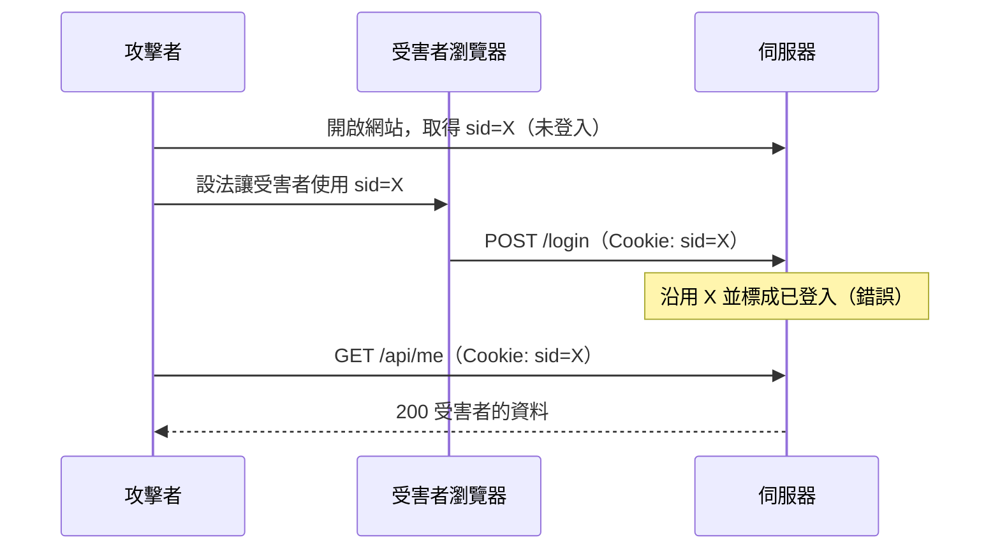

## 先想想

短網址服務 v1 有了登入。使用者 `POST /login` 成功後，下一個請求是 `GET /api/links`，要回傳「他自己的」短網址。但 HTTP 的每個請求都是獨立的，伺服器怎麼知道這個請求來自剛剛登入的 alice？

同事的做法是：登入成功就回 `Set-Cookie: user_id=42`，之後每個請求讀這個 Cookie 就知道是誰。

這樣有什麼問題？如果改成存一串隨機字串，伺服器又該記得什麼，才能在使用者按下「登出」之後，讓這串字串立刻失效？

<details>
<summary>提示</summary>

Cookie 存在使用者的瀏覽器裡，使用者自己打開開發者工具就能改。想想 `user_id=42` 改成 `user_id=1` 會發生什麼事。

</details>

## 是什麼

**Session（會話）** 是伺服器端為每一次登入保存的一筆狀態紀錄；**Cookie** 是瀏覽器保存、並在之後每個請求自動附上的一小段文字。

兩者合起來是最經典的有狀態認證：Cookie 裡只放一個不可猜測的 **session ID** ，使用者是誰、什麼時候過期，都留在伺服器。session ID 本身沒有任何意義，只是查表用的鑰匙。.,

## 為什麼存在

HTTP 是無狀態的：伺服器處理完一個請求就忘了它。沒有 session，唯一的辦法是每個請求都重新帶帳號密碼（例如 HTTP Basic）。這有兩個後果：密碼每次都要在網路上傳；而依照[密碼雜湊](/backend/l1/1-4-auth-basics/password-hashing/)那篇，每次驗證都要跑一次 argon2id，約 100 到 500 毫秒，一個頁面載入十個 API 就是幾秒。

Cookie 解決「帶什麼」：伺服器用 `Set-Cookie` 回應 header 交給瀏覽器一個值，瀏覽器依規則在之後的請求自動附上 `Cookie` header，前端程式不必處理。這套機制的規格是 RFC 6265。

Session 解決「值代表什麼」：登入時付一次驗證成本，之後每個請求只做一次查表。伺服器握有狀態，也就握有主動權：想讓某個登入失效，刪掉那筆紀錄即可。

## 怎麼運作

### 一次登入的完整流程

```mermaid
sequenceDiagram
    participant B as 瀏覽器
    participant S as 伺服器
    participant D as Session 儲存

    B->>S: POST /login（username、password）
    S->>S: 驗證密碼（argon2id）
    S->>D: 存入 id → {user, 期限}
    S-->>B: 204 + Set-Cookie: sid=id; HttpOnly; SameSite=Lax

    B->>S: GET /api/links（Cookie: sid=id）
    S->>D: 用 id 查表
    D-->>S: {user: alice}
    S-->>B: 200 alice 的短網址清單
```

看兩個重點：密碼只在第一步出現；之後的請求只帶 `sid`，伺服器每次都去查表確認。

### session ID：只能是不可猜測的隨機值

攻擊者只要拿到有效的 session ID，就等於是那個使用者，所以 ID 必須無法猜測。做法是用密碼學安全的亂數產生器，至少 128 位元；範例用 256 位元：

```go title="store.go"
// newID returns 256 bits from the OS CSPRNG, base64url-encoded (43 chars).
func newID() (string, error) {
	b := make([]byte, 32)
	if _, err := rand.Read(b); err != nil {
		return "", fmt.Errorf("session: generate id: %w", err)
	}
	return base64.RawURLEncoding.EncodeToString(b), nil
}
```

這裡的 `rand` 是 `crypto/rand`。不要用 `math/rand`：它的輸出可以從幾個樣本推回內部狀態，用時間當種子更是只有少數幾種可能。

登入時，伺服器在儲存裡建立 `id → {user, 期限}`，再把 `id` 放進 Cookie 送回去。

### Cookie 的屬性

Cookie 的行為由屬性決定。session Cookie 最少要設這些：

| 屬性 | 作用 | 登入 Cookie 的設定 |
| --- | --- | --- |
| `HttpOnly` | JavaScript 的 `document.cookie` 讀不到 | 一律開。XSS 時 ID 不會被腳本直接偷走 |
| `Secure` | 只在 HTTPS 請求上附帶 | 正式環境一律開 |
| `SameSite` | 限制跨站請求是否附上 Cookie | `Lax`：跨站請求只有「點連結跳轉過來的 GET」會附上；跨站表單 POST 與 `fetch` 不會 |
| `Path` | 哪些路徑會附上 | `/` |
| `Domain` | 哪些主機會附上 | 不設。不設時只有發出 Cookie 的那個主機收得到，設了會連所有子網域一起送 |
| `Max-Age`、`Expires` | Cookie 存活多久 | 不設就是關閉瀏覽器即消失；設了才是持久 Cookie（「記住我」用）。真正的期限以伺服器為準 |

範例集中在一個函式裡產生 Cookie，登入與登出共用：

```go title="handler.go"
func (a *Auth) cookie(value string, maxAge int) *http.Cookie {
	return &http.Cookie{
		Name:     a.cfg.CookieName,
		Value:    value,
		Path:     "/",
		MaxAge:   maxAge,
		HttpOnly: true,
		Secure:   a.cfg.Secure,
		SameSite: http.SameSiteLaxMode,
	}
}
```

`Secure` 做成設定值，是因為本機 demo 跑在 `http://127.0.0.1`。正式環境一律是 `true`。

:::note
名稱以 `__Host-` 開頭的 Cookie（例如 `__Host-sid`）會讓瀏覽器強制檢查：必須 `Secure`、`Path=/`、且不能有 `Domain`。這能防止同網域下的子網域或不安全連線偷偷覆寫它。
:::

### 儲存與期限

範例用記憶體裡的 `map` 加 `sync.Mutex`，單機可以用，多台伺服器就不行（見下一節）。期限採 **閒置逾時（idle timeout）** ：每次 `Get` 都把期限往後推：

```go title="store.go"
sess, ok := s.sessions[id]
if !ok {
	return Session{}, ErrNotFound
}
now := s.now()
if !now.Before(sess.ExpiresAt) {
	delete(s.sessions, id)
	return Session{}, ErrNotFound
}
sess.ExpiresAt = now.Add(s.idleTTL)
```

過期、不存在、已刪除都回同一個 `ErrNotFound`，呼叫端只需要處理「沒有有效 session」。沒人再回來的過期 session 不會被 `Get` 清掉，所以另有 `Sweep()` 定期掃除，否則記憶體會一直長。

### 登出與換發 ID

登出要做兩件事：從儲存刪掉那筆 session，並送 `Max-Age` 為負值的 Cookie 讓瀏覽器丟掉它。

```go title="handler.go"
func (a *Auth) Logout(w http.ResponseWriter, r *http.Request) {
	if c, err := r.Cookie(a.cfg.CookieName); err == nil {
		a.store.Delete(c.Value)
	}
	http.SetCookie(w, a.cookie("", -1))
	w.WriteHeader(http.StatusNoContent)
}
```

登入則要 **每次都發新的 ID** ，不沿用請求裡帶來的：

```go title="handler.go"
// Never keep an ID the client brought along: always issue a fresh one.
if old, err := r.Cookie(a.cfg.CookieName); err == nil {
	a.store.Delete(old.Value)
}
sess, err := a.store.Create(userID)
```

原因見下方「session fixation」。

回到一開始的問題：Cookie 放 `user_id=42` 的問題是 Cookie 由使用者控制，改成 `user_id=1` 就變成別人，伺服器沒有任何東西可以驗證。session 的做法是 Cookie 只放不可猜測的 ID，使用者是誰存在伺服器，猜中別人 ID 的機率可以忽略。登出時伺服器刪除那筆紀錄，即使有人先前複製了 ID，之後查表也是 `ErrNotFound`。

## 取捨與替代方案

| 方案 | 優點 | 代價 | 適用情境 |
| --- | --- | --- | --- |
| Cookie 直接存 `user_id` | 最簡單 | 使用者可以任意改，等於沒有認證 | 不要用 |
| 簽章 Cookie（把資料簽名後整包放進 Cookie） | 伺服器不必存狀態 | 無法主動讓單一登入失效；Cookie 有大小上限（約 4 KB）；簽章金鑰外洩就能偽造 | 資料少、可接受無法撤銷的小型網站 |
| 伺服器端 session（本文） | 可立刻撤銷、Cookie 很小、能存任意狀態 | 每個請求要查一次儲存；多台伺服器要共用儲存 | 瀏覽器為主的網站，包含短網址服務的管理後台 |
| Token（如 JWT） | 伺服器可不查表；跨服務、跨網域傳遞方便 | 撤銷困難，細節留到下兩篇 | 手機 App、第三方 API、微服務間 |

多台伺服器時，儲存不能放在各台自己的記憶體：使用者第一次打到 A 登入，下一個請求被負載平衡導到 B，B 沒有這筆 session，使用者就被登出了。解法是把儲存換成大家共用的資料庫或 Redis（L2 會學到），或讓負載平衡器把同一個使用者固定導到同一台（session 保持，代價是 A 掛了就全部登出）。

### 什麼時候不該用

- **客戶端不是瀏覽器時** ：手機 App、命令列工具、伺服器對伺服器的呼叫沒有 Cookie 的自動附帶機制，用 token 更自然。
- **要跨多個網域共享登入時** ：Cookie 依網域隔離，跨網域要靠 OAuth 2.0、OpenID Connect 這類協定，不是調 `Domain` 屬性能解決的。
- **沒有共用儲存、又需要多台伺服器時** ：先解決儲存，否則使用者會隨機被登出。

## 常見坑與故障案例

### 坑 1：session fixation（示意案例）

症狀：使用者登入後，沒做任何奇怪的事，帳號卻被別人使用。

原因：攻擊者先拿到一個合法但尚未登入的 session ID（例如在公用電腦上開了網站），再想辦法讓受害者的瀏覽器使用這個 ID。受害者登入時，若伺服器沿用這個 ID 並把它標成「已登入」，攻擊者手上的 ID 就升級成受害者的登入身分。



圖中的關鍵是第三步：換成「登入時一律發新 ID」，攻擊者手上的 X 就不會變成已登入。

避免：每次登入成功都發新 ID、刪除舊 ID。範例的 `TestLoginRotatesID` 先替攻擊者準備一個 ID，再確認登入後換成新的，而且舊的已失效。

### 坑 2：登出只清了 Cookie

症狀：使用者按了登出，但用 `curl` 帶著先前複製的 `sid` 仍然能呼叫 API。

原因：只送出 `Max-Age=0` 的 Cookie，只是叫瀏覽器丟掉它；伺服器端那筆 session 還在，ID 還有效。

避免：登出一定要刪伺服器端的紀錄。`TestLogoutKillsCopiedCookie` 檢查登出後重播舊 ID 會得到 401。

### 坑 3：沒設 `Secure`，整站沒有全程 HTTPS

症狀：使用者在咖啡廳的公共 Wi-Fi 使用網站，帳號被同一個網路裡的人接管。

原因：沒有 `Secure` 時，只要有任何一個請求走 HTTP（例如使用者輸入 `sho.rt` 時瀏覽器先試 HTTP），Cookie 就會以明文送出，同一個網路上的人可以側錄。2010 年的 Firesheep 外掛就是把這件事做成一鍵操作，讓大家看見許多大型網站在登入後仍用明文傳 Cookie（見延伸閱讀）。

避免：`Secure` 加上全站 HTTPS，並用 HSTS 讓瀏覽器不再嘗試 HTTP。

### 坑 4：沒設 `HttpOnly` 與 `SameSite`

症狀：網站有一個 XSS 漏洞，攻擊者的腳本把 `document.cookie` 送到自己的伺服器；或是別的網站上的表單，能替使用者對你的網站送出「刪除短網址」的請求。

原因：沒有 `HttpOnly`，腳本讀得到 session ID；沒有 `SameSite`，不同瀏覽器的預設行為不一，有的會在跨站請求上附帶 Cookie，這是 CSRF 的基礎。

避免：`HttpOnly` 加 `SameSite=Lax`。注意 `HttpOnly` 只能防「偷走 ID」，擋不住腳本在使用者的頁面裡直接發請求；兩者的完整說明見 [XSS](/cyber/p2-web/2-3-cross-site/xss/) 與 [CSRF](/cyber/p2-web/2-3-cross-site/csrf/)。前端與 API 在不同網域時還需要 CORS，見 [CORS](/backend/l1/1-4-auth-basics/cors/)。

### 坑 5：session 裡存了會過時的權限

症狀：管理員把某個使用者停權或降級，但他在已登入的瀏覽器上仍能繼續操作。

原因：登入時把角色、權限複製進 session，之後再也沒更新，改了資料庫也影響不到已存在的 session。

避免：session 只存 `UserID`，權限每次從資料庫（或有失效機制的快取）讀；停權時也要刪除該使用者所有的 session。這代表儲存要能「依使用者列出 session」，範例的單一 `map` 做不到，要在資料結構上多設計一層。

## 小練習

範例放在 `playground/backend/l1/1-4-auth-basics/session-cookie/`，執行 `go test ./...` 可以驗證。想看它動起來，執行 `go run .`，再用 `curl` 登入：

```bash
curl -i -c jar.txt -d 'username=alice&password=correct horse' http://127.0.0.1:8080/login
curl -b jar.txt http://127.0.0.1:8080/api/me
```

### 動手寫

目前 session 只有閒置逾時：只要使用者每 20 分鐘點一下，session 永遠不會過期。請在 `session/store.go` 加上 **絕對期限** ：`Store` 新增 `absoluteTTL` 欄位與 `SetAbsoluteTTL(d time.Duration)` 方法，`Get` 在 session 建立超過 `absoluteTTL` 後一律視為過期（`0` 代表不限制）。接著用測試裡的 `fakeClock` 寫一個測試：閒置逾時 30 分鐘、絕對期限 1 小時，每 20 分鐘存取一次，第三次存取（第 60 分鐘）要失敗。

<details>
<summary>參考解答</summary>

```go
func (s *Store) SetAbsoluteTTL(d time.Duration) { s.absoluteTTL = d }

// in Get, replace the expiry check with:
now := s.now()
idleExpired := !now.Before(sess.ExpiresAt)
absExpired := s.absoluteTTL > 0 && !now.Before(sess.CreatedAt.Add(s.absoluteTTL))
if idleExpired || absExpired {
	delete(s.sessions, id)
	return Session{}, ErrNotFound
}
```

測試：建立 session 後三次 `clk.advance(20 * time.Minute)` 並呼叫 `Get`，前兩次要成功，第三次要回傳 `ErrNotFound`。

閒置逾時防的是「忘了登出的電腦」，絕對期限防的是「被偷走的 ID 可以被不斷續命」，兩個都要。

</details>

### 辨識

下面是 AI 產生的登入、登出模組。它能通過「登入後 `currentUser` 回傳正確的人、帳密錯誤回 401」的測試，請做 code review，找出 3 個問題。

```go title="sessions.go"
func init() {
	rand.Seed(time.Now().UnixNano())
}

func newSessionID() string {
	return fmt.Sprintf("%016x%016x", rand.Uint64(), rand.Uint64())
}

func logout(w http.ResponseWriter, r *http.Request) {
	http.SetCookie(w, &http.Cookie{
		Name:   "sid",
		Value:  "",
		Path:   "/",
		MaxAge: -1,
	})
	w.WriteHeader(http.StatusNoContent)
}

// in login:
http.SetCookie(w, &http.Cookie{
	Name:   "sid",
	Value:  id,
	Path:   "/",
	MaxAge: 86400,
})
```

完整檔案在 `recognize/sessions.go`（AI 產生，不參與測試）。

<details>
<summary>參考解答</summary>

1. **`newSessionID` 用 `math/rand`，而且 `init` 裡用 `time.Now().UnixNano()` 當種子** ：輸出可預測，攻擊者知道大約的啟動時間，就能縮小範圍並推算出別人的 session ID。ID 長度看起來有 128 位元，實際熵遠低於此。正確寫法：用 `crypto/rand.Read` 取 32 bytes 再做 base64url 編碼。
2. **`logout` 只送出 `MaxAge: -1` 的 Cookie，沒有 `delete(sessions, ...)`** ：伺服器端的 session 還在，任何人拿著先前複製的 ID 仍然是登入狀態。正確寫法：先讀出 Cookie，用 `delete(sessions, c.Value)` 加鎖移除，再清 Cookie。
3. **登入的 Cookie 沒有 `HttpOnly`、`Secure`、`SameSite`** ：腳本讀得到 ID、HTTP 請求會明文送出、跨站請求的附帶行為交給各瀏覽器預設。正確寫法：`HttpOnly: true`、`Secure: true`、`SameSite: http.SameSiteLaxMode`。

這份程式碼的每個函式在正常流程裡都能運作，測試也看不出問題；風險只出現在有人試圖攻擊它的時候。

</details>

## 快閃卡

<details>
<summary>Session 與 Cookie 各自存在哪裡？各負責什麼？</summary>

Session 存在伺服器，記錄這次登入的使用者與期限；Cookie 存在瀏覽器，只放一個不可猜測的 session ID，讓瀏覽器在之後的請求自動附上。

</details>

<details>
<summary>為什麼不能直接把 user_id=42 放進 Cookie 當登入憑證？</summary>

Cookie 由使用者控制，在開發者工具改成 user_id=1 就能冒充別人，伺服器沒有任何方式驗證這個值是不是自己發的。

</details>

<details>
<summary>產生 session ID 時，為什麼要用 crypto/rand 而不是 math/rand？</summary>

math/rand 的輸出可以預測，攻擊者能推算出別人的 ID。crypto/rand 取自作業系統的密碼學安全亂數，至少 128 位元才無法被猜中。

</details>

<details>
<summary>Set-Cookie: sid=abc; HttpOnly，網站跑在 http:// 上。JavaScript 讀得到 sid 嗎？在公用 Wi-Fi 上會被側錄嗎？</summary>

JavaScript 的 document.cookie 讀不到，因為有 HttpOnly。但沒有 Secure，請求走 HTTP 時 Cookie 會以明文送出，同一個網路裡的人可以側錄。

</details>

<details>
<summary>別的網站上有一個表單，POST 到你的網站。你的 session Cookie 設 SameSite=Lax，這個請求會附上 Cookie 嗎？</summary>

不會。Lax 只在跨站的「點連結跳轉」這種頂層 GET 導覽才附帶 Cookie，跨站的表單 POST 與 fetch 都不附帶，所以能擋掉基本的 CSRF。

</details>

<details>
<summary>登出時伺服器只回 Set-Cookie: sid=; Max-Age=0，攻擊者先前複製的 sid 還能用嗎？</summary>

能。這只是叫瀏覽器丟掉 Cookie，伺服器端的 session 沒有刪，ID 仍然有效。登出一定要在伺服器刪掉那筆紀錄。

</details>

<details>
<summary>為什麼登入成功後要換一個新的 session ID？</summary>

防 session fixation：攻擊者可能事先讓受害者使用某個他已知的 ID。登入時若沿用，那個 ID 就變成已登入；換新 ID 並刪掉舊的，攻擊者手上的 ID 就沒用了。

</details>

<details>
<summary>伺服器從一台擴充成兩台後，使用者開始隨機被登出，最可能的原因是什麼？</summary>

session 存在各台自己的記憶體裡，請求被導到沒有那筆 session 的那一台，就查不到。解法是改用共用儲存（資料庫或 Redis），或用 session 保持把使用者固定導到同一台。

</details>

<details>
<summary>伺服器端 session 與簽章 Cookie 相比，主要的取捨是什麼？</summary>

伺服器端 session 可以立刻撤銷任何一個登入，代價是每次請求都要查儲存、多台伺服器要共用儲存。簽章 Cookie 不用存狀態，但發出去就收不回來。

</details>

## 延伸閱讀

- [OWASP Session Management Cheat Sheet](https://cheatsheetseries.owasp.org/cheatsheets/Session_Management_Cheat_Sheet.html)：session ID 長度、Cookie 屬性、逾時與換發的完整清單
- [RFC 6265：HTTP State Management Mechanism](https://www.rfc-editor.org/rfc/rfc6265)：Cookie 的原始規格
- [MDN：Using HTTP cookies](https://developer.mozilla.org/en-US/docs/Web/HTTP/Cookies)：各屬性與 `__Host-` 前綴的說明與瀏覽器行為
- [Go 標準庫 net/http 的 Cookie](https://pkg.go.dev/net/http#Cookie)：`http.Cookie` 各欄位與 `SameSite` 常數
- [Firesheep](https://en.wikipedia.org/wiki/Firesheep)：2010 年在公用 Wi-Fi 側錄未加密 session Cookie 的外掛
