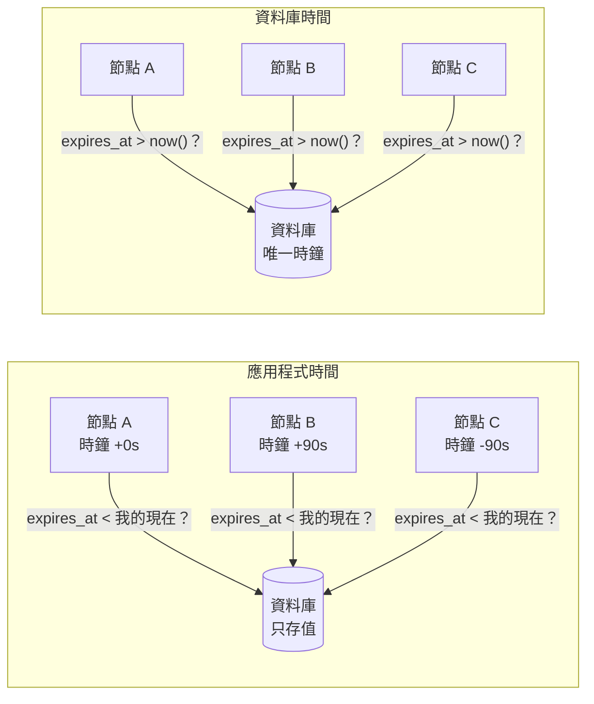

## 先想想

短網址服務 v2 跑在三台 API 節點上。每條短網址有 `expires_at`，節點 A 建立了一條 60 秒後過期的連結。

十秒後，使用者點了這條連結。負載平衡器把請求丟給節點 B，回 `404`。使用者重新整理，這次落到節點 C，回 `302`。

三台機器跑同一份程式碼、連同一個資料庫，資料也沒變。你查了一下，B 的系統時鐘比 A 快了 90 秒。

「現在幾點」到底該聽誰的？要怎麼設計，才能讓這種「同一條連結，有的節點說過期、有的說沒過期」的狀況根本不可能發生？

<details>
<summary>提示</summary>

先問「判斷過期要用到幾個時鐘？」。每多一個時鐘，就多一個可能跟別人不一致的答案。

</details>

## 是什麼

**以資料庫時間作為唯一時鐘**，意思是系統裡所有「現在」的判斷與時間戳，都由資料庫的 `now()` 產生，應用程式不自己讀系統時間、再傳進 SQL。

這不是什麼新工具，只是一條設計規則：時間是一種共享狀態，所以要放在共享狀態的地方。你已經知道「同一個事實只存一份」是正規化的精神，這條規則把它延伸到「現在」這個事實上。

## 為什麼存在

每台機器都有自己的系統時鐘，靠 NTP 之類的服務校準，但校準不是即時、也不是完美的。時鐘漂移（clock drift）與偏移（clock skew）在實務上一定會出現：校時服務掛掉、虛擬機被暫停後恢復、容器所在主機的時鐘被手動調過。

如果「現在」由每個節點各自決定，會出現三種問題：

- **判斷不一致**：先想想裡的情境。同一條連結，快的節點說過期，慢的節點說有效，使用者看到的是隨機的 404。
- **時間戳亂序**：`created_at` 由應用程式寫入，慢 90 秒的節點寫出的資料，看起來比先寫入的資料還早。依 `created_at` 排序、增量同步或除錯時，順序全是錯的。
- **提早或延後失效**：token、優惠券、鎖的租約，只要有效期是用某台節點的時鐘算出來、卻由另一台判斷，就會提早失效或延後失效。

改成讓資料庫給時間之後，所有節點問的是同一台機器的同一個時鐘。它不一定比各節點的時鐘「準」，但它是 **一致** 的：每個人看到同一個「現在」，答案就不會因為連到哪一台而不同。

## 怎麼運作

### 儲存：`timestamptz`，以 UTC 為準

先把時間存對。PostgreSQL 有兩種時間型別：

| 型別 | 存的是什麼 | 讀出來的樣子 |
| --- | --- | --- |
| `timestamp` | 一個沒有時區的「牆上時間」，例如 `2026-11-15 10:00:00` | 永遠是寫入時的數字，不隨 session 時區改變 |
| `timestamptz` | 一個絕對的時間點（內部是 UTC） | 依 session 的 `TimeZone` 設定顯示成對應的牆上時間 |

`timestamptz` 的名字容易誤導：它並不存時區，只是在寫入時把輸入轉成 UTC，讀出時再轉回 session 時區。因為存的是絕對時間點，不同時區的人讀同一列，指的是同一個瞬間。

相反地，`timestamp` 只有數字，沒有「這是哪個時區的數字」。同一個欄位，台北的程式與 UTC 的程式寫進去的值，無法區分，也無法比較。範例用實測驗證這件事：

```go title="clock.go"
// 把 now() 同時存進 timestamp 與 timestamptz，再用不同的 session 時區讀回。
func StoredAs(ctx context.Context, db *sql.DB, writeTZ, readTZ string) (plain, tz float64, err error) {
	// ...
	if _, err = conn.ExecContext(ctx, `INSERT INTO t VALUES (now(), now())`); err != nil {
		return 0, 0, err
	}
	// ...
}
```

```bash
make up
make demo
```

```text
== timestamp 與 timestamptz：UTC 寫入、Asia/Taipei 讀出
兩欄差 -28800 秒（-8.0 小時）
```

同一個瞬間寫入，換一個讀取時區，`timestamp` 欄位就偏了整整 8 小時，`timestamptz` 不受影響。所以規則很簡單：存「某個時間點」的欄位，一律用 `timestamptz`。

### 取值：三種「現在」

PostgreSQL 有三個常用的「現在」，差別在「什麼時候取值」：

| 函式 | 取值時間點 | 在同一個交易內 |
| --- | --- | --- |
| `now()`（等同 `transaction_timestamp()`） | 交易開始的時間 | 不變 |
| `statement_timestamp()` | 目前這條語句開始的時間 | 每條語句更新 |
| `clock_timestamp()` | 呼叫當下的真實時間 | 每次呼叫都不同 |

範例在同一個交易裡，每隔 300 毫秒讀三次：

```go title="clock.go"
// ReadClocks 在同一個交易裡，每隔 gap 讀一次三個時間，共 n 次。
if err := tx.QueryRowContext(ctx,
	`SELECT now(), statement_timestamp(), clock_timestamp()`).
	Scan(&c.TxStart, &c.Statement, &c.Wall); err != nil {
	return nil, err
}
```

```text
第 1 次：now()=+0s  statement=+0s  clock_timestamp()=+0s
第 2 次：now()=+0s  statement=+302ms  clock_timestamp()=+302ms
第 3 次：now()=+0s  statement=+604ms  clock_timestamp()=+604ms
```

大多數業務判斷（過期、建立時間）用 `now()` 就對了。同一個交易裡的所有寫入拿到同一個時間，天然一致。需要量測「這段程式花了多久」才用 `clock_timestamp()`。

### 判斷：把「現在」留在 SQL 裡

規則的核心只有一條：**不要把「現在」從應用程式傳進 SQL**。比較兩種寫法：

```go title="clock.go"
// 應用程式時間：節點自己算 expires_at，讀回來再自己比。
db.ExecContext(ctx,
	`INSERT INTO links (code, expires_at) VALUES ($1, $2)`,
	code, n.Now().Add(ttl))
```

```go title="clock.go"
// 資料庫時間：建立與判斷都在 SQL 裡，應用程式不碰「現在」。
db.ExecContext(ctx,
	`INSERT INTO links (code, expires_at) VALUES ($1, now() + make_interval(secs => $2))`,
	code, ttl.Seconds())

db.QueryRowContext(ctx,
	`SELECT expires_at > now() FROM links WHERE code = $1`, code).Scan(&active)
```

範例用 `Node.Skew` 模擬三台時鐘不同的節點：A 準確、B 快 90 秒、C 慢 90 秒。A 建立一條 60 秒的連結，三台各自判斷：

```text
節點 A（時鐘偏移 0s）：有效=true
節點 B（時鐘偏移 1m30s）：有效=false
節點 C（時鐘偏移 -1m30s）：有效=true
```

換成資料庫時間，`IsActiveDB` 連節點是誰都不需要知道，答案只有一個。

### 狀態：存期限，不存「已過期」

第二個容易踩的做法，是用背景工作定期把過期的列標成 `status = 'expired'`。這個欄位是 **派生值**：它由 `expires_at` 與「現在」決定，卻被存成獨立的事實。背景工作晚跑一分鐘，那一分鐘內就有「已經過期、狀態卻還是 active」的列；背景工作掛掉，過期的連結就永遠有效。

更好的做法是只存 `expires_at`，每次查詢時用 `expires_at > now()` 即時推算。要清掉舊資料時，另外用 `DELETE ... WHERE expires_at < now() - interval '7 days'` 回收空間，但「有沒有效」的判斷不依賴它。

下圖比較兩種設計。左邊每個節點各自讀系統時鐘，右邊所有節點都問資料庫。



左邊三個節點帶著三個不同的「現在」，右邊只有一個。

回到一開始的問題：「現在幾點」聽資料庫的。建立連結時由資料庫寫入 `expires_at = now() + ttl`，判斷時由資料庫比較 `expires_at > now()`，節點自己的時鐘完全不參與。節點 B 的時鐘快 90 秒，也不影響結果，因為它根本沒有被用到。

## 取捨與替代方案

「以資料庫時間為準」不是免費的，也不是唯一的做法：

| 方案 | 優點 | 代價 | 適用情境 |
| --- | --- | --- | --- |
| 資料庫時間（`now()`） | 全部節點一致；判斷可寫成單一 SQL；不用額外元件 | 資料庫時鐘成為單一依據；時間判斷都得進資料庫 | 以資料庫為主的服務：過期、租約、冷卻時間、建立與更新時間 |
| 應用程式時間 | 不需連線就能取得；單機、測試時最方便 | 多節點會漂移；由各節點決定結果 | 單機程式、只在同一個行程內量測耗時 |
| 傳入「現在」（參數注入） | 可以固定時間做測試 | 正式路徑若也傳入各節點的時間，就退回應用程式時間的問題 | 只在測試或重播歷史資料時傳入，正式路徑不傳 |
| 邏輯時鐘（版本號、序號） | 不依賴牆上時間，只關心先後 | 只能表達順序，無法表達「已經過了 60 秒」 | 要比先後而不是時間長短，例如樂觀鎖的 `version` |

用資料庫時間也要面對測試：`now()` 不能直接改成指定值。範例的做法是 **移動資料，而不是移動時鐘**：想測「已過期」，就建立一條 `ttl` 為 `-1s` 的連結（`expires_at` 在過去）；想測「還剩 60 秒」，就建立 60 秒的連結。測試仍然是確定的。

另一個代價是熱點。每次判斷都在資料庫完成，等於讓資料庫多承擔一些計算。不過這個成本通常很小：`expires_at > now()` 是在已經要讀的那一列上多一個比較，不增加往返次數。如果你把短網址快取在 Redis 或 CDN，就要讓快取的 TTL 也來自資料庫：用 `expires_at - now()` 算出剩餘秒數，而不是讓每個節點各自設一個固定值。

**什麼時候不該用**：

- **資料不經過資料庫**：純記憶體的限流、單一行程內的耗時量測，用資料庫時間反而多一次往返，用單調時鐘（Go 的 `time.Since`）更合適。
- **事件時間由客戶端決定**：例如行動 App 離線時記錄的點擊，真正發生的時間在客戶端。此時應該另存 `occurred_at`（客戶端時間，視為不可信的資料），再另存 `received_at`（資料庫 `now()`），兩個都留著。
- **跨多個資料庫要排全域順序**：每個資料庫有自己的時鐘，彼此並不一致。這時需要的是邏輯時鐘或專門的時間服務，不是單一的 `now()`。

## 常見坑與故障案例

### 長交易裡的 `now()` 是凍結的

**症狀**：一個批次工作花了 10 分鐘，結束時寫入的 `updated_at` 卻是 10 分鐘前；或是想用兩次 `now()` 相減量測耗時，結果永遠是 0。

**原因**：`now()` 等同交易開始的時間，同一個交易內每次呼叫都是同一個值。上面範例的輸出已經示範：三次讀取的 `now()` 都是 `+0s`。

**怎麼避免**：業務時間用 `now()`，需要真實流逝的時間就用 `clock_timestamp()`。另外，長交易本身也值得避免，它會持有鎖與連線（見[資料庫鎖](/backend/l2/2-2-database/database-locks/)）。

### 把 Go 的 `time.Now()` 當參數傳進 SQL

**症狀**：單機測試全部通過，上線後多節點偶爾出現「這個連結剛建立就過期」或「已經過期卻還能用」，無法穩定重現。

**原因**：`time.Now().Add(ttl)` 看起來無害，卻讓寫入端的時鐘決定了 `expires_at`。判斷端若用的是另一台節點的時鐘，兩者之間的偏移就直接變成錯誤。這個問題在單機環境完全不會出現，所以測試測不到。

**怎麼避免**：程式碼審查時，把「SQL 參數裡出現 `time.Now()`」當成警訊。需要「現在」就寫 `now()`，需要偏移就寫 `now() + make_interval(...)`。

### 用 `timestamp`（不帶時區）存時間點

**症狀**：資料庫換了時區設定、報表換了一個語言的 driver，或是第一次有海外使用者，時間忽然全部差了幾個小時。

**原因**：`timestamp` 只存數字，不記錄那個數字屬於哪個時區。寫入端與讀取端對時區的假設一旦不一致，值就悄悄偏掉，也沒有錯誤訊息。範例中同一個 `now()`，換個讀取時區，兩欄差了 8 小時。

**怎麼避免**：時間點一律用 `timestamptz`。`timestamp` 只留給「本來就沒有時區」的資料，例如「每天早上 9 點的營業時間」。

### 把狀態存成欄位，而不是由期限推算

**症狀**：使用者回報「連結明明過期了還能點」，或剛好相反。檢查資料庫發現 `status` 欄位與 `expires_at` 對不起來。

**原因**：`status = 'expired'` 要靠背景工作寫入，而背景工作可能延遲、失敗或被多個節點重複執行。派生值被存成獨立的事實，就會有和來源不同步的時刻。

**怎麼避免**：只存 `expires_at`，用 `expires_at > now()` 即時推算。真的需要索引加速，就在 `expires_at` 上建索引。

### 讀副本上的 `now()` 是副本自己的時鐘

**症狀**：寫入走主庫、讀取走讀副本的架構中，剛續期的連結，在副本上看到的還是舊的 `expires_at`；或是主庫與副本時鐘有偏差時，判斷結果和主庫不同。

**原因**：「資料庫時間」指的是 **你連到的那一台** 資料庫的時鐘。每台伺服器都有自己的系統時鐘，副本也不例外。另外，副本是非同步複寫，有延遲，讀到的資料可能是稍早的版本。

**怎麼避免**：對時間敏感的判斷（有沒有過期、能不能續期）走主庫，讓整個系統只有一個時鐘；或確保主庫與副本都有可靠的 NTP，並接受副本讀取的延遲。這是這條規則真正的邊界：資料庫時間是 **一致**，不是 **絕對準確**。

### 案例：2017 年閏秒讓 Cloudflare DNS 出錯

Cloudflare 在 2017 年 1 月 1 日遇到閏秒，他們的 DNS 元件用 Go 的 `time.Now()` 相減算出一段時間，閏秒讓時鐘倒退，相減得到負值，這個負值又被傳進隨機數函式，導致 panic，部分 DNS 請求失敗。事後 Cloudflare 公開了完整的檢討（見延伸閱讀）。Go 後來在 1.9 之後讓 `time.Now()` 帶上單調時鐘讀數，`time.Since` 這類相減不再受牆上時鐘倒退影響。

這個案例要提醒的是：牆上時鐘會倒退、會跳動，不能假設它單調前進。量測「經過多久」用單調時鐘；判斷「現在幾點」用單一來源。兩者是不同的事。

## 小練習

範例目錄：`playground/backend/l2/2-2-database/db-clock/`。先跑 `make up` 與 `make demo`，看過四個實驗的輸出。

### 動手寫：讓續期只聽資料庫的

`exercise/renew.go` 的 `Renew` 要為還沒過期的短網址續期。目前它用的是 `LocalSkew` 模擬的「快 90 秒的本機時鐘」，所以還剩 60 秒的連結會被誤判成已過期。

請改寫 `Renew`，讓它完全不碰本機時鐘：

- 還有效的連結，`expires_at` 被更新為「資料庫的現在 + `ttl`」。
- 已過期的連結回傳 `dbclock.ErrExpired`。
- 不存在的連結回傳 `dbclock.ErrNotFound`。

```bash
make exercise
```

`TestRenew` 通過就完成。起始狀態下它會失敗。

<details>
<summary>參考解答</summary>

最好把「有效才更新」寫成一條語句，而不是先讀、再比、再寫。這樣判斷與更新發生在同一個瞬間，中間不會有別人插進來：

```go title="renew.go"
res, err := db.ExecContext(ctx,
	`UPDATE links SET expires_at = now() + make_interval(secs => $2)
	 WHERE code = $1 AND expires_at > now()`, code, ttl.Seconds())
if err != nil {
	return err
}
n, err := res.RowsAffected()
if err != nil {
	return err
}
if n == 1 {
	return nil
}
```

影響列數為 0 時，要分辨是「不存在」還是「已過期」，再多查一次 `SELECT EXISTS (SELECT 1 FROM links WHERE code = $1)`：不存在回 `ErrNotFound`，存在就回 `ErrExpired`。

</details>

### 辨識

下面是 AI 產生的程式，包含「建立短網址」、「查詢」與「清掉過期短網址」，資料庫是 PostgreSQL，有三台 API 節點。請做 code review，找出 3 個與本文主題相關的問題。

```go title="handler.go"
// AI 產生：建立短網址、查詢，以及每分鐘由每台節點執行的清理
func (s *Server) Create(ctx context.Context, code string, ttl time.Duration) error {
	_, err := s.db.ExecContext(ctx,
		`INSERT INTO links (code, expires_at) VALUES ($1, $2)`,
		code, time.Now().Add(ttl))
	return err
}

func (s *Server) Sweep(ctx context.Context) error {
	_, err := s.db.ExecContext(ctx,
		`UPDATE links SET status = 'expired' WHERE expires_at < $1 AND status = 'active'`,
		time.Now())
	return err
}

func (s *Server) Audit(ctx context.Context) (time.Duration, error) {
	tx, err := s.db.BeginTx(ctx, nil)
	// ...
	var started time.Time
	if err := tx.QueryRowContext(ctx, `SELECT now()`).Scan(&started); err != nil {
		return 0, err
	}
	// ... 逐批掃描 ...
	var finished time.Time
	if err := tx.QueryRowContext(ctx, `SELECT now()`).Scan(&finished); err != nil {
		return 0, err
	}
	return finished.Sub(started), tx.Commit()
}
```

完整程式與資料表定義在 `recognize/handler.go`。

<details>
<summary>參考解答</summary>

1. **`Create` 與 `Sweep` 把 `time.Now()` 傳進 SQL**：`expires_at` 由寫入節點的時鐘決定，`Sweep` 又用執行節點的時鐘去比。三台節點的偏移直接變成提早或延後過期。應改成 `now() + make_interval(secs => $2)` 與 `expires_at < now()`。
2. **`status` 是派生值，卻被存成欄位**：連結過期後，要等某一台節點的 `Sweep` 跑過才會變成 `expired`。`Sweep` 延遲或失敗時，過期的連結仍然可以用。應移除 `status`，查詢時用 `expires_at > now()` 推算；需要清資料時另外刪除，但不影響有效性判斷。
3. **`Audit` 在交易裡用兩次 `now()` 量測耗時**：同一個交易內 `now()` 是同一個值，`finished.Sub(started)` 永遠是 0。要量測流逝的時間，應該用 `clock_timestamp()`，或在 Go 裡用 `time.Since`。

前兩點對應「判斷」與「狀態」，最後一點對應「取值」的差異。

</details>

## 快閃卡

<details>
<summary>什麼叫「以資料庫時間作為唯一時鐘」？它保證的是準確還是一致？</summary>

所有「現在」的判斷與時間戳都由資料庫的 `now()` 產生，應用程式不自己讀系統時間再傳進 SQL。它保證的是一致：所有節點看到同一個「現在」，但這個時鐘不一定比別台準。

</details>

<details>
<summary>三台 API 節點用各自的 time.Now() 判斷同一條連結是否過期，為什麼可能得到不同答案？</summary>

每台機器的系統時鐘都靠校時服務校準，但校準不是即時也不完美，節點之間會有偏移。同一個 `expires_at` 對上不同的「現在」，比較結果就不同。換成資料庫的 `now()`，所有節點用的是同一個時鐘。

</details>

<details>
<summary>PostgreSQL 的 timestamp 與 timestamptz 差在哪裡？存「某個時間點」該用哪一個？</summary>

`timestamp` 只存一個沒有時區的牆上時間，`timestamptz` 存的是絕對時間點（內部為 UTC），讀出時依 session 時區顯示。時間點該用 `timestamptz`，因為 `timestamp` 在讀寫端時區不一致時會悄悄偏掉，且沒有錯誤。

</details>

<details>
<summary>同一個交易裡先 SELECT now()、等三秒、再 SELECT now()，兩次結果會一樣嗎？想量測這三秒該用什麼？</summary>

會一樣。`now()` 是交易開始的時間，交易內不變。要量測真實流逝的時間，用 `clock_timestamp()`；`statement_timestamp()` 則是每條語句開始時更新。

</details>

<details>
<summary>有人在 Go 裡寫 db.Exec("INSERT ... VALUES ($1, $2)", code, time.Now().Add(ttl))，單機測試都通過，上線多節點後偶爾出錯。原因與修法是什麼？</summary>

`expires_at` 由寫入節點的時鐘決定，判斷的節點若是時鐘不同的另一台，偏移就變成錯誤；單機只有一個時鐘，所以測不到。修法是把運算留在 SQL 裡：`now() + make_interval(secs => $2)`。

</details>

<details>
<summary>為什麼不該用背景工作把過期的列標成 status = 'expired'，而是只存 expires_at、查詢時推算？</summary>

`status` 是由 `expires_at` 與現在決定的派生值，卻被存成獨立事實。背景工作延遲或失敗時，它與真實狀態就不同步，過期的連結仍可用。只存期限、用 `expires_at > now()` 推算，沒有可以不同步的第二份資料。

</details>

<details>
<summary>寫入走主庫、讀取走讀副本時，對時間敏感的判斷（例如能不能續期）該走哪裡？為什麼？</summary>

走主庫。每台資料庫伺服器都有自己的系統時鐘，副本的 `now()` 是副本自己的時間，另外副本還可能有複寫延遲。時間敏感的判斷走主庫，才能讓整個系統只有一個時鐘。

</details>

<details>
<summary>要測試「已過期」的情境，但 now() 不能直接改成指定值，要怎麼寫確定性的測試？</summary>

移動資料，而不是移動時鐘：建立 `ttl` 為負值的連結（`expires_at` 已在過去）表示已過期，建立 60 秒的連結表示還有效。這樣不必改動資料庫的時間，測試仍然確定。

</details>

## 延伸閱讀

- [PostgreSQL：Date/Time Functions and Operators](https://www.postgresql.org/docs/16/functions-datetime.html)：`now()`、`statement_timestamp()`、`clock_timestamp()` 的官方定義，包含「現在」的取值時間點
- [PostgreSQL：Date/Time Types](https://www.postgresql.org/docs/16/datatype-datetime.html)：`timestamp` 與 `timestamptz` 的儲存與時區轉換規則
- [PostgreSQL Wiki：Don't Do This](https://wiki.postgresql.org/wiki/Don't_Do_This)：社群整理的常見錯誤，包含不要用 `timestamp` 存時間點
- [How and why the leap second affected Cloudflare DNS](https://blog.cloudflare.com/how-and-why-the-leap-second-affected-cloudflare-dns/)：2017 年閏秒事故的完整檢討
- [Designing Data-Intensive Applications](https://dataintensive.net/)：第 8 章〈The Trouble with Distributed Systems〉討論不可靠的時鐘與為什麼不能信任牆上時間
