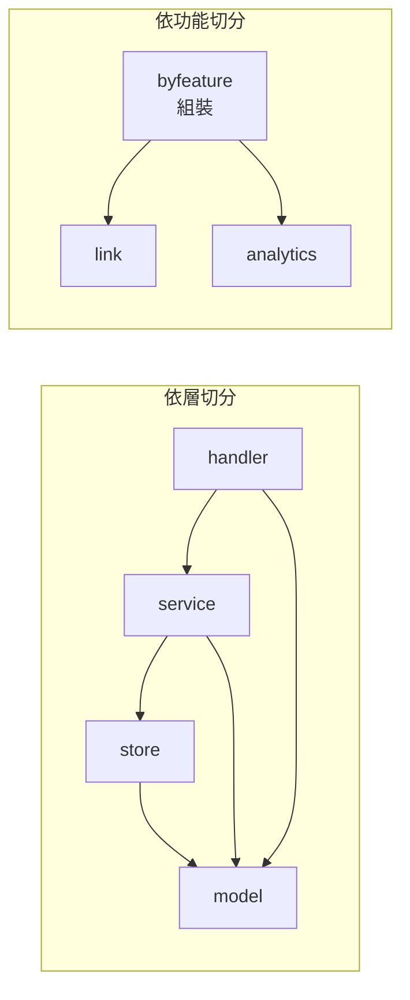

## 先想想

短網址服務 v2 的程式碼長這樣：`handler/`、`service/`、`store/`、`model/` 四個資料夾，每個都放著「連結」和「點擊統計」兩種功能的程式碼。下一步是 v3：拆成寫入、讀取、分析三個服務。

同事接了一個小需求：「連結加上到期時間，過期就回 404」。他的 PR 動到三個資料夾。另一位同事做分析報表時，為了拿到每個連結的網址，直接呼叫了 `store.LinkStore.Get`，繞過了 service 裡的到期判斷，報表上出現已過期的連結。

現在要拆服務了。你打開 `store/`，裡面混著連結和點擊的程式碼，彼此互相呼叫。哪些檔案屬於「分析服務」？為什麼一開始的資料夾結構，會讓這兩件事（改一個功能動四個資料夾、別人能繞過規則）都這麼容易發生？

<details>
<summary>提示</summary>

想想 Go 的可見性是以什麼為單位：檔案、資料夾，還是整個模組？`store` 和 `service` 在不同資料夾時，`LinkStore` 必須是大寫還是小寫？

</details>

## 是什麼

**套件切法** 是決定程式碼目錄第一層該依什麼分組的選擇。**依層切分（package by layer）** 依技術角色分：所有 handler 放一起、所有資料存取放一起。**依功能切分（package by feature）** 依業務功能分：一個功能需要的 handler、邏輯、資料存取都放在同一個套件裡。

兩者差的是「第一層」。依功能切分的套件裡仍然有分層，只是分層退到套件內部，用檔案或型別來分，而不是用資料夾。在 Go 裡，這個選擇的影響比在其他語言更大，因為 Go 的可見性只認套件：首字母小寫的名字，同一個套件裡的所有檔案都看得到，套件外完全看不到。

## 為什麼存在

先看依層切分的短網址服務。範例裡 `bylayer/` 有四個套件：

```text
bylayer/
├── model/     Link、Click、Count
├── store/     LinkStore、ClickStore
├── service/   LinkService、StatsService
└── handler/   LinkHandler、StatsHandler
```

因為 `service` 要呼叫 `store`、`handler` 要呼叫 `service`，所有跨資料夾使用的東西都得大寫匯出。用 `go doc -short` 數一下：這四個套件一共匯出 12 個頂層名字，其中包括 `LinkStore.Save`、`ClickStore.Add`，以及 `LinkService.Links` 這種直接指向儲存層的公開欄位。換句話說，程式裡任何一個套件都能跳過 service，直接寫入連結資料。

依功能切分的版本 `byfeature/` 只有兩個功能套件：`link` 與 `analytics`，加起來匯出 8 個頂層名字。差別不在數字本身，而在「誰能碰到資料」：`link` 的儲存結構是小寫的 `store`，套件外沒有任何路徑能繞過 `Service.Resolve` 去讀寫那張表。到期判斷寫在 `Resolve` 裡，就只能經過 `Resolve`。

改動範圍也不同。以「加到期時間」為例：依層切分要改 `model`（加欄位）、`service`（加判斷）、`handler`（接收參數）三個資料夾；依功能切分只動 `link` 一個。三個資料夾本身不可怕，問題是每個資料夾同時屬於所有功能，review 時很難判斷一個 diff 會影響誰。

## 怎麼運作

:::note
本篇的範例在 `playground/backend/l3/3-3-service-architecture/package-slicing/`。`bylayer/` 是依層切分版，`byfeature/` 是依功能切分版，兩者行為相同，測試都會通過。
:::

### 兩種切法的依賴方向



看箭頭的數量：依層切分時每一層都依賴下一層，也都依賴 `model`；依功能切分時，`link` 和 `analytics` 互不相識，只有組裝它們的那一層知道兩者存在。

### 一個功能一個套件，用檔案分層

依功能切分在 Go 的慣用寫法，是一個功能一個套件，套件內用檔案區分角色：

```text
byfeature/
├── wire.go           組裝：唯一同時認識 link 與 analytics 的地方
├── link/
│   ├── link.go       Link、Service、store（小寫）、ClickRecorder
│   └── http.go       Routes 與 handler
└── analytics/
    ├── analytics.go  Recorder、Count
    └── http.go       Routes 與 handler
```

`link.go` 裡的儲存結構是小寫，只有 `Service` 和它的方法是對外的：

```go title="link.go"
// ClickRecorder is defined here, by the code that needs it, so that
// link never imports analytics. main wires in the real implementation.
type ClickRecorder interface {
	Record(code string)
}

// store is unexported: nothing outside this package can touch the map.
type store struct {
	mu    sync.RWMutex
	links map[string]Link
}

type Service struct {
	links  store
	clicks ClickRecorder
}
```

注意命名：套件叫 `link`，型別就叫 `Service`，呼叫端寫成 `link.Service`、`link.New`。如果寫成 `link.LinkService`，名稱重複了一次，Go 的慣例（見延伸閱讀的 Package names）不鼓勵這種寫法。依層切分做不到這點，`service.LinkService` 和 `service.StatsService` 擠在同一個套件裡，只能靠前綴區分。

### 依功能切分的頭號問題：import 循環

功能之間難免要互相合作。轉址時要記一次點擊，所以 `link` 想呼叫 `analytics`；分析報表想顯示網址，所以 `analytics` 想呼叫 `link`。兩邊都直接 import，Go 會拒絕編譯：

```text
package x/a
	imports x/b from a.go
	imports x/a from b.go: import cycle not allowed
```

**import 循環（import cycle）** 是 Go 編譯器強制的規則：套件之間的依賴必須是單向的。依層切分很少撞到它，因為層與層天生單向（handler → service → store）。依功能切分時，功能之間沒有天生的上下關係，方向要你自己決定。

解法有三種，依偏好排序：

1. **由使用方定義介面**。`link` 需要「記錄點擊」這個能力，就在 `link` 裡宣告 `ClickRecorder`。`analytics.Recorder` 剛好有 `Record(code string)` 方法，Go 的介面是隱式滿足的，所以 `analytics` 不必 import `link`，`link` 也不必 import `analytics`。
2. **選一個方向**。如果 `analytics` 確實需要 `link` 的資料，就讓 `analytics` import `link`，而 `link` 只透過介面往外講話。方向通常是「下游依賴上游」：分析依賴連結，連結不需要知道分析存在。
3. **把共用的型別往下抽一層**。兩個功能都需要同一個型別，而且它真的是兩邊共有的概念，才抽成一個新套件。這一步最容易做過頭，見下一節的 `common`。

組裝發生在最外層：

```go title="wire.go"
func NewMux() *http.ServeMux {
	clicks := analytics.New()
	links := link.New(clicks) // *analytics.Recorder satisfies link.ClickRecorder

	mux := http.NewServeMux()
	clicks.Routes(mux)
	links.Routes(mux)
	return mux
}
```

`wire.go` 是唯一同時認識兩個功能的地方。之後拆成讀取服務與分析服務時，`ClickRecorder` 的實作會從「呼叫記憶體裡的 `Recorder`」換成「把點擊事件送進佇列」，`link` 本身一行都不用改。

### 功能內要不要再拆子套件

其他語言常見「外層依功能、內層依層」：`order/api`、`order/domain`、`order/infrastructure`。在 Go 裡，這三個子資料夾是三個獨立的套件。`api` 要呼叫 `domain`，`domain` 的東西就得大寫匯出，而大寫匯出的東西整個模組都看得到。依功能切分換來的封裝，被子套件抵銷了一大半。

所以 Go 的建議順序是：先一個功能一個套件，用 `link.go`、`http.go`、`store.go` 這樣的檔案分層。等某個功能大到一個套件裝不下（例如單一套件超過幾千行、或內部有明確可以獨立測試的子領域），再往下拆，並用 `internal/` 限制誰能 import 它。功能內部要怎麼分層、依賴該朝哪個方向，是本節「乾淨架構與六角架構」的主題；`internal/` 與模組邊界的自動檢查，留到本節「Go 模組化單體實作」。

### 共用程式碼放哪裡

依功能切分最常見的退化，是開一個 `common`、`shared` 或 `utils` 套件，把「不知道放哪」的東西都丟進去。Go 官方的 Package names 文章直接點名這類名稱：套件名應該說明它提供什麼，而 `util` 什麼都沒說。

實務上的判斷方式：

- 只有一個功能用到：放回那個功能的套件，小寫。
- 兩個功能用到，但其實是同一個概念的兩種用途：通常代表邊界切錯了，先檢查是不是該合成一個功能。
- 真的是通用能力：取一個說明能力的名字，例如 `shorturl/codegen`（產生短碼）、`httpx/jsonresp`（寫 JSON 回應），而不是 `common`。

### 從依層搬到依功能

如果你手上是像 `bylayer/` 這樣的專案，不必一次重寫。一次搬一個功能：

1. 選一個依賴最少的功能（範例裡是 `analytics`），開一個新套件。
2. 把它在 `model`、`store`、`service`、`handler` 裡的程式碼搬進去，對外只留建構函式、`Service` 與路由。
3. 編譯。如果出現 `import cycle not allowed`，找出循環的那條邊，在使用方定義介面，把具體實作的依賴移到組裝層。
4. 把搬過去後只剩這個功能在用的東西改成小寫，再跑一次測試。
5. 舊資料夾清空了就刪掉，換下一個功能。

每一步都是一個可以單獨合併的 PR。搬移期間兩種結構並存是正常的，只要依賴方向是「舊的依賴新的」，不要反過來。

### 該依什麼判斷

「專案小用依層、專案大用依功能」只說對一半。更可靠的判斷是看改動模式：打開最近 20 個 PR，數一數每個 PR 動到幾個資料夾。如果大部分 PR 都跨了三、四個層資料夾，代表最常一起改的程式碼被分散了，這就是依功能切分要解決的問題。反過來，如果多數改動都集中在單一層（例如一直在換資料庫存取方式），依層切分反而貼近實際。

回到一開始的問題：Go 的可見性以套件為單位，而依層切分讓 `store` 和 `service` 成為不同套件，`LinkStore` 只能大寫匯出，任何人都能繞過 service 裡的到期判斷，這就是報表出現過期連結的原因。同一個功能的程式碼又被拆在四個套件裡，所以「加到期時間」要動多個資料夾，拆服務時也很難指出哪些檔案屬於分析服務。改成依功能切分後，連結的儲存結構變成小寫，到期判斷只能經過 `link.Service`；`link` 與 `analytics` 互不 import，`analytics` 這個資料夾就是未來的分析服務。

## 取捨與替代方案

| 方案 | 優點 | 代價 | 適用情境 |
| --- | --- | --- | --- |
| 依層切分 | 直覺、框架教學多用此結構；依賴天生單向，不會撞到 import 循環 | 跨層的東西都要匯出，封裝弱；一個功能散在多個資料夾 | 功能少、以 CRUD 為主、改動多半集中在單一層 |
| 依功能切分，一功能一套件 | 可用小寫名字真正封裝；改動集中；資料夾即未來的服務邊界 | 要自己決定功能間的依賴方向；切錯邊界時功能互相糾纏 | 功能會持續增加、多人協作、預期日後拆服務 |
| 依功能切分，功能內再依層拆子套件 | 大功能內部結構清楚 | 子套件之間又得匯出，封裝效果打折；套件數變多 | 單一功能已大到一個套件裝不下 |
| 依能力切分（如 `net/http`、`encoding/json`） | 每個套件提供一種清楚的能力，容易重用 | 不直接對應業務功能，應用程式碼仍要決定業務怎麼組織 | 函式庫、基礎元件 |

各語言與框架的預設立場不同，這會影響你在其他專案看到的結構：

| 語言或框架 | 預設偏向 | 備註 |
| --- | --- | --- |
| Ruby on Rails | 依層 | `app/models`、`app/controllers`；Shopify 用 Packwerk 往依領域分組調整 |
| Spring（早期教學） | 依層 | Spring Modulith 以頂層套件為模組，偏向依功能 |
| .NET Clean Architecture 範本 | 依層（以 project 分） | 另有 Vertical Slice Architecture，偏向依功能 |
| Django | 依功能 | 每個 app 有自己的 models、views |
| NestJS、Angular | 依功能 | 以 module 為單位 |
| Phoenix（Elixir） | 依功能 | Contexts 依業務領域分組 |
| Go | 依功能或依能力 | 可見性以套件為單位；`models`、`utils` 被視為反模式 |

框架給的是起點，不是終點。規模變大之後，很多團隊會改成依功能分組，但這是趨勢，不是每個團隊都會走到同一個結構；也有團隊長期維持依層切分而運作良好。

什麼時候不該用依功能切分：

- 功能邊界還看不清楚時。產品剛起步、需求每週大改，你今天切的 `link` 和 `analytics` 下個月可能要合併。邊界切錯的成本，比依層切分的不便更高。
- 程式碼本質上是一個管線，而不是一組功能。例如一個只做「讀檔、轉換、寫出」的批次工具，每一層都只有一種實作，依功能切分沒有東西可以切。
- 團隊依技術專長分工，而且短期內不會變。依功能切分讓 `CODEOWNERS` 能依功能指派負責人；如果團隊本來就是「資料庫組」「API 組」，依層切分的 `CODEOWNERS` 反而比較貼近實際分工。

## 常見坑與故障案例

### 功能之間直接讀對方的儲存結構

症狀：分析報表出現已停用或過期的連結；連結的資料表改了欄位名稱，分析功能跟著壞掉。

原因：`analytics` 直接 import `link` 並讀取它的 store，繞過了 `link.Service` 裡的規則。在 Go 裡能這樣做，代表 store 被大寫匯出了。

修正：把 store 改成小寫，`analytics` 需要的資料，由 `link` 提供一個方法（或由 `analytics` 定義介面），讓規則只存在一個地方。

### `common` 套件變成雜物間

症狀：`common` 裡有 `models.go`、`utils.go`、`constants.go`，每個功能都 import 它；改 `common` 裡任何一個型別，所有功能都要重新編譯、重新測試。

原因：「兩個地方都用到」就往 `common` 丟，沒有判斷它是不是真的通用。

修正：照前面「共用程式碼放哪裡」的三條規則，把只有一個功能用的東西搬回去，真正通用的東西改成依能力命名的小套件。

### 為了避開 import 循環而合併功能

症狀：`link` 和 `analytics` 撞到 `import cycle not allowed`，有人把兩個套件合成一個 `core`，問題消失，但 `core` 越長越大。

原因：循環代表依賴方向沒有設計，合併只是把問題藏起來。

修正：找出循環的那條邊，在使用方定義介面，具體實作在組裝層注入。合併只在兩個功能確實是同一個概念時才做。

### 以為 `internal/` 只有父套件能用

症狀：把 `link/internal/codegen` 放好後，以為只有 `link` 能 import 它，結果 `link/admin` 也 import 了，規則沒擋。

原因：Go 的規則是「以 `internal` 的上一層目錄為根的整棵子樹」都能 import。`link/internal/codegen` 可以被 `link` 以及 `link/` 底下的任何套件使用，不只 `link` 本身。子樹以外的套件 import 時才會得到：

```text
r/r.go:3:8: use of internal package x/p/internal/q not allowed
```

修正：把 `internal/` 放在你真正想要的邊界上。細節在本節的「Go 模組化單體實作」。

### 真實案例：Shopify 的 Packwerk

Shopify 的 Rails 單體原本是依層切分，他們後來把程式碼依業務領域分成元件，並開發了 Packwerk 檢查元件之間的依賴與私有 API 的使用。

這個案例常被當成單純的成功故事引用，但 Shopify 在 2024 年初發表的回顧文章結論是好壞參半：

- 既有的違規記在 `package_todo.yml` 裡先放行，這份清單隨著每個新功能越長越大。文章的結論是，工具找出問題的速度遠快於團隊修掉它們的速度。
- 隱私檢查（禁止使用其他元件的私有常數）讓 Packwerk 變成了它原本不打算成為的「API 設計工具」，Packwerk 3.0 把它從核心移除，另由 `packwerk-extensions` 提供。
- 原本的依賴方向檢查則仍被認為有用，能擋住新的依賴長進底層。

教訓：資料夾結構和檢查工具只能讓違規「被看見」，邊界有沒有守住，取決於團隊是否把修正違規當成正式工作。

## 小練習

### 練習 1：切斷 `link` 對 `analytics` 的依賴

`playground/backend/l3/3-3-service-architecture/package-slicing/exercise/` 裡有一個依功能切分、但邊界沒守好的版本：`link` 直接 import `analytics`，而且匯出了 `Store` 型別與 `Service` 的欄位。分析團隊接下來要在 `analytics` 裡 import `link` 取得網址，到時就會形成 import 循環。

目標：

- `link` 不再 import `analytics`。
- 不再有名為 `Store` 的匯出型別，`Service` 沒有匯出的欄位。
- `link.New` 接受任何有 `Record(code string)` 方法的值。

驗證：

```bash
go test -tags exercise ./exercise/...
```

一開始測試會編譯失敗，因為測試傳入的是假的 recorder。改完後兩個測試都會通過。

<details>
<summary>參考解答</summary>

在 `link` 裡定義介面，把 store 改成小寫，欄位全改小寫：

```go title="link.go"
type ClickRecorder interface{ Record(code string) }

type store struct {
	mu    sync.RWMutex
	links map[string]string
}

type Service struct {
	store  *store
	clicks ClickRecorder
}

func New(clicks ClickRecorder) *Service {
	return &Service{store: &store{links: map[string]string{}}, clicks: clicks}
}
```

`Create` 與 `Resolve` 改用 `s.store.mu`、`s.store.links`。`analytics.Recorder` 已經有 `Record(code string)`，不用改它，組裝時直接傳 `analytics.New()` 進去即可。

</details>

### 辨識

下面是 AI 產生的分析報表程式碼，要在報表上顯示每個熱門連結的網址。專案依功能切分，有 `link`、`analytics` 兩個功能套件。請做 code review，找出違反本篇原則的地方。

```go title="report.go"
package analytics

import (
	"sort"

	"handbook/playground/backend/package-slicing/recognize/common"
	"handbook/playground/backend/package-slicing/recognize/link"
)

type Report struct {
	Links  *link.Store
	Clicks *ClickStore
}

func (r *Report) Top(n int) []common.LinkStat {
	totals := map[string]int{}
	for _, c := range r.Clicks.All() {
		totals[c.Code]++
	}
	out := make([]common.LinkStat, 0, len(totals))
	for code, total := range totals {
		l, ok := r.Links.Rows[code]
		if !ok {
			continue
		}
		out = append(out, common.LinkStat{
			Code:  code,
			URL:   common.NormalizeURL(l.URL),
			Total: total,
		})
	}
	sort.Slice(out, func(i, j int) bool { return out[i].Total > out[j].Total })
	return out[:min(n, len(out))]
}
```

<details>
<summary>參考解答</summary>

1. `Links *link.Store` 與 `r.Links.Rows[code]`：直接讀 `link` 的儲存結構。後果有三個：繞過 `link.Service` 裡的規則（例如過期判斷），報表會出現不該出現的連結；沒有拿 `link` 內部的鎖就讀 map，和寫入同時發生時會觸發 data race，甚至讓程式 panic；`link` 改儲存方式時 `analytics` 會跟著壞。正確做法是 `link` 的 store 保持小寫，`analytics` 自己定義需要的介面，例如 `type URLLookup interface{ URL(code string) (string, error) }`，由 `link.Service` 實作、在組裝層注入。
2. `common.LinkStat` 與 `common.NormalizeURL`：`common` 是沒有說明能力的雜物間。`LinkStat` 只有分析報表用到，應該放回 `analytics`；`NormalizeURL` 是連結的規則，應該在 `link` 存入時就完成，而不是讓每個讀取方各自正規化一次。
3. 這段程式本身能編譯，但 `analytics` import 了 `link`。只要 `link` 哪天為了記錄點擊而 import `analytics`，就會變成 import 循環。用第 1 點的介面解法，兩個套件就互不 import。

</details>

## 快閃卡

<details>
<summary>依層切分和依功能切分的差別在哪一層？</summary>

差在目錄的第一層。依層切分第一層是技術角色（handler、service、store），依功能切分第一層是業務功能（link、analytics），分層退到功能套件內部。

</details>

<details>
<summary>為什麼在 Go 裡，依層切分會讓封裝變弱？</summary>

Go 的可見性以套件為單位。store 和 service 在不同套件時，service 要用的東西都必須大寫匯出，而大寫的名字整個程式都能用，任何套件都能繞過 service 直接改資料。

</details>

<details>
<summary>套件 link 裡的型別叫 LinkService，這樣命名有什麼問題？</summary>

呼叫端會寫成 link.LinkService，名稱重複了一次。Go 慣例會讓套件名當作前綴，型別直接叫 Service，呼叫端寫 link.Service。

</details>

<details>
<summary>link 要記錄點擊，analytics 要查網址，兩邊都直接 import 對方，會發生什麼事？</summary>

編譯失敗，錯誤是 import cycle not allowed。Go 要求套件依賴是單向的，依功能切分時功能之間沒有天生的上下關係，必須自己決定方向。

</details>

<details>
<summary>在 Go 裡，打破兩個功能套件之間的 import 循環，首選做法是什麼？</summary>

由使用方定義介面。例如 link 宣告 ClickRecorder，analytics.Recorder 隱式滿足它，在最外層的組裝程式把實作傳進去，兩個套件就不必互相 import。

</details>

<details>
<summary>為什麼 Go 不建議一開始就把功能拆成 order/api、order/domain 這類子套件？</summary>

每個子資料夾都是獨立套件，彼此呼叫又得大寫匯出，依功能切分換來的封裝被抵銷。建議先一個功能一個套件、用檔案分層，大到裝不下再拆。

</details>

<details>
<summary>專案裡有 common/models.go，所有功能都 import 它。這可能帶來什麼問題？</summary>

common 變成雜物間，所有功能都依賴它，改任何一個型別都會影響所有功能。只有一個功能用的東西應該搬回該功能，真正通用的東西要用說明能力的名字。

</details>

<details>
<summary>link/internal/codegen 可以被 link/admin import 嗎？</summary>

可以。Go 允許以 internal 上一層目錄（這裡是 link/）為根的整棵子樹 import 它，不只 link 本身；子樹以外的套件才會被擋下。

</details>

<details>
<summary>怎麼用既有資料判斷專案該不該改成依功能切分？</summary>

看改動模式：翻最近的 PR，數每個 PR 動到幾個層資料夾。多數 PR 都跨好幾層，代表最常一起改的程式碼被分散了，依功能切分能把它們收在一起。

</details>

## 延伸閱讀

- [Organizing a Go module](https://go.dev/doc/modules/layout)：Go 官方的模組結構建議，涵蓋 `internal/` 與多套件專案。常被引用的 golang-standards/project-layout 並不是官方文件。
- [Package names](https://go.dev/blog/package-names)：Go 官方部落格，說明套件命名、避免名稱重複，以及為什麼 `util`、`common` 是壞名字。
- [Internal Directories（cmd/go 文件）](https://pkg.go.dev/cmd/go#hdr-Internal_Directories)：`internal/` 可見範圍的正式規則。
- [A Packwerk Retrospective](https://shopify.engineering/a-packwerk-retrospective)：Shopify 回顧用工具強制模組邊界的成效與教訓。
- [Spring Modulith](https://docs.spring.io/spring-modulith/reference/)：Java 生態以頂層套件為模組、並自動驗證依賴的做法，可對照 Go 的 `internal/`。
