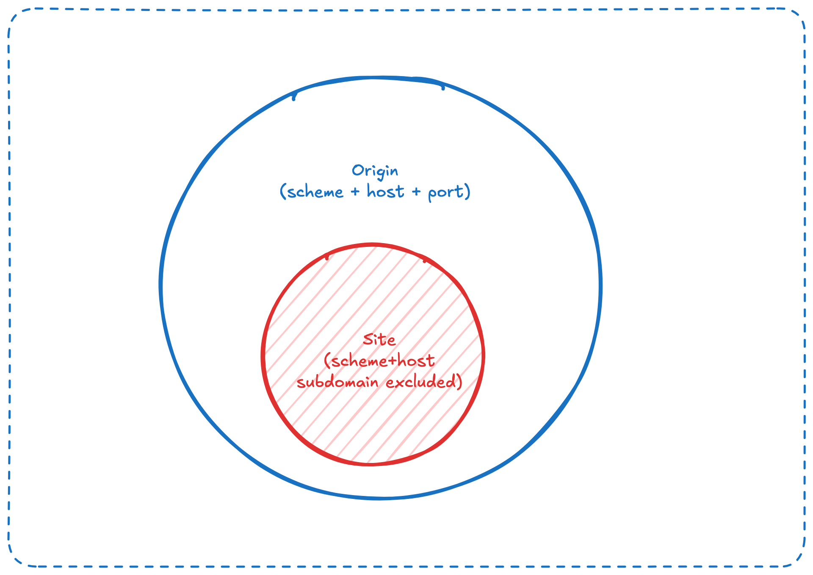

## 先想想

你已經登入短網址服務的管理頁 `https://sho.rt/admin`。頁面用 JavaScript 呼叫 `https://sho.rt/api/links`，伺服器靠瀏覽器自動帶上的 Cookie 認出你，回傳你的私人短網址清單。

接著你在另一個分頁打開了 `https://evil.example`。這個網頁的 JavaScript 也執行了一行 `fetch("https://sho.rt/api/links")`。瀏覽器同樣會帶上你在 `sho.rt` 的 Cookie。

是什麼東西阻止 `evil.example` 讀到你的清單？更進一步：這個請求到底有沒有送到 `sho.rt` 的伺服器？

<details><summary>提示</summary>

把「送出請求」和「讀到回應」當成兩件事來想。

</details>

## 是什麼

**同源政策（same-origin policy）** 是瀏覽器的一條安全規則：一個網頁上的程式，預設不能讀取另一個 origin 的資料。

這裡的 **origin** 由網址的三個部分組成：scheme（`http` 或 `https`）、host（網域或 IP）、port。三者完全相同才算同源，有一項不同就是跨源（cross-origin）。它是一條由瀏覽器執行的規則，不是 HTTP 協定的一部分，伺服器端也看不到它。

## 為什麼存在

瀏覽器是一個很特別的環境：你同時開著信箱、網銀、公司後台，還有一堆來路不明的網頁，它們全都在同一個程式裡執行。更麻煩的是，瀏覽器會在每個請求上**自動**帶上該網站的 Cookie，不管這個請求是哪個網頁發出的。

如果沒有同源政策，任何網頁都能用你的登入身分呼叫網銀的 API，再把回應讀出來傳回自己的伺服器。你只要點開一個連結，帳戶餘額、信件內容就外洩了，而你什麼都沒有察覺。

同源政策在 1990 年代中期隨 JavaScript 一起出現，後來由 RFC 6454 把 origin 的定義寫成標準。它的解法很直接：讓瀏覽器替使用者把關，不同 origin 的網頁之間預設互相看不到對方的資料。

## 怎麼運作

### 從網址取出 origin

一個網址只有前半段決定 origin，路徑、查詢字串、片段都不算：

```text
  https://sho.rt:443/api/links?page=2#top
  └─┬─┘   └─┬──┘ └┬┘ └─────────┬───────┘
 scheme    host  port   不影響 origin
  └──────────┬─────────┘
      origin = https://sho.rt
```

圖中只要看左半邊：三個部分合起來才是 origin。`https` 的預設 port 是 443，所以瀏覽器把它寫成 `https://sho.rt`。

拿 `https://sho.rt/admin` 當基準，比較幾個網址：

| 網址 | 同源嗎 | 原因 |
| --- | --- | --- |
| `https://sho.rt/api/links?page=2` | 是 | 只有路徑與查詢字串不同 |
| `https://sho.rt:443/` | 是 | 443 就是 `https` 的預設 port |
| `https://SHO.RT/` | 是 | 網域不分大小寫 |
| `http://sho.rt/admin` | 否 | scheme 不同 |
| `https://sho.rt:8443/admin` | 否 | port 不同 |
| `https://api.sho.rt/admin` | 否 | 子網域也是不同的 host |
| `https://sho.rt.evil.example/` | 否 | host 是 `sho.rt.evil.example`，只是開頭長得像 |

瀏覽器比較的是字串，不是背後的機器。`http://localhost:8080` 和 `http://127.0.0.1:8080` 連到同一個程式，但它們是不同的 origin。

`file:` 這類沒有 host 的網址會得到一個「不透明 origin（opaque origin）」，寫成 `null`，它和任何 origin 都不相同。

範例程式把這套規則寫成一個小套件：

```go title="origin.go"
func Parse(rawURL string) (Origin, error) {
	u, err := url.Parse(rawURL)
	if err != nil {
		return Origin{}, fmt.Errorf("origin: parse %q: %w", rawURL, err)
	}
	scheme := strings.ToLower(u.Scheme)
	def, ok := defaultPorts[scheme]
	if !ok {
		return Origin{}, fmt.Errorf("%w: scheme %q in %q", ErrOpaque, u.Scheme, rawURL)
	}
	// Host names are case-insensitive, so SHO.RT and sho.rt must compare equal.
	host := strings.ToLower(u.Hostname())
	if host == "" {
		return Origin{}, fmt.Errorf("origin: no host in %q", rawURL)
	}
	port := u.Port()
	if port == "" {
		port = def
	}
	return Origin{Scheme: scheme, Host: host, Port: port}, nil
}
```

`Origin` 是一個有三個欄位的 struct，所以「同源」就是 `a == b`，不需要更複雜的比對。

### 瀏覽器擋的是「讀」，不是「送」

同源政策常被誤解成「不能對別的網站發請求」。實際上，瀏覽器把跨源互動分成三類：

| 類型 | 例子 | 預設 |
| --- | --- | --- |
| 寫入 | 點連結、重新導向、送出表單 | 通常允許 |
| 嵌入 | ``、`<script src>`、`<link rel="stylesheet">`、`<iframe>` | 通常允許 |
| 讀取 | 用 `fetch` 讀回應內容、讀另一個 origin 的 iframe 內容 | 不允許 |

網頁本來就靠引用別人的圖片、字型、腳本組成，所以前兩類必須放行。真正被擋下來的，是 JavaScript 把另一個 origin 的回應內容讀進自己手裡。

### 一次跨源 `fetch` 的完整過程

```text
evil.example 的網頁           瀏覽器                     sho.rt 伺服器
       │                         │                             │
       │ fetch(sho.rt/api/links) │                             │
       ├────────────────────────►│ GET /api/links              │
       │                         │ Origin: https://evil.example│
       │                         │ Cookie: session=...         │
       │                         ├────────────────────────────►│
       │                         │                             │ 認得 Cookie，
       │                         │       200 OK + 你的清單      │ 照常回應
       │                         │◄────────────────────────────┤
       │                         │ 檢查：回應沒有允許          │
       │   TypeError（拿不到內容） │ evil.example 讀取           │
       │◄────────────────────────┤                             │
```

這張圖的重點在中間那條線：請求完整送到了伺服器，伺服器也照常回應，擋下來的地方在最後一步，也就是瀏覽器把回應交給網頁之前。

瀏覽器會在跨源請求上加一個 `Origin` header，告訴伺服器「這個請求是哪個 origin 的網頁發的」。範例的 API 把它記在 log 裡：

```go title="server.go"
	mux.HandleFunc("GET /api/links", func(w http.ResponseWriter, r *http.Request) {
		// Logging Origin proves the request reached us even when the
		// browser later hides the response from the calling page.
		logger.Printf("%s %s Origin=%q", r.Method, r.URL.Path, r.Header.Get("Origin"))
		// ...
	})
```

:::note
有些跨源請求（例如送 JSON、使用 `DELETE`）瀏覽器會先發一個「預檢請求」問伺服器，得到允許才送出真正的請求。這是 CORS 的一部分，留到後端 1.4 再講。
:::

### 不在瀏覽器裡，就沒有同源政策

同源政策保護的是**使用者**：防止一個網頁借用你的登入身分讀別的網站。它不保護伺服器。

用 `curl`、Postman、Go 的 `http.Client` 發請求，沒有任何 origin 的限制，`Origin` header 也可以隨便填。所以伺服器不能把同源政策當成存取控制，該做的認證與授權一項都不能少。

### Origin 與 site 不一樣

你之後會在 Cookie 與 CSRF 的章節看到「同站（same-site）」這個詞。site 的範圍比 origin 寬：它只看 scheme 和「可註冊網域」（例如 `sho.rt`、`example.com`），不看子網域，也不看 port。



| 比較對象 | 同源 | 同站 |
| --- | --- | --- |
| `https://sho.rt` 與 `https://api.sho.rt` | 否 | 是 |
| `https://sho.rt` 與 `https://sho.rt:8443` | 否 | 是 |
| `https://sho.rt` 與 `http://sho.rt` | 否 | 否 |

Cookie 的範圍也是以網域劃分，不看 port。所以同一台機器上不同 port 的服務，通常會共用同一份 Cookie。

回到一開始的問題：`evil.example` 的請求確實送到了 `sho.rt`，而且帶著你的 Cookie，伺服器也真的回傳了你的清單。擋住它的是瀏覽器：回應裡沒有任何表示「允許 `https://evil.example` 讀取」的訊號，所以瀏覽器不把內容交給那個網頁，`fetch` 只拿到一個錯誤。

## 取捨與替代方案

同源政策本身不是你能選擇要不要用的東西，它是瀏覽器的預設行為。你要做的選擇是：當前端和 API 確實不同源時，用什麼方式讓合法的跨源讀取成立。

| 方案 | 優點 | 代價 | 適用情境 |
| --- | --- | --- | --- |
| 讓前端與 API 同源（反向代理依路徑分流，例如 `/api` 轉給後端） | 完全不需要跨源設定，Cookie 行為最單純 | 部署要多一層代理 | 自己的前端呼叫自己的 API |
| CORS：伺服器在回應裡宣告允許哪些 origin 讀取 | 標準做法，可精確控制 | 設定錯誤會直接開出漏洞 | API 要給其他網域的前端使用 |
| `postMessage`：兩個視窗或 iframe 之間互傳訊息 | 不必經過伺服器 | 雙方都要寫程式，且要自己檢查訊息來源 | 嵌入第三方小工具、跨網域登入視窗 |
| JSONP：用 `<script>` 載入回應 | 舊瀏覽器也能用 | 等於讓對方在你的頁面執行任意程式碼 | 已被 CORS 取代，新專案不該使用 |

什麼時候不該依賴同源政策：

- **不要拿它當伺服器的存取控制。** 瀏覽器以外的程式完全不受限，`Origin` header 也能偽造。
- **不要以為它擋得住 CSRF。** 跨源的表單送出屬於「寫入」，本來就被允許；請求一到伺服器，資料就被改了，網頁讀不讀得到回應已經不重要。
- **不要以為它能阻止資料被送出去。** 同源政策管的是讀取，惡意網頁仍能用 `` 把它已經拿到的資料送走。

## 常見坑與故障案例

### 看到錯誤就以為請求沒有送出

**症狀**：前端呼叫跨源 API 時主控台出現錯誤，例如「blocked by CORS policy」，開發者以為什麼都沒發生，就按了好幾次重試。

**原因**：對於簡單的請求（例如表單格式的 POST），瀏覽器會照常送出，伺服器也照常執行，只是回應不交給網頁。範例的 `TestCrossOriginPostStillDeletes` 就重現了這件事：跨源的刪除請求確實刪掉了資料。

**對策**：先看伺服器的 log，而不是只看瀏覽器主控台。改變狀態的 API 要做好認證與 CSRF 防護，不要指望瀏覽器替你擋。（示意案例）

### 把 `localhost` 和 `127.0.0.1` 當成同一個地方

**症狀**：前端從 `http://localhost:5173` 打開，API 寫成 `http://127.0.0.1:8080`；或是前後端只差一個 port。開發時一直遇到跨源錯誤，換一種寫法又好了，原因不明。

**原因**：host 字串不同、port 不同，都是不同的 origin。瀏覽器不會去查兩個名字是否指向同一台機器。

**對策**：開發環境統一使用同一個 host 寫法；能用前端開發伺服器的 proxy 讓 API 變成同源，就不要讓它們跨源。（示意案例）

**補充**：

- `127.0.0.1` 是 IPv4 迴環位址（Loopback IP）；`localhost` 是保留的網域名稱（Hostname）。
- `127.0.0.1` 不需要解析，網卡直接處理；`localhost` 需要經過作業系統（`host`）處理。
- 瀏覽器會將 `http://127.0.0.1:3000` 和 `http://localhost:3000` 視為不同源。兩者的 LocalStorage 無法共用，互發 API 請求也可能會觸發 CORS 錯誤。
- 在現代作業系統（如 Windows 10/11、macOS）中，`localhost` 預設通常會優先解析成 **IPv6** 的 `::1`。
- 許多瀏覽器 API（如相機、麥克風、Web Crypto API）或第三方登入（OAuth）將 `localhost` 視為安全環境，允許在沒有 HTTPS 的情況下測試；但使用 `127.0.0.1` 時，部分功能或設定可能會受到限制。

### 只檢查網域「開頭」或「包含」某個字串

**症狀**：程式用 `strings.HasPrefix(origin, "https://sho.rt")` 判斷來源是否可信，結果 `https://sho.rt.evil.example` 也通過了。

**原因**：origin 要三個部分完全相等，不能用字串前綴或包含來比對。

**對策**：先把網址解析成 scheme、host、port，再整組比較，如同範例的 `origin.Parse`。這個坑在後端 1.4 設定 CORS 白名單時會再出現。（示意案例）

### 同源政策被 CPU 層級的漏洞繞過：Spectre 與 Site Isolation

**症狀**：2018 年公開的 Spectre 漏洞，讓一段網頁上的 JavaScript 有機會透過 CPU 的推測執行與快取時間差，讀到同一個 process 裡其他資料的內容。

**原因**：當時瀏覽器常把不同網站的頁面放在同一個 process。同源政策是瀏覽器程式碼裡的檢查，只要資料還在同一塊記憶體裡，這類旁道攻擊就能繞過檢查。

**對策**：Chrome 67 在桌面版預設啟用 Site Isolation，讓不同網站各自跑在獨立、受沙箱保護的 process 裡，由作業系統的 process 隔離來守住邊界。代價是記憶體用量增加；Chromium 專案的數字是同時開很多分頁時約多 10–13%。這是一個真實的例子：上層的安全規則最後仍要靠底層的隔離撐住。

## 小練習

範例程式在 `playground/cs/n-network/n-4-application/same-origin-policy/`。

**1. 先猜再驗證。** 在 `origin/origin_test.go` 的 `TestSameOrigin` 加入三個網址，先寫下你預測的 `want`，再執行 `go test ./origin/`：`https://sho.rt:443/x`、`https://sho.rt./`（結尾多一個點）、`http://[::1]:8080/`。哪一個和你預期的不同？

<details><summary>參考解答</summary>

`https://sho.rt:443/x` 和基準同源。`https://sho.rt./` 的 host 是 `sho.rt.`，我們的 `Parse` 會把它當成不同的 host；瀏覽器在這點上也通常把兩者視為不同 origin。`http://[::1]:8080/` 的 scheme 與 port 都不同，所以不同源。這題的重點是：遇到邊界情況，寫成測試比憑直覺可靠。

</details>

**2. 親眼看到「送出但讀不到」。** 在範例目錄執行：

```bash
go run .
```

用瀏覽器打開 `http://127.0.0.1:9090/`，按「讀取短網址清單」，再按「刪除 todo」。對照瀏覽器主控台的錯誤和終端機的 log。最後用 `curl http://127.0.0.1:8080/api/links` 確認 `todo` 還在不在。

<details><summary>參考解答</summary>

兩個按鈕都會在頁面上顯示「讀不到回應」，主控台也會出現跨源錯誤。但終端機的 log 會出現兩筆帶有 `Origin="http://127.0.0.1:9090"` 的請求，以及 `deleted "todo"`；`curl` 回傳的清單裡已經沒有 `todo`。讀取被擋了，寫入卻成功了。

</details>

**3. 證明 `Origin` header 不可信。** 在範例執行中時，用 `curl` 假裝自己是 `https://sho.rt` 呼叫 API，看看 log 記下了什麼。

<details><summary>參考解答</summary>

```bash
curl -H 'Origin: https://sho.rt' http://127.0.0.1:8080/api/links
```

log 會記下 `Origin="https://sho.rt"`。瀏覽器不讓網頁偽造這個 header，但瀏覽器以外的程式可以填任何值。所以伺服器可以用 `Origin` 來判斷「瀏覽器裡的哪個網頁在呼叫我」，卻不能用它來判斷「呼叫我的人是誰」。

</details>

### 辨識

下面這段程式碼由 AI 產生，目的是「只讓自己網站的頁面能刪除短網址」。它能編譯，用 `https://sho.rt` 的頁面測試也都正常。請做 code review，找出它的問題（至少兩個）。

```go title="guard.go"
const trustedSite = "https://sho.rt"

// guard only lets pages from our own site change links.
func guard(next http.Handler) http.Handler {
	return http.HandlerFunc(func(w http.ResponseWriter, r *http.Request) {
		if r.Method == http.MethodGet {
			next.ServeHTTP(w, r)
			return
		}
		origin := r.Header.Get("Origin")
		if !strings.HasPrefix(origin, trustedSite) {
			http.Error(w, "forbidden origin", http.StatusForbidden)
			return
		}
		next.ServeHTTP(w, r)
	})
}
```

完整程式碼在 `recognize/guard.go`，它有 `//go:build ignore`，不會被 `go test ./...` 掃到。

<details><summary>參考解答</summary>

1. **`strings.HasPrefix(origin, trustedSite)`**：`https://sho.rt.evil.example` 以 `https://sho.rt` 開頭，會通過檢查。攻擊者只要註冊這樣的網域，就能讓頁面刪除使用者的短網址。正確寫法是用 `origin.Parse` 解析後整組比較，或乾脆對整個字串做相等比對：`origin == trustedSite`。
2. **把 `Origin` header 當成存取控制**：`curl -X DELETE -H 'Origin: https://sho.rt' ...` 就能通過，因為只有瀏覽器會替網頁誠實填這個 header。這段程式碼完全沒有認證，任何人偽造一個 header 就能刪資料。`Origin` 檢查最多當成「擋掉瀏覽器裡其他網站的頁面」的額外一層，真正的存取控制要靠 Cookie 或 token 的認證與授權。
</details>

## 快閃卡

<details>
<summary>origin 由哪三個部分組成？</summary>

scheme、host、port。三者完全相同才算同源；路徑、查詢字串、片段都不影響 origin。

</details>

<details>
<summary>瀏覽器為什麼需要同源政策？如果沒有它會發生什麼事？</summary>

因為瀏覽器會在每個請求上自動帶上該網站的 Cookie，不管請求是哪個網頁發的。沒有同源政策，任何網頁都能用你的登入身分呼叫網銀或信箱的 API，再把回應讀走。

</details>

<details>
<summary>以 https://sho.rt/admin 為基準，https://sho.rt:443/ 和 https://api.sho.rt/admin 各自同源嗎？</summary>

`https://sho.rt:443/` 同源，因為 443 就是 `https` 的預設 port。`https://api.sho.rt/admin` 不同源，子網域是不同的 host。

</details>

<details>
<summary>http://localhost:8080 和 http://127.0.0.1:8080 連到同一個程式，它們同源嗎？</summary>

不同源。瀏覽器比較的是 host 字串，不會去查兩個名字是否指向同一台機器。

</details>

<details>
<summary>跨源互動分成寫入、嵌入、讀取三類，同源政策預設擋哪一類？為什麼不全擋？</summary>

只擋讀取，也就是 JavaScript 讀另一個 origin 的回應內容。網頁本來就靠連結、表單、引用別人的圖片與腳本組成，寫入與嵌入必須放行。

</details>

<details>
<summary>另一個 origin 的網頁用表單格式 POST 呼叫 <code>/api/links/delete</code> ，主控台出現跨源錯誤。資料有被刪掉嗎？</summary>

有。這是簡單請求，瀏覽器照常送出，伺服器照常執行，只是回應不交給網頁。這也是同源政策擋不住 CSRF 的原因：請求一到伺服器，資料就被改了。

</details>

<details>
<summary>為什麼伺服器不能把同源政策或 Origin header 當成存取控制？</summary>

同源政策只存在於瀏覽器裡，`curl`、Go 的 `http.Client` 完全不受限，`Origin` header 也能隨便填。認證與授權一項都不能少。

</details>

<details>
<summary>用 <code>strings.HasPrefix(origin, "https://sho.rt")</code> 判斷可信來源，會出什麼問題？</summary>

`https://sho.rt.evil.example` 也會通過。正確做法是先解析出 scheme、host、port，再整組比較是否完全相等。

</details>

<details>
<summary>https://sho.rt 和 https://sho.rt:8443 是同源嗎？是同站嗎？</summary>

不同源，因為 port 不同；但是同站，因為 site 只看 scheme 與可註冊網域，不看 port，也不看子網域。

</details>

<details>
<summary>同源政策已經在瀏覽器裡檢查了，為什麼 Spectre 還能讀到其他網站的資料？瀏覽器怎麼補救？</summary>

當時不同網站常跑在同一個 process，資料在同一塊記憶體裡，CPU 旁道攻擊能繞過程式碼層級的檢查。Chrome 用 Site Isolation 讓不同網站各自跑在獨立 process，改由作業系統的隔離守住邊界。

</details>

## 延伸閱讀

- [Same-origin policy（MDN）](https://developer.mozilla.org/en-US/docs/Web/Security/Defenses/Same-origin_policy)：寫入、嵌入、讀取三類跨源互動的權威整理，附上各種例外。
- [RFC 6454: The Web Origin Concept](https://www.rfc-editor.org/rfc/rfc6454)：origin 的正式定義，以及如何把它序列化成 `Origin` header。
- [Understanding "same-site" and "same-origin"（web.dev）](https://web.dev/articles/same-site-same-origin)：用大量例子區分 origin 與 site，讀 Cookie 與 CSRF 章節前很值得先看。
- [Site Isolation（Chromium）](https://www.chromium.org/Home/chromium-security/site-isolation/)：Chrome 怎麼用 process 隔離守住同源政策，以及它對 Spectre 的意義與記憶體代價。
