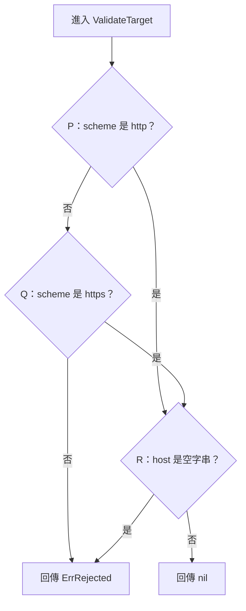

## 先想想

短網址服務 v1 要在建立連結前檢查目標網址：只接受 `http` 與 `https`，而且 host 不能是空的。你寫了兩個測試案例，一個 `ftp://a.com` 預期被擋，一個 `https://a.com` 預期通過。

執行 `go test -cover`，畫面上是 `coverage: 100.0% of statements`。同事看到 100% 就放心了。

一個月後有人「順手整理」，把檢查 host 的那一行改壞了，結果空 host 的網址也能建立。兩個測試依然全綠。

覆蓋率明明是 100%，為什麼擋不住這個改壞？這兩個案例還漏掉了哪些事？

<details>
<summary>提示</summary>

數數看這個 `if` 裡有幾個小條件，兩個案例各讓每個小條件變成真或假幾次。

</details>

## 是什麼

**覆蓋準則（coverage criteria）** 是一組白箱測試的量尺：它規定「測試至少要讓程式碼的哪些部分被執行過」，並把達成程度算成百分比。

本篇講三種由弱到強的準則： **敘述覆蓋（statement coverage）** 看每一行陳述式有沒有跑過， **分支覆蓋（branch coverage）** 看每個判斷的真與假兩條路有沒有走過， **條件覆蓋（condition coverage）** 看判斷裡每個小條件的真與假有沒有出現過。它們最接近你已經看過的「行覆蓋率」，只是問的問題越來越細。

## 為什麼存在

沒有準則時，「測夠了沒」只能憑感覺。感覺常常是錯的：寫測試的人傾向測「會成功的路」，因為那是自己腦中的使用方式。只跑成功路徑，就可能讓一個函式大部分的行被執行，卻一次錯誤分支都沒走過。

覆蓋準則把「感覺」換成可以檢查的問題：哪一行從沒被執行？哪個判斷從沒變成假？答案是一份具體的清單，你可以逐項決定要補測試，還是承認這段程式碼沒必要存在。

它的價值在於找出「沒測到的地方」。反過來不成立：覆蓋到不等於測到，這點留到本節最後一篇「白箱測試的極限」再談。

## 怎麼運作

範例在 `playground/testing/l1/1-3-white-box/coverage-criteria/`。受測的是短網址服務 v1 的一個小函式：

```go title="validate.go"
func ValidateTarget(scheme, host string) error {
	if !(scheme == "http" || scheme == "https") || host == "" {
		return ErrRejected
	}
	return nil
}
```

### 先畫控制流程圖

**控制流程圖（control flow graph，CFG）** 把程式碼畫成節點與箭頭：每個判斷是一個菱形，每條可能走的路是一條箭頭。覆蓋準則本質上都在問「圖上的哪些東西被走過」。

這個 `if` 由三個原子條件組成：`scheme == "http"`（下面簡稱 P）、`scheme == "https"`（Q）、`host == ""`（R）。Go 的 `||` 會短路，所以圖長這樣：



看圖時注意：scheme 是 `ftp` 時，P、Q 都為假，直接被擋，R 根本不會被求值。

### 敘述覆蓋：每個節點都走過

敘述覆蓋要求每一條陳述式至少執行一次。這張圖有兩個出口 `return ErrRejected` 與 `return nil`，所以兩個案例就夠：`ftp` 走到 `X`，`https` 加 `a.com` 走到 `OK`。這正是「先想想」的兩個測試。

它是最弱的準則：`if` 後面沒有 `else` 時，只要「真」的那條路跑過，這行 `if` 的「假」就算沒測也是 100%。

### 分支覆蓋：每個判斷的真假都走過

分支覆蓋（也叫判定覆蓋）要求整個判斷式的結果，真與假各出現一次。這裡判斷式整體為真代表被擋，為假代表通過，兩個案例同樣滿足。所以「先想想」的兩個案例，分支覆蓋也是 100%。

分支覆蓋比敘述覆蓋強：沒有 `else` 的 `if`，必須有案例讓條件為假。但它只看判斷式「整體」的結果，不管裡面是哪一個小條件造成的。

### 條件覆蓋：每個小條件的真假都出現過

條件覆蓋要求每個原子條件，各自至少被求值為真一次、為假一次。把兩個案例攤開看：

| 案例 | P：http | Q：https | R：空 host | 整體（是否擋下） |
| --- | --- | --- | --- | --- |
| `ftp`、`a.com` | 假 | 假 | 沒求值 | 真 |
| `https`、`a.com` | 假 | 真 | 假 | 假 |

P 從沒變成真，R 從沒變成真。這就是為什麼 `host == ""` 被改壞也沒有測試紅燈：沒有任何案例讓它發揮作用。補上 `http`、`a.com` 讓 P 為真，再補 `https`、空字串讓 R 為真，四個案例才滿足條件覆蓋。

### 條件覆蓋不等於分支覆蓋

教科書上有一個經典反例：判斷式 `a && b`，兩個案例 `(a=真, b=假)` 與 `(a=假, b=真)`。每個小條件都出現過真與假，條件覆蓋達成；但整體結果兩次都是假，分支覆蓋沒達成。

所以實務上會把兩者合起來，叫 **判定／條件覆蓋（decision/condition coverage）**：整體的真假、每個小條件的真假都要出現。更嚴格、要求每個小條件都能「獨立影響」整體結果的準則叫 MC/DC，下一篇再講。

回到一開始的問題：兩個案例的敘述與分支覆蓋都是 100%，但 P 與 R 從沒變成真，所以 `host == ""` 被改壞、或 `http` 被拿掉，都不會讓任何測試變紅。要擋住，至少要補到讓每個小條件都出現過真與假。

## 取捨與替代方案

| 準則 | 問的問題 | 優點 | 代價 | 適用情境 |
| --- | --- | --- | --- | --- |
| 敘述覆蓋 | 每一行跑過嗎？ | 工具最普遍，很快找出完全沒被執行的程式碼 | 看不出沒走過的 `else`，最弱 | 當作最低門檻，找整段漏測 |
| 分支覆蓋 | 每個判斷真假都走過嗎？ | 比敘述覆蓋強，案例數仍少 | 不看複合判斷裡的小條件 | 一般業務邏輯 |
| 條件覆蓋 | 每個小條件真假都出現過嗎？ | 能抓出複合判斷裡沒被測到的小條件 | 不保證分支覆蓋；短路時有些條件求值不到 | 複合判斷多的驗證邏輯 |
| 判定／條件覆蓋 | 兩者都滿足嗎？ | 補上條件覆蓋的缺口 | 案例數較多 | 規則複雜的核心邏輯 |
| MC/DC（預告） | 每個小條件都能獨立決定結果嗎？ | 最嚴格，航電等安全關鍵領域要求 | 案例設計成本高 | 下一篇再談 |

選哪一種，取決於這段邏輯出錯的代價。對 QA 來說，被問到「這個模組要覆蓋多少」時，比較好的回答不是一個百分比，而是：「這幾個複合判斷，我用判定／條件覆蓋逐一設計案例；其餘用分支覆蓋當最低標準。」

### 什麼時候不該用

- 不要把覆蓋率訂成團隊 KPI。人會為了數字寫出沒有斷言的測試，數字好看，保護力為零。
- 單純的 getter、自動產生的程式碼、只轉呼叫的薄封裝，追求高覆蓋準則的成本大於它抓到的錯。

## 常見坑與故障案例

### 短路求值讓條件「看起來測過」

**症狀**：你以為每個小條件都測過了，改壞其中一個，測試仍然全綠。

**原因**：`||` 與 `&&` 在 Go 裡會短路。前面的條件已經決定結果時，後面的條件根本不會被求值。上面的 `ftp` 案例就是：P、Q 為假直接擋下，R 沒被碰過。

**避免**：設計案例時，對每個複合判斷畫出像上面的真值表，確認每個小條件「被求值」時看到過真與假，而不是只看輸入值。

### 把 `go test -cover` 當成分支或條件覆蓋

**症狀**：`-cover` 顯示 100%，但複合判斷裡的小條件沒測到。

**原因**：Go 內建的 `-cover` 只量敘述區塊（statement block）有沒有被執行，不量分支，也不量條件。範例裡兩個案例就能讓它顯示 100.0%。

```bash
go test -cover ./...
```

```text
ok  	handbook/playground/testing/coverage-criteria	0.284s	coverage: 100.0% of statements
```

**避免**：看到 100% 時，把它讀成「每一行都被執行過」，而不是「每個判斷都測過」。分支與條件要靠自己對照程式碼設計案例。

### 只執行，沒有斷言

**症狀**：覆蓋率高，程式碼被改壞卻沒有測試紅燈。

**原因**：覆蓋率只量「有沒有跑過」，不量「有沒有檢查結果」。一個只呼叫函式、不比對回傳值的測試，照樣把那些行算成已覆蓋。

**避免**：每個案例都要有明確的預期值，並對失敗與成功兩個方向都斷言。範例裡 `ftp` 案例必須斷言「真的回傳 `ErrRejected`」，不是只斷言「通過時沒出錯」。

### 改壞一行，覆蓋率仍然 100%

**症狀**：重構時把檢查條件改成別的值，覆蓋率與測試結果都沒變。

**原因**：跟「先想想」同一個機制。你可以自己驗證：把 `host == ""` 改成 `host == " "`，現有的兩個案例依然通過，覆蓋率依然 100%。

**避免**：補齊小條件的案例之後，再做一次這種「故意改壞」的檢查，確認測試真的會變紅。系統化的做法叫變異測試，會在 L3 的「衡量測試的有效性」介紹。

### 把未被執行的程式碼當成沒問題

**症狀**：重大安全漏洞藏在一段永遠沒被執行的程式碼裡。

**原因**：2014 年 Apple 的 SSL/TLS 實作多了一行重複的 `goto fail;`，使後面的簽章檢查永遠不會被執行（[Adam Langley 的分析](https://www.imperialviolet.org/2014/02/22/applebug.html)）。一個要求每行都被執行的覆蓋準則，會把那段從沒跑過的程式碼標出來。

**避免**：把覆蓋報告當成「找出沒人執行過的程式碼」的工具，對每一段紅色的區塊問：是漏測，還是這段程式碼根本到不了？

## 小練習

### 實作：補齊條件覆蓋

起手式在 `playground/testing/l1/1-3-white-box/coverage-criteria/`。`validate_test.go` 裡只有兩個案例，執行 `go test -cover ./...` 是 100%。

目標：只改 `validate_test.go` 裡的 `targetCases`（不要動 `validate.go`），讓每個原子條件都被求值為真與假各至少一次。

驗證：執行下面的指令。補齊之前它會列出哪些條件沒被求值為真；補齊之後會通過。

```bash
go test -tags exercise ./...
```

再多做一步：暫時把 `validate.go` 裡的 `host == ""` 改成 `host == " "`，你的測試現在應該會變紅。改完記得改回來。

<details>
<summary>參考解答</summary>

補上兩個案例，總共四個：

```go title="validate_test.go"
var targetCases = []targetCase{
	{"ftp 被擋", "ftp", "a.com", ErrRejected},
	{"https 通過", "https", "a.com", nil},
	{"http 通過", "http", "a.com", nil},
	{"空 host 被擋", "https", "", ErrRejected},
}
```

`http`、`a.com` 讓 P 為真，`https`、空字串讓 R 為真，原本兩個案例讓 P、Q 為假、Q 為真、R 為假。三個小條件各自的真與假都齊了。補完之後，把 `host == ""` 改壞會讓「空 host 被擋」這一案例失敗，這就是你多出來的保護。

</details>

### 辨識：這份測試能合併嗎？

下面是 AI 為 `ValidateTarget` 產生的測試。它的註解宣稱「覆蓋率 100%，所有分支皆已測試」。請你做 code review：這份測試可以直接合併嗎？

```go title="validate_ai_test.go（AI 產生）"
// 覆蓋率 100%，所有分支皆已測試。
func TestValidateTarget(t *testing.T) {
	tests := []struct {
		name   string
		scheme string
		host   string
		reject bool
	}{
		{"unsupported scheme", "ftp", "example.com", true},
		{"valid https", "https", "example.com", false},
	}
	for _, tt := range tests {
		t.Run(tt.name, func(t *testing.T) {
			err := shortener.ValidateTarget(tt.scheme, tt.host)
			if !tt.reject && err != nil {
				t.Errorf("unexpected error: %v", err)
			}
		})
	}
}

func TestValidateTargetEmptyHost(t *testing.T) {
	err := shortener.ValidateTarget("https", "")
	t.Log("result:", err)
}
```

完整檔案在 `recognize/validate_ai_test.go`（加上 `-tags recognize` 才會編譯）。

<details>
<summary>參考解答</summary>

不能合併，至少三個問題：

1. **`reject` 為真的案例沒有斷言。** 只有 `!tt.reject && err != nil` 一個檢查，所以 `ftp` 案例即使 `ValidateTarget` 永遠回傳 `nil` 也會通過。後果：把整個驗證刪光，這個測試依然全綠。正確做法：用 `errors.Is(err, shortener.ErrRejected)` 對失敗與成功兩個方向都斷言。這屬於「只執行，沒有斷言」。
2. **`TestValidateTargetEmptyHost` 只有 `t.Log`，沒有任何斷言。** 它把 `host == ""` 那段程式碼算成已執行，卻永遠不會失敗。後果：這是最典型的「覆蓋率高、保護力為零」。正確做法：斷言回傳 `ErrRejected`。
3. **註解「所有分支皆已測試」只對整體判斷成立。** 整體的真與假各有一個案例，但 `http` 從沒被測過，`host == ""` 也從沒真正決定過結果（第二個測試沒斷言）。後果：把 `"http"` 從條件拿掉、或把 `host == ""` 改壞，都不會紅。正確做法：用真值表補齊小條件的案例，像上一題那樣。

</details>

## 快閃卡

<details>
<summary>什麼是敘述覆蓋？它最大的盲點是什麼？</summary>

要求每一條陳述式至少被執行一次。盲點是沒有 `else` 的 `if`：只要「真」的那條路跑過，這行就算已覆蓋，條件為假的情況沒測也不會被發現。

</details>

<details>
<summary>敘述覆蓋與分支覆蓋差在哪裡？</summary>

敘述覆蓋看每一行有沒有執行過；分支覆蓋看每個判斷的真與假兩條路各走過一次。後者在沒有 `else` 的 `if` 上要求多一個「條件為假」的案例。

</details>

<details>
<summary>函式裡有 <code>if a && b { run() }</code>，只用 a、b 都為真的一個案例測試。敘述覆蓋與分支覆蓋各是多少？</summary>

敘述覆蓋是 100%，因為 `run()` 被執行了；分支覆蓋不到 100%，因為整個判斷式從沒變成假。需要再補一個讓判斷式為假的案例。

</details>

<details>
<summary>為什麼條件覆蓋達成不代表分支覆蓋達成？</summary>

條件覆蓋看的是每個小條件各自的真假，不看整體結果。例如 `a && b` 搭配 `(真, 假)` 與 `(假, 真)` 兩個案例，每個小條件都出現過真假，但整體兩次都是假，整體的真從沒出現。

</details>

<details>
<summary>判定／條件覆蓋比條件覆蓋多要求什麼？</summary>

多要求整個判斷式的結果也要真與假各出現一次，補上條件覆蓋沒保證分支覆蓋的缺口。

</details>

<details>
<summary><code>ValidateTarget</code> 只有 <code>ftp</code>、<code>a.com</code> 與 <code>https</code>、<code>a.com</code> 兩個案例，<code>go test -cover</code> 顯示 100.0%。能因此斷定 <code>host == ""</code> 被測過嗎？</summary>

不能。`go test -cover` 只量敘述區塊有沒有被執行，不量條件。這兩個案例裡 `host == ""` 從沒變成真，改壞它測試仍然全綠。

</details>

<details>
<summary>在 Go 裡，<code>scheme</code> 是 <code>ftp</code> 時，<code>host == ""</code> 會被求值嗎？這對條件覆蓋有什麼影響？</summary>

不會。`!(P || Q)` 已經為真，後面的 `||` 短路，R 沒被求值。所以設計案例時，要確認每個小條件「被求值時」看過真與假，而不是只看輸入值。

</details>

<details>
<summary>覆蓋率 100%、測試全綠，程式碼被改壞卻沒有測試失敗。有哪些可能原因？</summary>

常見原因有兩個：案例沒讓被改壞的小條件變成真（條件沒覆蓋），或測試只執行了那段程式碼卻沒有斷言結果（覆蓋率只量有沒有跑過，不量有沒有檢查）。

</details>

## 延伸閱讀

- [Code coverage（維基百科）](https://en.wikipedia.org/wiki/Code_coverage)：各種覆蓋準則的定義與彼此的包含關係
- [Modified condition/decision coverage（維基百科）](https://en.wikipedia.org/wiki/Modified_condition/decision_coverage)：下一篇的主角 MC/DC 先看個概念
- [The cover story（Go 官方部落格）](https://go.dev/blog/cover)：`go test -cover` 怎麼量、量的是什麼
- [Test Coverage（Martin Fowler）](https://martinfowler.com/bliki/TestCoverage.html)：為什麼覆蓋率是找漏洞的工具，不是品質指標
- [Apple 的 SSL/TLS bug（Adam Langley）](https://www.imperialviolet.org/2014/02/22/applebug.html)：一行重複的 `goto fail;` 如何讓檢查永遠不被執行
