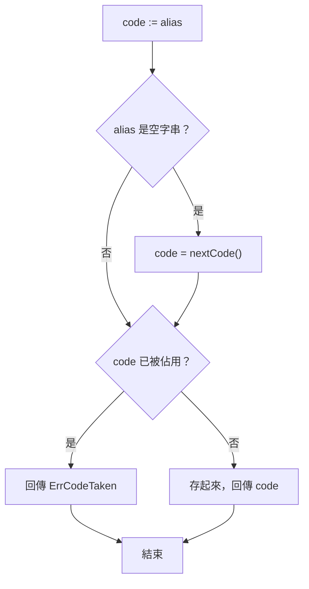

## 先想想

短網址服務 v1 建立連結時，使用者可以自己指定短碼，不指定就自動產生。程式碼裡有兩個前後接續的判斷：先看要不要自動產生短碼，再看這個短碼是不是已被佔用。你寫了兩個測試，一個自動產生、一個自訂短碼衝突，兩個判斷的真與假都走過了，分支覆蓋 100%。

上線一週後，有使用者沒指定短碼，卻收到「短碼已被使用」。

另一個問題：同事為 `ValidateTarget` 寫了四個案例，`ftp`／`a.com`、`http`／`a.com`、`https`／空 host、`ftp`／空 host，滿足上一篇的判定／條件覆蓋。如果有人把 `|| scheme == "https"` 整段刪掉，這四個測試會變紅嗎？

<details>
<summary>提示</summary>

第一題：兩個判斷各有真假，組合起來有幾種走法？兩個測試走了其中幾種？第二題：把刪掉之後的判斷式套進四個案例，逐一算結果。

</details>

## 是什麼

**路徑覆蓋（path coverage）** 要求測試走過控制流程圖（CFG）上從入口到出口的每一條完整路徑。它看的不是單一判斷，而是判斷之間的組合。

**MC/DC（modified condition/decision coverage，修正條件／判定覆蓋）** 要求判斷式裡的每個原子條件，都有一組案例證明「只改這個條件，就能改變整個判斷的結果」。**獨立影響對（independence pair）** 指的就是這組案例。MC/DC 是上一篇判定／條件覆蓋的加強版：不只要求每個條件出現過真假，還要求每個條件真的有作用。

## 為什麼存在

分支覆蓋一次只看一個判斷。當第二個判斷讀到第一個判斷改過的變數時，錯誤藏在「某個組合」裡，分支覆蓋看不到。「先想想」的事故就是這樣：自動產生的短碼剛好被別人用自訂短碼佔走，這個組合沒有測試走過。

條件覆蓋有另一個洞：每個條件出現過真假，不代表它影響過結果。第二題的四個案例裡，`scheme == "https"` 雖然出現過真，但每次它為真時 host 都是空的，結果本來就是擋下。刪掉它，沒有任何結果改變。

**多重條件覆蓋（multiple condition coverage）** 是最徹底的做法：N 個條件的 2^N 種組合全測。條件一多就不可行，10 個條件要 1,024 個案例。MC/DC 用 N+1 個案例（最少的情況）證明每個條件都有作用，是航電軟體標準 DO-178C 對最高安全等級 Level A 的要求。

## 怎麼運作

範例在 `playground/testing/l1/1-3-white-box/path-mcdc/`。先看「先想想」裡的建立函式：

```go title="store.go"
func (s *Store) CreateNaive(target, alias string) (string, error) {
	code := alias
	if code == "" {
		code = s.nextCode()
	}
	if s.has(code) {
		return "", ErrCodeTaken
	}
	s.links[code] = target
	return code, nil
}
```

### 列出路徑

把它畫成 CFG：



看圖時注意：兩個判斷的箭頭會在 `D2` 匯合，所以 `D1` 的兩條路都能接上 `D2` 的兩條路，一共四條路徑。

| 路徑 | alias 是空的？ | 短碼已被佔用？ | 情境 | 兩個測試走過嗎 |
| --- | --- | --- | --- | --- |
| 1 | 是 | 否 | 自動短碼，正常建立 | 走過 |
| 2 | 否 | 是 | 自訂短碼衝突 | 走過 |
| 3 | 否 | 否 | 自訂短碼，正常建立 | 沒有 |
| 4 | 是 | 是 | 自動短碼撞上別人的自訂短碼 | 沒有 |

路徑數隨判斷個數指數成長：k 個前後接續的 `if` 最多有 2^k 條路徑。加上迴圈更糟，迴圈跑 0 次、1 次、2 次各是不同的路徑，迴圈次數沒有上限時，路徑數也沒有上限。所以完整的路徑覆蓋只對很小的函式做得到。

### 基本路徑：有上限的折衷

**循環複雜度（cyclomatic complexity）** 由 McCabe 在 1976 年提出，算法是 V(G) = E − N + 2，E 是邊數、N 是節點數。上圖有 8 條邊、7 個節點，V(G) = 8 − 7 + 2 = 3。只有 `if` 與迴圈時，更快的算法是「判斷個數加 1」。

V(G) 是 **基本路徑（basis path）** 的條數：任何一條路徑都能由這幾條組合出來。**基本路徑測試（basis path testing）** 就是為每條基本路徑寫一個案例。它保證分支覆蓋，案例數又有上限，是完整路徑覆蓋的務實替代。

但要小心：上圖選路徑 1、2、3 就是一組合法的基本路徑，偏偏漏掉路徑 4。基本路徑只規定「幾條」，不規定「哪幾條」。挑選時，優先挑「前一個判斷改了變數，後一個判斷又讀它」的組合，這裡就是 `D1` 改了 `code`、`D2` 讀 `code`。

修正後的版本把兩種短碼分開處理，自動短碼撞到就換下一個：

```go title="store.go"
func (s *Store) Create(target, alias string) (string, error) {
	if alias != "" {
		if s.has(alias) {
			return "", ErrCodeTaken
		}
		s.links[alias] = target
		return alias, nil
	}
	code := s.nextCode()
	for s.has(code) {
		code = s.nextCode()
	}
	s.links[code] = target
	return code, nil
}
```

三個判斷，V(G) = 4。四條基本路徑是：自訂短碼沒被佔用、自訂短碼已被佔用、自動短碼迴圈 0 次、自動短碼迴圈至少 1 次。`store_test.go` 的 `TestCreateBasisPaths` 一條路徑一個案例。

### MC/DC：為每個條件找獨立影響對

回到上一篇的判斷式。三個原子條件是 P：`scheme == "http"`、Q：`scheme == "https"`、R：`host == ""`。判斷式 `!(P || Q) || R` 為真時擋下。

```go title="validate.go"
func ValidateTarget(scheme, host string) error {
	if !(scheme == "http" || scheme == "https") || host == "" {
		return ErrRejected
	}
	return nil
}
```

先列真值表。P 與 Q 不可能同時為真（scheme 不能同時是兩個值），所以 8 列只有 6 列做得出來：

| 列 | P：http | Q：https | R：空 host | 結果 | 例子 |
| --- | --- | --- | --- | --- | --- |
| 1 | 真 | 假 | 假 | 通過 | `http`、`a.com` |
| 2 | 真 | 假 | 真 | 擋下 | `http`、空字串 |
| 3 | 假 | 真 | 假 | 通過 | `https`、`a.com` |
| 4 | 假 | 真 | 真 | 擋下 | `https`、空字串 |
| 5 | 假 | 假 | 假 | 擋下 | `ftp`、`a.com` |
| 6 | 假 | 假 | 真 | 擋下 | `ftp`、空字串 |

接著為每個條件找一組獨立影響對：兩列只有這個條件不同，結果也不同。

- P：列 1 與列 5。只有 P 不同，結果從通過變擋下。
- Q：列 3 與列 5。
- R：列 1 與列 2，或列 3 與列 4。

把它們聯集起來，最少是 {1, 3, 5} 再加 2 或 4，共 4 個案例，正好 N+1。上一篇補齊條件覆蓋的四個案例（`ftp`／`a.com`、`https`／`a.com`、`http`／`a.com`、`https`／空字串）就是列 5、3、1、4，剛好也達成 MC/DC。

`mcdc_test.go` 裡的 `independencePair` 把這個找法寫成程式：對每個條件，在案例裡找「只差這一個條件、結果不同」的兩個案例。

### 兩種 MC/DC

上面的找法叫 **unique-cause MC/DC**：配對時，其他條件的值必須完全相同。有些判斷式做不到，例如 `(a && b) || (a && c)`，`a` 出現兩次，改一個就同時改另一個。

另一種叫 **masking MC/DC**：其他條件可以不同，只要它們在這兩個案例裡被「遮住」、不影響結果。Go 的 `&&` 與 `||` 會短路，沒被求值的條件本來就不影響結果，所以短路語言的工具與認證實務多半接受這種較寬的配對。對你設計案例的影響是：先試 unique-cause，配不出來再用 masking，並在測試裡註明。

回到一開始的問題：第一題，分支覆蓋只要兩條路徑，`CreateNaive` 卻有四條。出事的是路徑 4，自動產生的短碼撞上別人的自訂短碼，兩個測試都沒走過。第二題，那四個案例是列 5、1、4、6，`scheme == "https"` 與 `host == ""` 都找不到獨立影響對。刪掉 `|| scheme == "https"` 之後，四個案例的結果都沒變，測試全綠，但所有 `https` 網址都會被擋下。

## 取捨與替代方案

| 準則 | 要求 | 優點 | 代價 | 適用情境 |
| --- | --- | --- | --- | --- |
| 分支覆蓋 | 每個判斷的真假各一次 | 案例少，工具多 | 看不到判斷之間的組合 | 一般業務邏輯的最低標準 |
| 基本路徑測試 | V(G) 條基本路徑各一次 | 案例數有上限，保證分支覆蓋 | 挑錯路徑仍會漏掉關鍵組合 | 判斷彼此有資料相依的函式 |
| 完整路徑覆蓋 | 每條完整路徑各一次 | 組合全測 | 指數成長，有迴圈時無上限 | 只有幾個判斷、沒有迴圈的小函式 |
| MC/DC | 每個條件都有獨立影響對 | N+1 個案例就能證明每個條件有作用 | 設計與審查成本高，耦合條件難配對 | 安全關鍵邏輯、權限與驗證規則 |
| 多重條件覆蓋 | 2^N 種組合全測 | 最徹底 | 條件一多就不可行 | 條件少於 4 個的關鍵判斷 |

路徑類準則看「判斷之間」，MC/DC 看「判斷之內」，兩者回答不同的問題，不是誰取代誰。當團隊問「核心邏輯要測到什麼程度」時，可以這樣回答：「判斷之間有資料相依的函式做基本路徑測試，權限與驗證這類複合判斷做 MC/DC，其餘維持分支覆蓋。」理由是出錯代價：權限判斷少測一個條件，後果是越權，不是畫面錯一個字。

### 什麼時候不該用

- 不要對整個專案要求路徑覆蓋或 MC/DC。成本會讓團隊開始寫湊數字的測試，比不做更糟。
- 判斷式只有一個條件時，MC/DC 與分支覆蓋相同，不需要另外做。
- V(G) 很高（例如超過 10）的函式，先拆小再談路徑測試。測一個難測的函式，不如先把它改得好測。

## 常見坑與故障案例

### 迴圈讓路徑數失控

**症狀**：想把含迴圈的函式所有路徑都列出來，越列越多，最後放棄，連基本的迴圈邊界也沒測。

**原因**：迴圈每多跑一次就是一條新路徑，次數沒有上限時路徑也沒有上限。

**避免**：對每個迴圈只測三種次數：0 次、1 次、多次。`Create` 的「迴圈 0 次」與「至少 1 次」兩個案例就是這個原則。

### 不可行的路徑與組合

**症狀**：真值表或路徑表裡有幾列怎麼樣都做不出輸入，覆蓋率卡在某個數字上不去。

**原因**：條件之間彼此相關。`scheme == "http"` 與 `scheme == "https"` 不可能同時為真，所以 8 列只有 6 列存在。路徑也一樣：前一個判斷成立時，後一個判斷可能必定不成立。

**避免**：把不可行的列或路徑標出來並寫下理由，從分母拿掉。不要為了湊滿去改受測程式碼或塞假輸入。

### 把 N+1 當成達成 MC/DC 的證明

**症狀**：測試裡有 N+1 個案例，註解寫「已達成 MC/DC」，改壞某個條件卻沒有紅燈。

**原因**：N+1 是最少需要的數量，不是足夠的條件。重點是每個條件有沒有一組「只差它、結果不同」的案例。案例數對了，配對錯了，一樣沒有證明任何事。

**避免**：審查時逐個條件指出它的獨立影響對，並檢查兩個案例是否真的只差這一個條件。範例的 `-tags exercise` 測試就是在自動做這件事。

### 基本路徑挑完，仍漏掉出事的組合（示意案例）

**症狀**：函式的每條基本路徑都有測試，上線後還是在某個組合出錯，就像「先想想」的自動短碼衝突。

**原因**：基本路徑只決定條數，同一個函式有很多組合法的基本路徑。挑到不含關鍵組合的那一組，一樣是「做完了基本路徑測試」。

**避免**：找出「在一個判斷裡被改、在另一個判斷裡被讀」的變數，確保它們的組合一定在挑選的路徑裡。

## 小練習

### 實作：補到 MC/DC

起手式在 `playground/testing/l1/1-3-white-box/path-mcdc/`。`validate_test.go` 的 `targetCases` 就是「先想想」第二題的四個案例，`go test ./...` 全部通過。

目標：只改 `targetCases`，用最少的案例讓三個條件都有獨立影響對。

驗證：補齊之前，下面的指令會列出哪些條件沒有獨立影響對；補齊之後會通過。

```bash
go test -tags exercise -run TestMCDC -v .
```

```text
--- FAIL: TestMCDC (0.00s)
    mcdc_exercise_test.go:15: 條件 scheme == "http"："ftp 被擋" 與 "http 通過"
    mcdc_exercise_test.go:12: 條件 scheme == "https" 沒有獨立影響對：找不到只差這個條件、結果又不同的兩個案例
    mcdc_exercise_test.go:12: 條件 host == "" 沒有獨立影響對：找不到只差這個條件、結果又不同的兩個案例
```

再多做一步：補齊之後，暫時把 `validate.go` 的 `|| scheme == "https"` 刪掉，`go test .` 應該會變紅。改完記得改回來。

<details>
<summary>參考解答</summary>

把 `ftp`／空字串換成 `https`／`a.com`，維持 4 個案例：

```go title="validate_test.go"
var targetCases = []targetCase{
	{"ftp 被擋", "ftp", "a.com", ErrRejected},
	{"http 通過", "http", "a.com", nil},
	{"https 空 host 被擋", "https", "", ErrRejected},
	{"https 通過", "https", "a.com", nil},
}
```

對照真值表：P 用列 1 與列 5，Q 用列 3 與列 5，R 用列 3 與列 4。原本的 `ftp`／空字串（列 6）不屬於任何一組獨立影響對，拿掉不損失什麼。保留它變成 5 個案例也能通過，只是不是最少。

</details>

### 辨識：這份測試達成 MC/DC 了嗎？

下面是 AI 為 `ValidateTarget` 產生的測試，註解宣稱已達成 MC/DC。請你做 code review：這個說法成立嗎？

```go title="validate_ai_test.go（AI 產生）"
// 判斷式有 3 個條件，MC/DC 需要 N+1 = 4 個案例，以下 4 個案例達成 MC/DC。
//
//	scheme == "http"  的獨立影響：案例 1 與案例 2
//	scheme == "https" 的獨立影響：案例 3 與案例 2
//	host == ""        的獨立影響：案例 3 與案例 4
func TestValidateTargetMCDC(t *testing.T) {
	tests := []struct {
		name   string
		scheme string
		host   string
		reject bool
	}{
		{"1 http ok", "http", "example.com", false},
		{"2 ftp empty host", "ftp", "", true},
		{"3 https ok", "https", "example.com", false},
		{"4 https empty host", "https", "", true},
	}
	for _, tt := range tests {
		t.Run(tt.name, func(t *testing.T) {
			err := shortener.ValidateTarget(tt.scheme, tt.host)
			if tt.reject != errors.Is(err, shortener.ErrRejected) {
				t.Errorf("ValidateTarget(%q, %q) = %v, reject = %v", tt.scheme, tt.host, err, tt.reject)
			}
			if !tt.reject && err != nil {
				t.Errorf("unexpected error: %v", err)
			}
		})
	}
}
```

完整檔案在 `recognize/validate_ai_test.go`（加上 `-tags recognize` 才會編譯）。

<details>
<summary>參考解答</summary>

不成立。斷言本身沒問題，問題在案例的配對：

1. **`scheme == "http"` 的配對不是獨立影響對。** 案例 1 與案例 2 之間，P 從真變假，R 也從假變真，兩個條件同時改變，無法說明結果是誰造成的。正確做法：用 `http`／`example.com` 對 `ftp`／`example.com`，只讓 P 不同。
2. **`scheme == "https"` 的配對有同樣的問題。** 案例 3 與案例 2 之間，Q 與 R 同時改變。正確做法：用 `https`／`example.com` 對 `ftp`／`example.com`。
3. **用案例數證明 MC/DC。** 註解的論證是「N+1 = 4，所以達成」，這是「把 N+1 當成證明」這個坑。後果：這四個案例裡只有 R 有真正的獨立影響對，scheme 的檢查整段刪掉，只留 `if host == ""`，四個測試依然全綠，`ftp` 網址就能建立連結。正確做法：補上 `ftp`／`example.com`，它同時是 P 與 Q 的配對對象，再把註解改成真正的配對。

</details>

## 快閃卡

<details>
<summary>路徑覆蓋要求什麼？為什麼實務上很少要求 100%？</summary>

要求 CFG 上從入口到出口的每一條完整路徑都走過。路徑數隨判斷個數指數成長，有迴圈時沒有上限，所以只有很小的函式做得到。

</details>

<details>
<summary>一個函式有 3 個前後接續、互不巢狀的 <code>if</code>，沒有迴圈。分支覆蓋最少要幾個案例？完整路徑最多幾條？</summary>

分支覆蓋最少 2 個：一個讓三個判斷都為真，一個讓三個都為假。完整路徑最多 2^3 = 8 條，因為每個判斷的兩條路都能接上下一個判斷的兩條路。

</details>

<details>
<summary>CFG 有 9 條邊、7 個節點，循環複雜度是多少？它代表什麼？</summary>

V(G) = 9 − 7 + 2 = 4。代表有 4 條基本路徑，任何路徑都能由它們組合出來；基本路徑測試就是為這 4 條各寫一個案例。

</details>

<details>
<summary>每條基本路徑都有測試，上線後還是在某個判斷組合出錯。可能的原因是什麼？</summary>

基本路徑只規定條數，不規定哪幾條，同一個函式有很多組合法的選擇。挑到的那組可能剛好不含出事的組合，尤其是「一個判斷改變數、另一個判斷讀它」的組合。

</details>

<details>
<summary>什麼是獨立影響對？</summary>

兩個案例只有某一個原子條件不同、其他條件相同，而判斷結果也不同。它證明這個條件確實能單獨影響結果，MC/DC 要求每個條件都有一組。

</details>

<details>
<summary>判斷式 <code>a && b</code> 要達成 MC/DC，最少需要哪幾個案例？</summary>

3 個：(真, 真)、(假, 真)、(真, 假)。(真, 真) 與 (假, 真) 證明 a 的影響，(真, 真) 與 (真, 假) 證明 b 的影響，共 N+1 = 3 個。

</details>

<details>
<summary>MC/DC 和多重條件覆蓋差在哪裡？</summary>

多重條件覆蓋要測全部 2^N 種組合；MC/DC 只要求每個條件有一組獨立影響對，最少 N+1 個案例。條件多時，前者不可行，後者仍做得到。

</details>

<details>
<summary><code>ValidateTarget</code> 的案例是 <code>ftp</code>／<code>a.com</code>、<code>http</code>／<code>a.com</code>、<code>https</code>／空、<code>ftp</code>／空。條件覆蓋達成了嗎？MC/DC 呢？</summary>

條件覆蓋達成，每個條件都出現過真與假。MC/DC 沒有：`scheme == "https"` 與 `host == ""` 都找不到只差自己、結果又不同的配對，所以刪掉 `|| scheme == "https"` 測試仍然全綠。

</details>

## 延伸閱讀

- [A Practical Tutorial on Modified Condition/Decision Coverage（NASA）](https://ntrs.nasa.gov/citations/20010057789)：NASA 的 MC/DC 教學，有大量真值表與配對範例
- [Modified condition/decision coverage（維基百科）](https://en.wikipedia.org/wiki/Modified_condition/decision_coverage)：unique-cause 與 masking 兩種 MC/DC 的定義
- [A Complexity Measure（McCabe, 1976）](http://www.literateprogramming.com/mccabe.pdf)：循環複雜度與基本路徑的原始論文
- [Cyclomatic complexity（維基百科）](https://en.wikipedia.org/wiki/Cyclomatic_complexity)：V(G) 的各種算法與它和測試案例數的關係
- [gocyclo](https://github.com/fzipp/gocyclo)：算出 Go 函式的循環複雜度，找出該先拆小的函式
