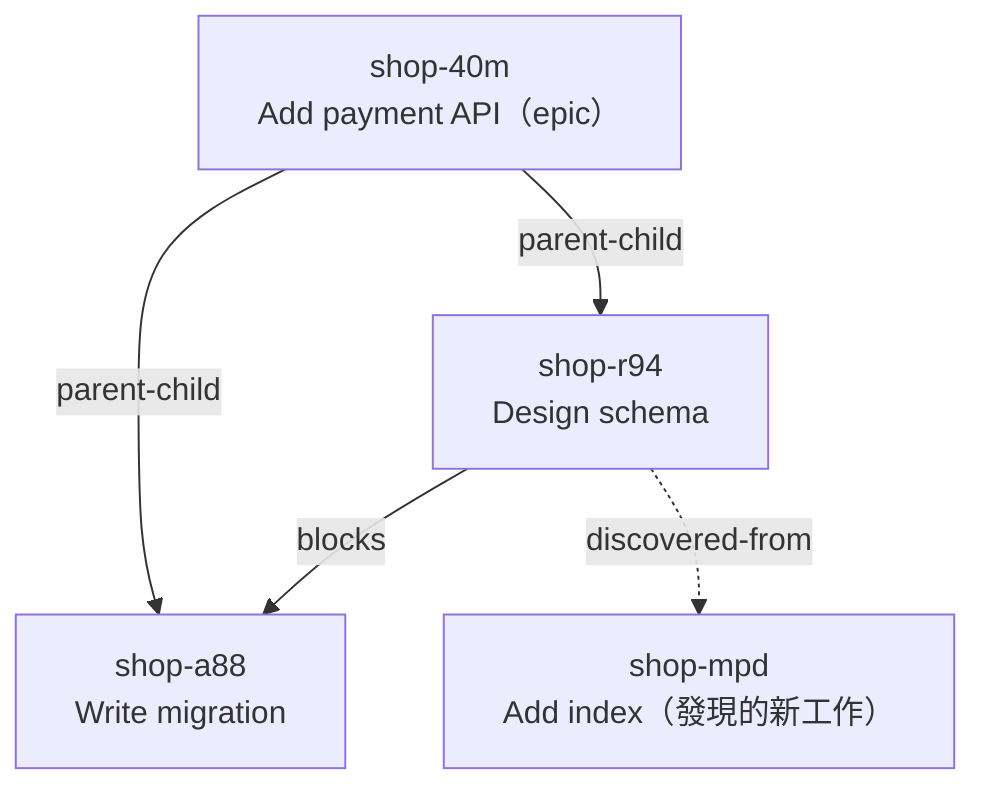

## 先想想

你請 coding agent 把「付款 API」做完。它先寫了一份 `PLAN.md`，列了十個待辦，做到第六項時上下文塞滿，session 被壓縮。

新的 session 開始，agent 讀回 `PLAN.md`。檔案裡第七項「寫 migration」前面沒有任何標記，第三項「設計 schema」也還沒打勾。

這個 agent 要怎麼知道下一步該做什麼？如果同時有兩個 agent 都在改這份檔案，又會發生什麼事？

<details><summary>提示</summary>

想想一份純文字清單缺少哪兩種資訊：項目之間的先後關係，以及誰正在做哪一項。

</details>

## 是什麼

**Beads**（指令是 `bd`）是一套給 coding agent 用的 issue tracker：它把任務存成一張帶依賴關係的圖，讓 agent 隨時問得出「現在有哪些事可以做」。

它和你熟悉的 GitHub Issues、Linear 同屬 issue tracker，差別是使用者主要是 agent，而不是人。資料存在專案本機的 Dolt（有版本控制的 SQL 資料庫）裡，查詢與寫入都走命令列，並支援 `--json` 輸出。

本文用 Beads 示範一類工具的共同概念：任務圖、就緒狀態、持久記憶。換成別的同類工具，概念仍然適用。

## 為什麼存在

沒有它時，agent 常用 Markdown 清單追蹤進度。這種做法有三個問題：

- **上下文一壓縮就丟失**：清單的內容會被讀進上下文，但「做到哪、為什麼這樣做」只存在對話裡。session 結束，這些資訊就不見了。
- **沒有依賴關係**：清單是平的。agent 不知道第七項要等第三項，可能先做 migration，再回頭發現 schema 還沒定。
- **多個 agent 會互相覆蓋**：兩個 agent 同時編輯同一份檔案，後存檔的蓋掉先存檔的，或在合併時產生衝突。

Beads 的做法是把「進度」從對話搬到資料庫：每個任務有穩定的 ID、狀態與依賴，agent 每次開工先查詢，而不是靠記憶。

## 怎麼運作

### 核心概念：bead 與依賴

一個任務叫一顆 **bead**，它有標題、優先度（P0 到 P4）、類型（`task`、`epic` 等）與狀態。bead 之間用依賴連起來，常用的類型有四種：

| 依賴類型 | 意義 | 會擋住「就緒」嗎 |
| --- | --- | --- |
| `blocks` | A 沒做完，B 不能開始 | 會 |
| `parent-child` | B 是 epic A 底下的子任務 | 不會，只表達從屬 |
| `discovered-from` | 做 A 的時候發現了 B | 不會，只記錄來源 |
| `related` | 兩者有關聯 | 不會 |

我們用一個小專案實測。建立一個 epic 和兩個子任務，再讓「寫 migration」依賴「設計 schema」：

```bash
bd create "Add payment API" -p 1 -t epic
bd create "Design schema" -p 1 -t task
bd create "Write migration" -p 1 -t task
bd dep add shop-a88 shop-r94
bd update shop-r94 --parent shop-40m
bd update shop-a88 --parent shop-40m
```

`bd dep add <被擋的> <擋人的>` 的第一個參數是被擋住的任務。結果的依賴圖如下：



看圖時注意實線與虛線：實線 `blocks` 決定能不能開工，虛線 `discovered-from` 只記錄來源。

### 就緒清單：agent 的下一步

`bd ready` 只列出沒有未完成阻擋者的任務。實測輸出：

```text
○ shop-40m P1 [epic] Add payment API
○ shop-r94 P1 Design schema ← Add payment API
```

`shop-a88`（寫 migration）不在清單裡，因為 `shop-r94` 還沒關閉。關閉 `shop-r94` 之後，它就出現了。agent 不需要自己推理順序，圖已經幫它算好。

### 運作方式：hash ID 與 Dolt

三件事決定 Beads 在多 agent 下能不能用：

- **hash ID**：ID 由 hash 產生（例如 `shop-a88`），不是遞增的 `#1`、`#2`。兩個 agent 或兩條分支各自新增任務，ID 也不會撞號。前綴 `shop` 在 `bd init --prefix` 時指定，預設取目錄名。
- **Dolt 儲存**：預設用內嵌（embedded）模式，資料放在 `.beads/embeddeddolt/`，並已被 `.beads/.gitignore` 排除，不會進你的程式碼 commit。Dolt 支援分支與合併，所以資料的合併由資料庫處理。
- **跨機器同步**：用 `bd dolt push` 與 `bd dolt pull`。資料存在 git remote 的 `refs/dolt/data`，和你的程式碼分支（`refs/heads/*`）分開。

`.beads/issues.jsonl` 只是給其他工具讀的匯出檔，不是資料來源。

### 上手：安裝與初始化

```bash
brew install beads
cd your-project
bd init --quiet
```

`bd init` 除了建立資料庫，也會寫入 agent 的指引：專案根目錄的 `AGENTS.md`（說明任務一律用 `bd` 追蹤），並設定 Claude Code、Codex、Cursor 的整合。其他安裝方式（npm、安裝腳本）見[官方文件](https://beads.gascity.com/)。

### 標準工作流

一個 agent session 通常照這個順序走：

```bash
bd prime                      # 載入工作流程與持久記憶
bd ready                      # 找可做的任務
bd update shop-r94 --claim    # 原子地認領，並標為進行中
# ... 實際做事 ...
bd create "Add index on orders.user_id" -p 2 -t task --deps discovered-from:shop-r94
bd close shop-r94             # 完成
bd dolt push                  # 有 remote 時，session 結束前同步
```

做事過程中發現的新工作，不要塞進目前的任務，也不要憑記憶放著。用 `discovered-from` 建成新 bead，來源就留下紀錄：

```text
DISCOVERED FROM
  ◊ ✓ shop-r94: Design schema P1
```

關閉 `shop-r94` 後，再跑 `bd ready`：`shop-a88` 出現了，剛發現的 `shop-mpd` 也在清單裡。

### 持久記憶：`bd remember`

任務圖記的是「要做什麼」。專案的長期事實，用 `bd remember` 另外存：

```bash
bd remember "payments use integer cents, never float"
```

```text
Remembered [payments-use-integer-cents-never-float]: payments use integer cents, never float
```

之後每次 `bd prime`，這則記憶都會出現在輸出的 `Persistent Memories` 區塊，新 session 一開始就看得到。可以用 `bd memories <關鍵字>` 搜尋，`bd forget <key>` 刪除。

它和 `CLAUDE.md` 的分工：`CLAUDE.md` 放給人寫、給所有工具讀的穩定規則；`bd remember` 放 agent 在工作中累積的事實。`bd init` 產生的指引還會要求 agent 不要另外寫 `MEMORY.md`，避免記憶散在多處。

### 進階功能（簡述）

- **formulas 與 molecules**：formula 是可重複使用的工作流範本（TOML 或 JSON），molecule 是照範本展開的一組任務。
- **gates**：非同步的協調點，等人批准、等計時器或等 GitHub 的事件。
- **compaction**：把舊的已完成項目壓縮，節省上下文。`bd compact` 則是壓縮 Dolt 的提交歷史。

這些先知道有就好，等任務圖用熟再回頭看。

回到一開始的問題：新 session 的 agent 先跑 `bd prime` 與 `bd ready`，馬上知道哪些任務沒被擋住、哪些已經被認領。`--claim` 是原子操作：任務已被別人認領時，第二次認領會失敗（實測訊息是 `issue already claimed by Brian Huang`），不會重複做同一項。多個 agent 也不會編輯同一個檔案，而是各自對資料庫寫入，並用不同的 hash ID。

## 取捨與替代方案

| 方案 | 優點 | 代價 | 適用情境 |
| --- | --- | --- | --- |
| Markdown 計畫檔 | 零安裝，人和 agent 都看得懂 | 無依賴、無認領，多人編輯易衝突 | 單一 agent、少於十項的短任務 |
| GitHub Issues | 團隊已在用，有權限與通知 | 為人設計，agent 要透過 API，沒有「就緒」查詢 | 需要和團隊其他人共用的正式工作項目 |
| Linear 等專案管理工具 | 有看板、週期與報表 | 同上，且多半是雲端服務 | 產品與專案管理 |
| Beads | 依賴圖、`bd ready`、hash ID、持久記憶、離線可用 | 多一個工具要學，資料在 Dolt 而不是你的 Git 歷史 | 長任務、多 session、多 agent 的開發 |

人和 agent 看的是同一件事的兩個面向：人需要看板與報表，agent 需要「現在做什麼」的精確答案。兩者可以並存，由人維護 Linear，agent 在開發時用 Beads 拆解。

### 什麼時候不該用

- **任務很短**：一個 session 做得完的修改，建 bead 的成本比收益大。
- **團隊要共同看進度**：Beads 的資料在 Dolt 裡，不是團隊成員日常看的地方；這種情況用 GitHub Issues 或 Linear。
- **你的環境不能裝額外工具或不能同步 Dolt**：資料只留在本機，換機器就帶不走。

## 常見坑與故障案例

以下三項來自官方文件與實測，沒有對應的公開事故報告，所以標為示意案例。

### 忘了 `bd dolt push`

**示意案例**。症狀：你在筆電上做了三天，換到另一台機器 `bd ready`，什麼都沒有。

原因：Beads 資料不在 Git 的程式碼分支裡，`git push` 不會帶走它。必須另外執行 `bd dolt push`，資料才會到 remote 的 `refs/dolt/data`。

做法：把 `bd dolt push` 放進 session 結束的固定步驟；`bd init` 寫入的 `AGENTS.md` 也有這一行。

### 把 `issues.jsonl` 當成資料來源

**示意案例**。症狀：你手動編輯 `.beads/issues.jsonl` 或把它 commit 當備份，之後資料對不上。

原因：它只是被動匯出，不是同步協定。`AGENTS.md` 也明確寫了：不要把 JSONL 當成唯一真實來源，一般操作時也不要 `bd import`。

做法：任何修改都用 `bd` 指令；要備份或同步，用 `bd dolt push`。

### 升級後 `bd ready` 的結果不對

症狀：升級 Beads 後，明明沒有阻擋者的任務卻不出現，或被擋住的任務出現在清單裡。

原因：官方文件說明，從 bd 1.2.x 或更早版本建立的資料庫，升級跨過 migration 0059 後，儲存的「是否被擋住」旗標會過期。

做法：每個工作區執行一次 `bd recompute-blocked`。`bd dolt pull` 之後旗標過期時，也可以用它修復。

### 在任務裡亂塞發現的新工作

症狀：一個 bead 的描述越寫越長，最後無法判斷到底做完了沒有。

原因：做事時順手發現的新問題直接寫進目前任務，沒有獨立的完成條件。

做法：用 `--deps discovered-from:<id>` 建新 bead。原任務保持單一目標，新工作有自己的優先度。

## 小練習

### 動手：建出一條依賴鏈

在一個空的 Git 目錄裡練習，不需要任何專案程式碼。

1. 執行 `git init` 與 `bd init --quiet --prefix demo`。
2. 建立一個 epic「部署服務」，以及三個任務：「建立映像」「設定環境變數」「上線」。
3. 讓「上線」同時依賴另外兩項，並把三項都設為 epic 的子任務。
4. 執行 `bd ready`，確認「上線」不在清單中。
5. 認領並關閉「建立映像」，再執行 `bd ready`。「上線」是否出現？
6. 再關閉「設定環境變數」，確認「上線」出現。

驗證方式：步驟 5 時「上線」仍不在清單，步驟 6 才出現。

<details>
<summary>參考解答</summary>

```bash
bd create "部署服務" -p 1 -t epic
bd create "建立映像" -p 1 -t task
bd create "設定環境變數" -p 1 -t task
bd create "上線" -p 1 -t task
# 假設 ID 分別是 demo-1、demo-2、demo-3、demo-4，請換成實際輸出的 ID
bd dep add demo-4 demo-2
bd dep add demo-4 demo-3
bd update demo-2 --parent demo-1
bd update demo-3 --parent demo-1
bd update demo-4 --parent demo-1
bd ready
bd update demo-2 --claim
bd close demo-2
bd ready
bd close demo-3
bd ready
```

`上線` 要等兩個 `blocks` 阻擋者都關閉才會出現。只關閉一個時，它仍被另一個擋住。

</details>

### 辨識

下面是 AI 產生的 `AGENTS.md` 片段與一段 session 收尾腳本。請做程式碼審查，指出和本文原則不符的地方。

```markdown title="AGENTS.md"
## Task tracking

- Track tasks in `TODO.md`; use `bd` only for big epics.
- When you find extra work while coding, add it to the description of the current bead.
- Store project facts in `MEMORY.md`.
```

```bash title="finish.sh"
#!/bin/sh
bd close "$1"
git add -A
git commit -m "done: $1"
git push
```

<details>
<summary>參考解答</summary>

1. **用 `TODO.md` 追蹤任務**：回到沒有依賴與認領的平面清單，agent 會在壓縮後失去進度，多 agent 也會互相覆蓋。應該一律用 `bd create`、`bd ready`。
2. **把新發現的工作加進目前 bead 的描述**：任務的完成條件變得模糊。應該用 `bd create ... --deps discovered-from:<id>` 建立獨立的 bead。
3. **用 `MEMORY.md` 存專案事實**：記憶會散在多個檔案，`bd prime` 也不會把它帶進新 session。應該用 `bd remember`。
4. **`finish.sh` 只有 `git push`，沒有 `bd dolt push`**：任務與記憶的資料不在 Git 分支裡，換機器或換 agent 後會看不到這次的變更。應該在收尾加上 `bd dolt push`。
5. **`git add -A` 一次加入所有檔案**：這和 Beads 無關，但在 agent 腳本中很危險，可能把不相關或機密檔案提交。應該只加入這次任務改動的檔案。

</details>

## 快閃卡

<details>
<summary>Markdown 待辦清單給 coding agent 用，缺少哪兩種資訊？</summary>

缺少項目之間的依賴關係，以及誰已經認領了哪一項。沒有這兩者，agent 不知道順序，多個 agent 也會重複或互相覆蓋。

</details>

<details>
<summary>Beads 裡 <code>blocks</code> 與 <code>discovered-from</code> 兩種依賴，哪一種會影響 <code>bd ready</code>？</summary>

只有 `blocks`。`discovered-from` 只記錄新任務是從哪個任務發現的，不會擋住任何事。`parent-child` 和 `related` 也同樣不擋。

</details>

<details>
<summary>為什麼 Beads 的 ID 用 hash（如 <code>shop-a88</code>），而不是遞增編號？</summary>

多個 agent 或分支可以各自新增任務，ID 不會撞號。遞增編號在並行建立時一定會衝突。

</details>

<details>
<summary>你在 A 機器做完任務並 <code>git push</code>，換到 B 機器 <code>bd ready</code> 卻看不到。最可能的原因是什麼？</summary>

沒有執行 `bd dolt push`。Beads 的資料不在 Git 的程式碼分支裡，而是存在 remote 的 `refs/dolt/data`，要另外推送與拉取。

</details>

<details>
<summary>你直接編輯 <code>.beads/issues.jsonl</code> 想修一個任務，為什麼不應該這樣做？</summary>

`issues.jsonl` 只是被動的匯出檔，不是資料來源。真正的資料在 Dolt，修改要用 `bd` 指令，不然檔案和資料庫會不一致。

</details>

<details>
<summary>從 bd 1.2.x 升級到 1.3.4 後，<code>bd ready</code> 的結果怪怪的，要先做什麼？</summary>

對每個工作區執行一次 `bd recompute-blocked`，重新計算「是否被擋住」的旗標。舊版建立的資料庫在跨過 migration 0059 後，這個旗標會過期。

</details>

<details>
<summary><code>bd remember</code> 和 <code>CLAUDE.md</code> 各適合放什麼？</summary>

`CLAUDE.md` 放給人寫的穩定規則；`bd remember` 放 agent 在工作中累積的專案事實。後者會在每次 `bd prime` 時被帶進新 session。

</details>

<details>
<summary>一個只要半小時、一個 session 就能做完的修改，要不要建 bead？為什麼？</summary>

通常不用。建立與維護 bead 的成本，比它帶來的跨 session 接續效益大。Beads 適合長任務、多 session 或多 agent 的工作。

</details>

## 延伸閱讀

- [Beads 官方文件](https://beads.gascity.com/)：指令、概念與版本說明的權威來源
- [Beads GitHub 儲存庫](https://github.com/gastownhall/beads)：安裝方式、各 agent 的整合與原始碼
- [Beads sync-concepts](https://github.com/gastownhall/beads/blob/main/docs/core-concepts/sync-concepts.md)：資料如何在機器之間同步，以及該避免的做法
- [Gas Town](https://github.com/gastownhall/gastown)：建立在 Beads 之上的多 agent 編排層，想讓多個 agent 協作時再讀
