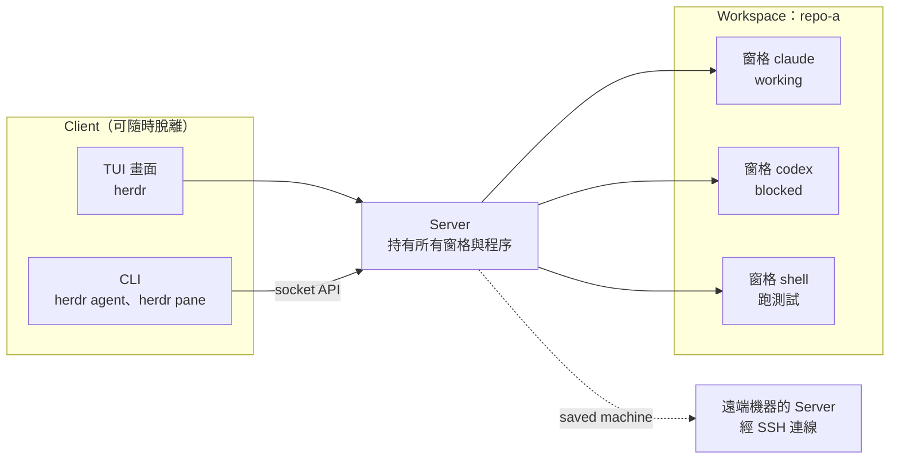

## 先想想

你同時開了三個 coding agent：A 在重構認證模組，B 在補測試，C 在寫 migration。你離開十分鐘去回信，回來時發現筆電的 Wi-Fi 斷過一次，終端機視窗也被你不小心關掉了。

現在有兩個問題。第一，三個 agent 還在跑嗎？第二，就算還在跑，你怎麼在不逐一切換視窗的情況下，知道哪一個正卡在「是否允許執行這個指令」的提示上等你？

<details><summary>提示</summary>

第一個問題是「程序由誰持有」，第二個問題是「誰來讀懂畫面的意思」。這兩件事，一般的終端機視窗都沒有負責。

</details>

## 是什麼

**Herdr** 是一個給 coding agent 用的終端多工器（terminal multiplexer）：一個背景伺服器持有所有終端機，並辨識每個窗格（pane）裡跑的 agent 處於什麼狀態，讓你一眼看出誰在跑、誰在等你。


Herdr 的原始碼在 [herdrdev/herdr](https://github.com/herdrdev/herdr)（TUI 版），組織頁是 [herdrdev](https://github.com/herdrdev)。

![]

它最接近你可能已經用過的 tmux：兩者都能分割畫面、脫離（detach）後再接回來。差別是 Herdr 把「這個窗格裡是 Claude Code，它現在被擋在核准提示上」當成一級資訊，並提供同一套 CLI 讓 agent 自己控制畫面。

Herdr 以 Rust 撰寫，採 Apache 2.0 授權，目前有三個產品：

- `herdr`（TUI 版）：在終端機裡執行的原始版本，本文的主角。
- `herdr-app`：桌面應用程式。
- `herdr-core`：給伺服器與腳本用的核心，CLI 是 `hc`。

後兩者只在「怎麼運作」的最後簡介。這個工具更新很快，本文的指令以 0.9.5 實測。

## 為什麼存在

一次只用一個 agent 時，一個終端機分頁就夠了。你同時開三到五個 agent，用 tmux 或多個視窗管理，會遇到三個問題：

- **看不到狀態**：每個窗格都要切過去看一眼。agent 卡在核准提示時，沒有任何東西提醒你，它可能停了半小時。
- **協調靠人手**：想讓另一個 agent 來審查剛寫完的改動，你得自己開新窗格、啟動 agent、貼上指示、等它做完再把結果搬回來。
- **接回來要重建**：tmux 能保住程序，但它不知道哪個窗格是 agent。Herdr 的做法是在保住程序之外，再把 agent 的狀態算出來，顯示在側邊欄。

所以 Herdr 解決的主要不是「程序不死」（tmux 已經做到），而是「同時管很多 agent 的注意力成本」。

## 怎麼運作

### 三層結構：client、server 與窗格

Herdr 把「誰持有終端機」和「誰畫畫面」拆開：



看圖時注意箭頭方向：窗格掛在 server 底下，不是掛在 client 底下。client 只是一個畫面，關掉它不影響窗格。

執行 `herdr` 會啟動（或接上）背景 server，並開一個 client 顯示畫面。用 `ctrl+b` 再按 `q` 脫離，server 與所有 agent 繼續跑；再執行一次 `herdr` 就接回來。要真的全部停掉，執行 `herdr server stop`。

`herdr status` 可以看目前的 client 與 server：

```bash
herdr status
```

```text
client:
  version: 0.9.5
  channel: stable
server:
  status: running
  version: 0.9.5
  endpoint_compatible: yes
  socket: ~/.config/herdr/herdr.sock
```

輸出節錄自實測，完整輸出還有協定版本與更新狀態。注意最後一行的 `socket`：CLI 與 agent 都是透過這個 Unix socket 和 server 溝通。

這些概念的包含關係如下：

| 層級 | 是什麼 | 建議的用法 |
| --- | --- | --- |
| session | 一個獨立的 server 命名空間，預設只有一個 | 通常用預設就好，需要完全隔離時用 `herdr --session <name>` |
| workspace | 專案層級的容器，擁有 tabs 與窗格 | 一個 repo、一個任務或一次調查開一個 |
| tab | workspace 裡的一個版面 | 分出 `agents`、`logs`、`server` 這類視圖 |
| pane | 一個真正的終端機，可往右或往下分割 | 放一個 agent 或一個一般指令 |
| agent | 窗格裡被 Herdr 認出的程序 | 由 Herdr 偵測，不需要你宣告 |

這裡的 session 和網站登入用的 session 是兩件事，指的是 Herdr server 的命名空間。官方建議先用 workspace 分專案，真的需要完全獨立的 server 時才用具名 session。

### 辨識 agent 的狀態

Herdr 用三種輸入判斷一個窗格裡的 agent 在做什麼：

1. **程序偵測**：看窗格的前景程序是不是已知的 agent。如果被包裝腳本遮住，可用環境變數 `HERDR_AGENT=<agent>` 提示。
2. **畫面偵測**：讀窗格底部的畫面，用一份「偵測清單（manifest）」的規則判斷這是 `idle`、`working` 還是 `blocked`。清單是 TOML 檔，隨 Herdr 內建，也會從官網更新。
3. **整合（integration）回報**：agent 若透過 hook 主動回報狀態，Herdr 就用回報取代讀畫面。

狀態共有五種：

| 狀態 | 意義 |
| --- | --- |
| `working` | agent 正在執行 |
| `blocked` | 畫面符合已知的核准、提問或權限提示，需要你決定 |
| `done` | 剛完成，而且你還沒看過 |
| `idle` | 完成或等待中，而且你已看過 |
| `unknown` | 有 agent，但 Herdr 無法有把握地分類 |

`done` 與 `idle` 的差別只在「你看過沒有」，兩者都表示 agent 可以接收新輸入。這個設計讓側邊欄像一個收件匣：沒看過的完成項目會一直亮著。

想知道 Herdr 為什麼把某個窗格判成某個狀態，用 `herdr agent explain <窗格或名稱>`：

```text
agent: claude
state: idle
manifest: remote:~/.local/state/herdr/agent-detection/remote/claude.toml
rule: live_prompt_box (region=prompt_box_body priority=950)
```

輸出是節錄，實際還會附上命中規則時的畫面內容。`rule` 說明命中了哪條規則，所以偵測是可追查的，不是黑箱。

畫面偵測有一個天生的限制：它靠辨認已知的提示樣式。官方文件說明，agent 出現新的提示介面時，Herdr 可能先把它顯示成 `idle`，要等偵測清單更新才會學到。所以看到非預期的提示時，先看畫面再送輸入，不要只信狀態。

### Agent 控制 agent：CLI 與 socket API

Herdr 的 CLI 與 socket API 是同一套介面，人和 agent 都用它。agent 在 Herdr 的窗格裡執行時，環境變數 `HERDR_ENV=1` 會被設定，並帶著自己所在的 workspace、tab、pane 的 ID。下面是一個 agent 啟動審查者並等結果的典型流程：

```bash
herdr pane split --current --direction right --cwd "$PWD" --no-focus
herdr agent start reviewer --kind codex --pane <新窗格的 ID>
herdr agent prompt reviewer "Review the current diff and report only actionable findings." --wait --timeout 120000
herdr agent read reviewer --source recent-unwrapped --lines 120
```

幾個設計值得注意：

- `pane split` 與 `agent start` 是分開的：先有窗格，才在窗格裡啟動 agent。窗格 ID 要從上一個指令回傳的 JSON 讀，不要自己猜。
- `agent prompt --wait` 會等到對方的狀態穩定（`idle`、`done` 或 `blocked`）才回來。這就是狀態偵測在自動化裡的用途：它是同步點。
- 如果對方卡在核准提示，`agent prompt` 會直接以 `agent_blocked` 拒絕，不會把文字打進提示框。
- `--no-focus` 讓背景工作不搶走你的游標。

`herdr --skill` 會印出一份給 agent 讀的技能檔，內容就是這套指令的用法與安全規則。

### 一個任務一個 worktree

多個 agent 同時改同一個資料夾，會互相覆蓋對方的檔案。Git worktree 讓同一個 repo 同時有多份工作目錄，各自在不同分支。Herdr 把它做進操作裡：

```bash
herdr worktree create    # 建立並開啟一個 worktree workspace
herdr worktree list      # 列出 worktree workspace
```

TUI 內也有對應的快捷鍵（預設 `prefix+shift+g` 開新 worktree）。實務上的搭配是：一個 repo 一個主 workspace，每個任務再開一個 worktree workspace，agent 各改各的分支。

### 操作模型與設定

Herdr 有三種模式：**terminal mode** 把按鍵送給目前的窗格；按下 prefix 鍵（預設 `ctrl+b`，和 tmux 相同）進入 **prefix mode** 後再按一個鍵，執行一個動作；**navigate mode** 是持續顯示的導覽畫面。

| 動作 | 預設按鍵 |
| --- | --- |
| 向右分割 | `prefix+v` |
| 向下分割 | `prefix+minus` |
| 新增 tab | `prefix+c` |
| 脫離 | `prefix+q` |
| 顯示所有按鍵 | `prefix+?` |

設定檔在 `~/.config/herdr/config.toml`，沒有檔案也能運作。`herdr --default-config` 會印出完整預設值，改完用 `herdr server reload-config` 套用到執行中的 server。官方也明說：Herdr 以滑鼠操作為主，它「不是 tmux」，不要期待所有 tmux 習慣都能搬過來。

### 跨機器

要管遠端機器上的 agent，有三種方式：

| 方式 | 做法 | 取捨 |
| --- | --- | --- |
| SSH 進去再跑 `herdr` | 整套都在遠端執行 | 最簡單，手機的 SSH 軟體也能用；讀不到本機剪貼簿 |
| `herdr --remote <host>` | 本機當薄 client，畫面與主題用本機設定 | 可橋接剪貼簿圖片；client 在你的機器上 |
| 儲存機器 | `herdr machine add <host> --label <label>` | 一個視窗同時看本機與多台遠端機器 |

儲存機器之後，可以用 `herdr --machine <label> agent list` 對遠端的 server 下指令。注意 ID 與 agent 名稱只在單一 server 內有效：兩台機器可以各有一個 `w1:p1`，指令沒帶 `--machine` 就一律打到本機。

### 重開之後還剩什麼

「常駐」有邊界。下表整理官方文件對各情境的說明：

| 情境 | 程序 | 版面 | agent 對話 |
| --- | --- | --- | --- |
| 脫離再接回 | 繼續跑 | 回來 | 接續，因為程序沒停 |
| server 重啟（含重新開機） | 結束 | 回來，窗格變成新的 shell | 只有 agent 支援原生 session 還原時才接續 |
| 更新（未用 `--handoff`） | 相容的 server 繼續跑，否則可能要重啟 | 重啟後回來 | 同上 |
| 更新（用 `--handoff`，實驗功能） | 盡力保留 | 回來 | 交接成功就接續 |

重點是：重新開機會讓所有窗格裡的程序結束。Herdr 還原的是版面與工作目錄，不是程序。agent 對話能不能接續，取決於 agent 是否透過整合回報了 session 資訊，這項還原預設開啟。

可以用 `herdr integration status` 看哪些 agent 已裝好整合，用 `herdr integration install claude` 安裝。

### 桌面版與核心

`herdr-app` 是同一個想法的桌面版：agent 跑在背景的 `herdr-core` server 裡，app 只是 client，外加多機器側邊欄、手機 app 與用 agent 修改版面與外觀的設定檔。它使用開放的 OSC 7501 狀態協定接收 agent 的回報。

兩個版本要分清楚：TUI 版與桌面版各有自己的 server，彼此看不到對方的 agent。官方也提到，桌面版裡的 agent 若跑在 tmux 中，就無法回報狀態，應該直接跑在 Herdr 的窗格裡。這些是桌面版的細節，本文不展開。

### 回到一開始的問題

回到一開始的問題：三個 agent 還在跑，因為窗格掛在 server 底下，你關掉視窗只是關掉 client；Wi-Fi 斷線同理，重新執行 `herdr` 就接回來。要知道誰在等你，不必逐一切換，側邊欄的狀態會顯示哪個窗格是 `blocked`，哪個是還沒看過的 `done`。

唯一不能保證的是筆電關機：server 一停，窗格裡的程序就沒了，只有版面與支援還原的 agent 對話會回來。

## 取捨與替代方案

| 方案 | 優點 | 代價 | 適用情境 |
| --- | --- | --- | --- |
| 多個終端機視窗或分頁 | 零設定 | 關掉就沒了，沒有狀態總覽 | 一個 agent、短任務 |
| tmux、zellij 等多工器 | 程序持久、設定與外掛生態成熟 | 通常不辨識 agent 狀態，協調靠手動 | 已有成熟的 tmux 工作流，只需要持久與分割 |
| agent 內建的 subagent | 不需要額外工具，結果直接回到主 agent | 只能用該 agent 自己的機制，看不到整體狀態 | 同一個 agent 內拆分子任務 |
| Herdr | 狀態總覽、agent 可控制畫面、多機器 | 工具很新，偵測靠規則，不是 tmux | 同時管多個 coding agent，尤其是跨機器 |

Herdr 的主要代價有三個：

- **狀態是推斷出來的**：畫面偵測依賴已知的提示樣式，新介面可能判錯，整合回報比讀畫面可靠，但要 agent 支援。
- **持久不等於可重開機**：程序只活到 server 結束為止。
- **生態還年輕**：更新頻繁，指令與預設值可能變動；使用前先用 `herdr --help` 對一次版本。

### 什麼時候不該用

- **只跑一個 agent、任務很短**：一個終端機分頁就夠，狀態總覽沒有用處。
- **需要 tmux 的既有生態**：團隊共用的 tmux 設定、腳本與外掛，不能直接搬到 Herdr。
- **需要重開機後無縫續跑**：Herdr 只還原版面，長時間任務的狀態要靠 agent 自己的 session 還原，或像 [Agent 任務與記憶管理](/tools/a-agent-dev/a-1-task-memory/beads-task-memory/) 那樣把進度存在工具外面。
- **你用的 agent 不在支援清單，也沒有整合**：Herdr 仍可當一般終端機使用，但看不到狀態，價值大減。

## 延伸閱讀

- [Herdr 官網](https://herdr.dev/)：產品總覽與下載
- [Herdr TUI](https://herdr.dev/tui/)：TUI 版的功能與版面說明
- [Herdr guide](https://herdr.dev/guide/)：桌面版的導覽，以及讓 agent 協助設定的做法
- [Session state and restore](https://herdr.dev/tui/docs/session-state/)：重啟、更新與 handoff 後哪些東西會保留
- [Agents](https://herdr.dev/tui/docs/agents/)：狀態如何判斷，以及支援的 agent 清單
- [herdrdev on GitHub](https://github.com/herdrdev)：TUI、桌面版與核心的原始碼
