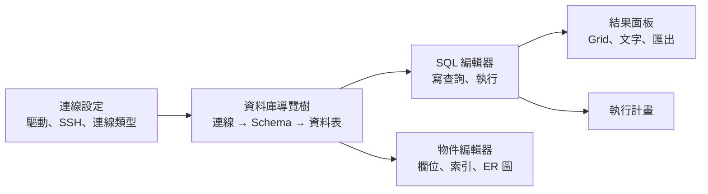

## 先想想

你剛進一個新團隊，主管說：「幫我查一下 production 上，哪個短網址的點擊紀錄最多，順便看一下為什麼這個查詢要跑幾秒。」

你打開 DBeaver，看到一個像十幾年前的視窗：左邊一棵樹、上面三排圖示、右上角還有你從沒聽過的面板。選單裡有上百個項目。

你會先點哪三個東西？哪些你可以放心先不碰？還有一個更要緊的問題：在這個視窗裡，哪一個動作最可能讓你在正式環境留下無法復原的痛？

<details><summary>提示</summary>

先想「連到哪裡」「查詢在哪裡跑」「結果怎麼看」這三件事，而不是「有哪些功能」。

</details>

## 是什麼

**DBeaver** 是一個通用的資料庫用戶端（database client）：用一個圖形介面連到各種資料庫，在裡面瀏覽結構、寫 SQL、看結果、匯出資料、編輯資料列。

它分 Community（免費、開源）與 Pro（付費）兩個版本。本文只談 Community 25.2，Pro 版多出的能力會在最後簡短提到。

如果你用過 IDE，可以把它想成「資料庫的 IDE」：左邊是專案樹（資料庫物件）、中間是編輯器（SQL）、下面是輸出（結果面板）。介面老舊的原因也在這裡：它是用 Eclipse 平台（一個 Java 的桌面應用框架）長出來的，保留了一整套大型 IDE 的面板與設定。

## 為什麼存在

沒有通用用戶端時，每種資料庫各有一套工具：PostgreSQL 用 `psql`、MySQL 用 MySQL Workbench、SQLite 用另一個、Redis 又是另一個。一個後端工程師手上通常同時有兩三種資料庫，每換一種就要重學一套操作與快捷鍵。

DBeaver 的做法是用 JDBC（Java 連資料庫的標準介面）統一連線層，每種資料庫只多一個驅動（driver）。第一次連某種資料庫時，它會下載對應驅動。你的操作習慣就能跨資料庫沿用。

代價是它必須把各家資料庫的功能「取最大公約數」再加上各家特有的面板，所以功能多、選項雜、介面看起來沒有重點。這不是設計疏失，而是通用性的直接成本。

## 怎麼運作

### 一張圖看懂整個視窗



這張圖要看的是依賴方向：所有東西都從「連線設定」長出來。連線設定錯了，後面每一步都是在錯的地方做事。

DBeaver 有上百個選項，但日常真正用到的，只有下面 6 個。其餘功能當成需要時再查的手冊。

### 1. 連線設定與 SSH tunnel

新增連線時有三件事值得認真填：

- **驅動與連線資訊**：host、port、資料庫名稱。第一次會提示下載驅動。
- **SSH 分頁**：正式環境的資料庫通常不對外開放，你要先經過跳板機（bastion host）。在 SSH 分頁填跳板機的位址與金鑰，DBeaver 會在本機開一條 tunnel，把資料庫的 port 轉到你的電腦上。
- **連線類型（connection type）**：選 Development、Test 或 Production。這不只是顏色標籤，它決定預設的提交模式與是否要求確認，下一節會看到影響。

連線類型是最容易被忽略、也最值得第一天就設好的功能。

### 2. SQL 編輯器與交易模式

編輯器的核心操作只有兩個：執行游標所在的單一語句（預設 Ctrl/Cmd + Enter），以及執行整份腳本（預設 Alt/Option + X）。這兩個快捷鍵可能因你的設定而不同，以你的版本為準。

要記住的是**交易模式（transaction mode）**。工具列上有一個切換：

- **Auto-commit**：每個語句執行完立刻提交，無法反悔。
- **Manual commit**：語句執行後留在交易裡，你按 Commit 或 Rollback 才結束。
- **Smart commit**：平常是自動提交；一旦你執行了會改資料的語句，就自動切成手動提交。

Production 類型的連線預設是 Manual commit，並且在執行改資料的語句前會要求確認；Development 預設是 Auto-commit。所以同一份 SQL 在兩種連線上，風險完全不同。

編輯器還支援參數：在 SQL 裡寫 `:code` 或 `${code}`，執行時 DBeaver 會跳出視窗請你填值。查詢要重複用時，這比手動改字串安全。

```sql title="top-links.sql"
SELECT l.code, count(*) AS clicks
FROM links l
JOIN clicks c ON c.link_id = l.id
WHERE l.code = :code OR :code = ''
GROUP BY l.code
ORDER BY clicks DESC
LIMIT 10;
```

### 3. 結果面板與匯出

查詢結果出現在下方的 Grid，可以切到文字或 JSON 檢視。兩件事要知道：

- **預設只抓一部分資料**。結果面板預設每次最多取回 200 列（可在設定中調整，並有「取更多」按鈕）。你看到的不一定是完整結果，下結論前先確認筆數。
- **匯出**：在結果上選 Export data，可輸出為 CSV、JSON、SQL INSERT、Excel 等。匯出走的是重新執行查詢的完整結果，不受 200 列限制。需要注意編碼（通常選 UTF-8）與換行、分隔符號。

### 4. ER 圖

在資料表上選 View Diagram，或在表的編輯器裡切到 ER Diagram 分頁，就會畫出該表與外鍵關聯的圖。對剛接手的資料庫來說，這是最快建立「這些表怎麼連」心智模型的方法。它只讀取結構，不會改任何東西。

### 5. 執行計畫

在編輯器裡對一個查詢選 Explain Execution Plan（選單名稱以你的版本為準），DBeaver 會把資料庫回傳的計畫畫成樹狀或文字。

更穩定的做法是直接把關鍵字寫在 SQL 裡，結果跟任何工具都一樣：

```sql title="explain.sql"
EXPLAIN (ANALYZE, BUFFERS)
SELECT count(*) FROM clicks WHERE link_id = 42;
```

在本文的練習資料庫（50 萬筆點擊、`link_id` 沒有索引）上，輸出的關鍵幾行如下：

```text
Parallel Seq Scan on clicks  (cost=0.00..5789.17 rows=208 width=0) (actual time=0.018..6.409 ...)
  Filter: (link_id = 42)
  Rows Removed by Filter: 166500
...
Execution Time: 8.116 ms
```

要看的是 `Seq Scan`（掃整張表）與 `Rows Removed by Filter`（被丟掉的列數）。丟掉的列數遠大於回傳的列數，通常表示該有索引卻沒有。

:::caution
`EXPLAIN ANALYZE` 會**真的執行**這個語句。對 `SELECT` 沒問題；對 `UPDATE`、`DELETE` 要放進交易再 Rollback，否則資料已經被改了。
:::

### 6. 資料編輯與提交

結果 Grid 在符合條件時可以直接改：結果來自單一資料表、有主鍵、你有寫入權限。改完的格子會標記，**不會立刻寫入**，要按 Save 才會送出 `UPDATE`；而送出之後有沒有生效，還要看交易模式。

安全流程是：先確認連線類型，改完用 Save，讀過實際送出的語句與受影響列數，確認後才 Commit。

### 回到一開始的問題

你會先點的三個東西：**連線設定**（確認連的是哪一台、連線類型是什麼）、**SQL 編輯器**（寫那個「最多點擊」的查詢）、**執行計畫**（看為什麼慢）。可以放心先不碰的：資料產生器、各種外掛、版本管理整合、圖表視圖。

最容易在正式環境留下痛的動作，是**在 Auto-commit 的連線上直接改資料或跑腳本**。所以第一天就該把正式連線的類型設為 Production。

## 取捨與替代方案

| 方案 | 優點 | 代價 | 適用情境 |
| --- | --- | --- | --- |
| DBeaver Community | 免費、支援多種資料庫、功能面廣 | 介面舊、選項多、啟動較慢（Java 應用） | 同時連多種資料庫，想要一個工具包辦 |
| DataGrip（付費） | 補全與重構強、與 JetBrains IDE 一致 | 要付費、較重 | 已在用 JetBrains 全家桶，查詢與重構量大 |
| TablePlus（付費，有免費額度） | 原生介面、輕快 | 功能較少，進階功能要付費 | 主要用 PostgreSQL 或 MySQL，重視速度 |
| IDE 內建（如 VS Code 外掛、GoLand 的資料庫面板） | 不用切視窗 | 管理多連線與匯出較弱 | 偶爾查一下，不需要完整功能 |
| `psql`、`mycli` 等命令列 | 輕量、可寫進腳本、可用在伺服器上 | 結果難瀏覽、要記指令 | 在跳板機或容器裡操作；自動化 |

Pro 版（依官方的版本比較表）另外提供 NoSQL 與雲端資料庫支援、進階資料比對與視覺化等功能。如果你只用 PostgreSQL 或 MySQL，Community 版通常已經夠用，不必先付費。

我們的建議是：Community 版夠用，介面舊但功能廣，先把上面 6 項學熟，其餘功能當成需要時再查的手冊，不要一開始就逐個選單掃過去。

### 什麼時候不該用

- **只連一種資料庫、又重視速度與手感**：原生輕量的工具（如 TablePlus）或命令列客戶端會更順手，也不需要啟動一個 Java 應用。
- **要在正式環境的跳板機或容器裡處理**：那裡通常沒有圖形介面，應該用 `psql` 這類命令列工具，並把操作寫成可審閱的腳本。
- **需要可重複、可審查的變更**：資料結構變更與資料修正應該走 migration 與 code review，而不是在 DBeaver 裡手動點。

## 常見坑與故障案例

### 在 Auto-commit 的正式連線上跑 UPDATE

**症狀**：你只想先試試看一個 `UPDATE`，執行完就發現所有列都被改了，而且無法 Rollback。

**原因**：連線類型是 Development（Auto-commit），語句執行完立刻提交；或是忘了寫 `WHERE`。

**避免**：正式連線一律設成 Production 類型，保持 Manual commit；改資料前先寫 `SELECT` 確認會影響哪些列，用 `BEGIN` 包起來，看過影響筆數再 Commit。

### 以為結果就是全部

**症狀**：你數了 Grid 裡的列數，得出「這個使用者有 200 筆訂單」，之後才發現其實有 3,000 筆。

**原因**：結果面板預設只取回一部分（預設 200 列），這不是查詢結果的總數。

**避免**：要總數就寫 `SELECT count(*)`；要完整資料就用匯出，不要複製 Grid。

### 交易開著忘了結束

**症狀**：你在 Manual commit 的連線上跑了一個 `UPDATE`，然後去開會。同事的應用程式開始卡住、逾時。

**原因**：交易還開著，鎖住了那幾列，也讓 autovacuum 無法清理舊版本。

**避免**：改完立刻 Commit 或 Rollback；留意工具列上的交易狀態；不要在 Production 連線留下開著的交易。

### 連線數悄悄增加

**症狀**：資料庫的 `max_connections` 快滿了，一查發現來自你的帳號有十幾條連線。

**原因**：DBeaver 預設會為每個 SQL 編輯器開一條獨立連線（這樣編輯器之間的交易互不影響），再加上導覽樹用的元資料連線，編輯器一多連線就多。

**避免**：不用的編輯器就關掉；對共用資料庫在連線設定裡調整連線行為；不要用全權限的共用帳號。

### 以為儲存的密碼很安全

**症狀**：你把 DBeaver 的設定資料夾放進雲端同步，或打包給同事。

**原因**：連線密碼雖然會加密儲存，但加密金鑰並不是秘密，這個機制擋的是隨手翻檔案，不是有意取得的人。

**避免**：不要同步或分享設定資料夾；正式環境用唯讀、個人專屬的帳號，並使用短效憑證或跳板機授權。

## 小練習

### 動手：用 DBeaver 看出缺少的索引

**目標**：在 DBeaver 連上練習資料庫，用執行計畫看出 `clicks.link_id` 缺少索引，建立索引後再確認計畫改變。

**起始檔案**：`playground/tools/b-db-client/b-1-connect-query/dbeaver-overview/`。

```bash
cd playground/tools/b-db-client/b-1-connect-query/dbeaver-overview
docker compose up -d
```

步驟：

1. 在 DBeaver 新增 PostgreSQL 連線：`localhost:55432`、資料庫 `shortener`、使用者與密碼都是 `app`。連線類型選 Production，觀察工具列的提交模式。
2. 執行 `top-links.sql` 那種查詢，找出點擊最多的短網址。再貼上 `explain.sql`，記下計畫節點與 `Execution Time`。
3. 建立索引 `CREATE INDEX clicks_link_id_idx ON clicks (link_id);` 並 Commit，再執行一次 `EXPLAIN`，比較前後的節點類型。
4. 先 `DROP INDEX clicks_link_id_idx;`，再用腳本檢查環境。腳本會自己建立索引、驗證計畫改變，然後把索引刪掉。

```bash
./verify.sh
```

通過時輸出：

```text
rows: 500000
before index: Seq Scan
after index: Bitmap Heap Scan
PASS
```

### 辨識

下面是 AI 產生的清理腳本，用途是清掉測試短網址的資料。有人把它貼進連到正式環境的 DBeaver，用「執行腳本」跑。請做 code review：指出它有哪些問題，各會造成什麼後果。

```sql title="cleanup.sql"
-- AI 產生：清掉測試短網址的點擊與連結（貼進正式環境的 SQL 編輯器，用執行腳本跑）
DELETE FROM clicks
WHERE link_id IN (SELECT id FROM links WHERE code LIKE '%test%');

DELETE FROM links
WHERE code LIKE '%test%';
```

<details>
<summary>參考解答</summary>

1. **`LIKE '%test%'` 範圍過大**：任何代碼中含有 `test` 的連結都會被刪，例如使用者自訂的 `contest-2026`、`latest`。後果是誤刪真實資料。正確做法：用明確的條件（例如專屬前綴 `LIKE 'test-%'` 加上建立時間或建立者），並先寫一個條件相同的 `SELECT count(*)` 確認筆數與樣本。
2. **兩個 `DELETE` 沒有包在同一個交易裡**：在 Auto-commit 的連線上，第一個 `DELETE` 成功提交後，如果第二個失敗（例如被其他表的外鍵擋下），就會留下「點擊已刪、連結還在」的不一致狀態。在 Manual commit 的連線上則相反：兩者都沒提交，交易一直開著鎖住列。正確做法：用 `BEGIN; ... COMMIT;` 包起來，執行後檢查影響筆數再決定 Commit 或 Rollback。
3. **沒有確認影響筆數就直接收尾**：腳本沒有任何驗證或回報。這屬於「正式環境沒有安全網」的坑。正確做法：先預覽，執行時留意 DBeaver 回報的受影響列數，數字不符就 Rollback。
4. **用編輯器直接在正式資料上做一次性清理**：沒有備份也沒有審閱。這類變更應該寫成可審查的腳本，先在備份或副本上跑過。

</details>

## 快閃卡

<details>
<summary>DBeaver 為什麼功能多、介面看起來舊？</summary>

它基於 Eclipse 平台，並用 JDBC 統一連線層以支援多種資料庫，必須取各家功能的最大公約數再加上各家特有面板。通用性的代價就是功能多、選項雜。

</details>

<details>
<summary>連線類型 Production 與 Development 的預設行為差在哪裡？</summary>

Production 預設是 Manual commit，並在執行改資料的語句前要求確認；Development 預設是 Auto-commit。同一份 SQL 在兩種連線上風險不同。

</details>

<details>
<summary>你在 Auto-commit 連線上執行 UPDATE 後發現漏了 WHERE，可以 Rollback 嗎？</summary>

不行。Auto-commit 下每個語句執行完就已提交，沒有可以 Rollback 的交易。所以正式連線要用 Manual commit，改資料前先用 SELECT 預覽。

</details>

<details>
<summary>你在結果面板看到 200 列，能說這個查詢只回傳 200 筆嗎？</summary>

不能。結果面板預設只取回一部分（預設 200 列）。要總數用 <code>SELECT count(*)</code>，要完整資料用 Export data。

</details>

<details>
<summary>EXPLAIN 與 EXPLAIN ANALYZE 差在哪？對 DELETE 用 ANALYZE 有什麼風險？</summary>

EXPLAIN 只顯示計畫；EXPLAIN ANALYZE 會真的執行語句並回報實際耗時。對 DELETE 或 UPDATE 用它，資料會真的被改，要放進交易再 Rollback。

</details>

<details>
<summary>計畫裡出現 Seq Scan，而且 Rows Removed by Filter 很大，通常代表什麼？</summary>

代表資料庫掃了整張表、丟掉大量不符合的列，通常是篩選的欄位沒有索引。可以考慮建立索引，再重新看計畫。

</details>

<details>
<summary>為什麼資料庫的連線數會因為開了很多 SQL 編輯器而上升？</summary>

DBeaver 預設為每個 SQL 編輯器開一條獨立連線，讓編輯器之間的交易互不影響，再加上導覽樹的元資料連線，編輯器越多連線越多。

</details>

<details>
<summary>只連 PostgreSQL、又想要輕量快速的人，為什麼可能不選 DBeaver？</summary>

DBeaver 是通用的 Java 應用，啟動較慢、選項多。只用單一資料庫時，原生輕量的工具或命令列客戶端更順手，不必為不會用到的通用性付代價。

</details>

## 延伸閱讀

- [DBeaver 官方文件](https://dbeaver.com/docs/dbeaver/)：連線、SQL 編輯器、資料編輯等功能的完整說明與目前版本的操作步驟
- [DBeaver GitHub 倉庫](https://github.com/dbeaver/dbeaver)：Community 版原始碼與 issue，可查已知問題
- [PostgreSQL 文件：使用 EXPLAIN](https://www.postgresql.org/docs/current/using-explain.html)：看懂執行計畫節點與成本的官方說明
